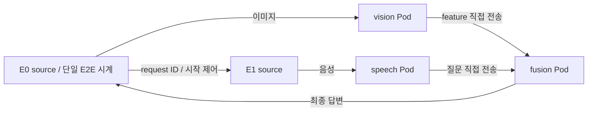

# 토폴로지·노드 성능 기반 DAG 배치: 현재 클러스터 실행 계획

작성일: 2026-10-19. 계획 작성 당시 상태: **계획 및 읽기 전용 환경 점검 완료 / 새 AI 실험 미실행**.

후속 실행: 사용자 실행 요청에 따라 `experiment/topology-profile-live` 작업트리에서 CPU reference60쌍과 두 배포24workflow/72receipt를 검증했다. 엣지 분기 고정1237.69ms, 실제 default-scheduler 서버 배치723.43ms는 순차 smoke 기술 통계다. 네트워크 제한·6정책 본 비교는 남아 있다. [실행 결과](/home/jinuk/codex-work/scheduler-topology-profile-live/docs/experiments/topology-profile-smoke.md)에 실패 준비 시도·품질·복구와 범위를 기록했다.

**부하 설계 수정:** native smoke의 데이터/부하가 Git 설계와 달랐다는 사용자 지적에 따라 [Git 부하 재분석](topology-profile-load-reanalysis.md)을 추가했다. 아래 초기20/5Mbps·저부하 계획에 앞서 decoded image/PCM 경계 복원, 공유 WAN100/10/2Mbps·RTT 대조, 완료 entry/timeout 수정과 open-loop 도착 검증을 우선한다. 앞선 smoke를 엣지 제약 성능 비교로 확대 해석하지 않는다.

대상은 `experiment/topology-profile-system-20261019`의 `e110d8b431c7c7d7c185897fe3429cda20c63257`이다. `main`의 직렬 대기열 보정 시뮬레이션 `0e8ebfa`와 구분한다. 이번 문서는 사용자 요청에 따른 실제 시스템 적용 계획이며, 해당 브랜치를 main에 병합하거나 클러스터에 배포한 결과가 아니다.

## 1. 결론과 검증할 질문

**현재 시스템에서 추진할 수 있다. 다만 모델 자산 확보 → CPU 분산 DAG 검증 → 실측 보정 → 배치 비교 순서가 필요하다.** 준비된 계획기만 실행해서 실제 AI 성능을 얻을 수는 없다.

첫 범위는 고정 엣지 입력의 `영상 특징 추출 + 음성 인식 → VQA 합류`다. Pi 2대와 x86 서버 1대의 CPU를 사용해 토폴로지·전달 비용과 작업별 실행 성능의 기여를 분리한다. GPU/NPU, 온라인 재배치, Koordinator·DRL은 이 단계 완료 후 별도 실험이다. 이는 프로젝트 전체 비교 요구를 완료했다는 뜻이 아니다.

- Q1: 같은 실행 가능 후보·모델·입력·자원에서 두 정보를 함께 사용한 배치가 실제 default-scheduler보다 E2E를 줄이는가?
- Q2: topology_only와 profile_only보다 나은 조건과 차이가 없는 조건은 무엇인가?
- Q3: 단순 Task-fastest 및 전달 비용을 고려한 greedy와 비교해 DAG 공동 선택의 추가 이득이 남는가?
- Q4: 선택 차이가 실제 성능 차이로 이어지는가, 아니면 보정 오차·동시 실행 간섭 때문에 예측 순위가 뒤집히는가?

새 알고리즘의 필요성과 선행 방법의 실패는 위 결과로 별도 판단한다. 작은 DAG 전수 탐색과 변수 결합 자체는 기여로 삼지 않는다.

## 2. 기존 실험을 분석한 결과

원자료 `results.json.gz`를 해제해 manifest SHA-256, 144조건×12시드×4정책=6,912행, 같은 seed의 입력 trace/요청 수, 같은 배치의 성능 재사용을 대조했다. 시뮬레이터 재실행은 하지 않았다. [검증 기록](../../artifacts/topology-profile-planning/20261019t090313z/simulation-audit.json).

| full 방식의 비교 대상 | 개선 / 동일 / 악화 조건 | 해석 |
|---|---|---|
| resource_proxy | 144 / 0 / 0 | 자원 점수 근사 대비 결과이며 실제 Kubernetes 대비 결과가 아님 |
| topology_only | 112 / 25 / 7 | 노드 성능 정보가 유용한 경우가 많지만 추가 정보가 항상 개선을 보장하지 않음 |
| profile_only | 120 / 20 / 4 | 전달 비용의 중요성을 지지하지만 모든 조건에서 차이가 나지는 않음 |

개선/악화는 점 추정치 부호다. 원 보고서의 CI는 개별 구간이며 다중비교를 보정하지 않았다. 1,728개 condition×seed에서 full과 같은 계획을 고른 횟수는 resource150, topology_only344, profile_only272였다. 같은 계획은 독립적인 정책 성능 표본으로 늘리지 않는다.

| 실측으로 옮길 때 중요한 차이 | 실행 계획에 반영할 조치 |
|---|---|
| 노드당 하나의 처리 lane으로 모든 task를 직렬화 | 실제로는 stage별 Pod가 독립 실행. 단일 요청의 두 분기도 같은 노드에서 경합 가능. 해당 실행을 보정하고 시뮬레이션과 동일한 실행 의미라고 주장하지 않음 |
| 시뮬레이션 계획기는 단일 요청의 노드 lane 경합도 계산하지만 `prepare.cost()`는 DAG max만 계산 | 현재 비용 모델의 명시적 한계로 유지하고, 모든 feasible 배치의 별도 진단으로 예측 오차를 확인. 보완하면 모든 성분 제거군에도 같은 보완 적용 |
| 6,912행 중636행에서 node_rho 또는 link_rho≥1 | 유한 입력 후 drain한 결과. 정상상태 지연 개선으로 해석하지 않음. 초기 실측은 낮은 부하로 시작 |
| P75 기반 선택, lognormal 표본의 평균 E2E 평가 | P75 합/최댓값이 전체 E2E의 P75는 아님. 예측 목표와 관측 평균·p95를 구분 |
| 공개 JellyBean CPU1/CPU5/GPU1 수치를 가상 노드에 대입 | 현 장비의 task×node 시간을 새로 보정. 기존 숫자 이식 금지 |
| Kubernetes v1.35.0 두 플러그인 근사 | 실제 scheduler 이미지 v1.31.14 확인. 현 default-scheduler를 직접 실행하고 실제 배치 기록 |
| 합성 WAN/tree/cloud_hub 경로 | 현 Pod 데이터 경로부터 확인. Pod 대역폭 제한만 한 것을 cloud_hub나 물리 WAN 변경으로 부르지 않음 |
| source가 동시에 발생하는 가상 event | 실제 split source의 시작 제어 비용·시차를 기록하고 E0의 단일 시계로 완료시간 측정 |

`main`의 24조건·1,152회·16.92% 평균 개선은 **클라우드 대기열 재진입 예측 보정**에 대한 별도 진단이다. 새 fork/join 정적 배치의 기대 개선율·표본 수·효과 크기 근거로 사용하지 않는다.

원문: [설계](https://github.com/dsa04156/edge-workflow-placement/blob/e110d8b431c7c7d7c185897fe3429cda20c63257/experiments/topology-profile-20261019/DESIGN.md), [보고서](https://github.com/dsa04156/edge-workflow-placement/blob/e110d8b431c7c7d7c185897fe3429cda20c63257/experiments/topology-profile-20261019/REPORT.md), [실측 준비 계획기](https://github.com/dsa04156/edge-workflow-placement/blob/e110d8b431c7c7d7c185897fe3429cda20c63257/experiments/real-topology-profile/prepare.py).

## 3. 실제 장비 배정

2026-10-19 09:03 UTC(18:03 KST) 읽기 전용 snapshot 기준이다. 예약량은 이어서 수행한 `kubectl describe node` 결과이며 실험 직전 다시 수집한다. [노드](../../artifacts/topology-profile-planning/20261019t090313z/nodes.json), [자원 예약량](../../artifacts/topology-profile-planning/20261019t090313z/allocated-resources.json), [scheduler](../../artifacts/topology-profile-planning/20261019t090313z/scheduler.json).

| 역할 | 노드 | 상태·자원 관측 | 배정 이유/제약 |
|---|---|---|---|
| E0, 카메라 source | etri-dev0003-raspi5 | Ready, arm64, 4CPU, 약7.77GiB allocatable; CPU requests785m | 기존 엣지 입력·HTTP 실행 근거가 있음. 새 모델은 별도 검증 |
| E1, 마이크 source | etri-dev0002-raspi5 | Ready, arm64, 4CPU, 약15.74GiB; CPU requests1970m | 두 번째 고정 source. 잔여 예약 CPU는2030m이며 helper 배포 후 1CPU task2개가 안 들어갈 수 있음 |
| C, 서버 실행 후보 | etri-ser0002-cgnmsb | Ready, amd64, 24CPU, 약30.52GiB; CPU requests2460m | CPU 후보 및 첫 VQA 고정 위치. GPU1개는 이미 요청됨 |
| GPU 확장 후보 | etri-ser0003-cg0ms0 | Ready, arm64, 20CPU, 약121.59GiB; nvidia.com/gpu1, 현재 요청0 | CUDA 모델·arm64 빌드·자원 독점 검증 후 별도 단계 |

전체10노드 중7Ready. dev0001/dev0004/dev0007은 Ready=Unknown/unreachable로 초기 후보에서 제외한다. control-plane 노드는 첫 실험에 사용하지 않는다. Ready는 모델 성공이나 충분한 여유 성능의 증거가 아니다.

실제 accelerator key는 `npu.intel.com/accel`, `hailo.ai/h8`, `mobilint.com/npu`, 일부 노드의 `nvidia.com/gpu.shared` 등으로 서로 다르다. `intel.com/npu` 한 key의 부재를 NPU 부재로 해석하면 안 된다. 등록 현황과 실행 호환성을 따로 기록한다.

예비 자원안: task별 CPU request/limit1, memory request/limit2GiB, batch1, intra/inter-op thread 수 고정. source agent는 E0/E1 각각100m·256MiB로 항상 유지한다. 이는 초기 smoke용 제안이며 모델 peak RSS와 스레드 실행을 보고 **보정 전** 동결한다. 부족하면 모든 정책에 동일하게 조정한다. 네트워크 sidecar·source·Pod overhead·init container를 포함한 유효 requests로 계획 가능성을 검사한다. 동일 노드에 여러 task를 넣을 때 실제 admission 제약을 반영한다.

## 4. 모델·입력 계약과 첫 차단 조건

[공식 소스 확인](../research/topology-profile-system-source-check.md)에 근거해 첫 조합을 다음과 같이 제안한다.

| stage | 첫 모델 경로 | 입력 → 실제 출력 |
|---|---|---|
| vision | JellyBean ResNet18, no-att, 이미지448 | 이미지 bytes → 512차원 FP32 feature 및 shape/dtype envelope |
| speech | facebook/wav2vec2-base-960h | mono16kHz 음성 → 인식 질문 문자열 |
| fusion | ResNet18에 대응하는 MutanNoAtt checkpoint | feature + 질문 → answer ID/text/score |

첫 fusion은 C에 고정하고 vision/speech의 위치를 E0/E1/C에서 바꾼다. 최대9조합에서 자원·품질 제약으로 infeasible 조합을 제거한다. **최소 두 task에 각각 두 개 이상의 실행 후보**가 있어야 공동 배치 비교로 진행한다. 모두 C만 가능하면 실행 호환성 결과만 보고하고 배치 이득 실험은 보류한다.

MUTAN checkpoint뿐 아니라 config, train vocabulary, answer mapping, skip-thoughts 자산이 필요하다. 공식 Box 링크의 실제 파일 확보 여부는 미확정이다. 파일 hash·출처·사용 조건까지 확인해야 G1을 통과한다. 임의 head나 다른 VLM을 연결해 동일 워크플로라고 부르지 않는다. 자산이 없으면 해당 모델 경로를 blocked로 기록하고, 합성 RPC는 실행기 검증에만 사용한다.

입력은 실제 이미지와 짝지어진 음성 질문 파일을 엣지 Pod에서 재생한다. 입력 ID·hash·오디오 길이·이미지 크기를 고정하고, 보정과 평가 목록을 분리한다. 서로 다른 길이/크기를 넣되 평가 결과를 보고 입력을 빼지 않는다. 첫 corpus 크기는 확보한 유효 pair를 기준으로 manifest에서 확정한다. 각 정책은 같은 순서의 평가 입력을 받는다.

CPU reference에서 feature shape/dtype, ASR transcript, 최종 answer ID를 저장한다. 검증 목표는 같은 입력에 대한 실행 경로 동등성이다. 정답 accuracy는 별도 label이 있을 때 계산한다. feature `allclose` 허용오차는 reference 반복성/정밀도를 검사해 보정 시작 전에 수치로 동결한다. transcript/answer는 기본 exact match를 사용하고, 이를 만족하지 못하는 task×node는 원인을 기록한 뒤 후보에서 제외한다. 입력 자체는 유지한다.

## 5. 구현할 분산 실행 경로



- same-source 조건에서는 E0가 이미지와 음성을 보낸다. split 조건에서는 E1의 로컬 파일을 E1이 보낸다. 외부 제어 PC는 payload를 중계하지 않는다.
- E0가 요청을 release하기 직전부터 최종 답변까지 monotonic clock으로 E2E를 측정한다. split source trigger/준비 비용도 포함하고 별도 기록한다. 서로 다른 노드의 timestamp를 빼서 전송시간을 만들지 않는다.
- stage별 persistent Pod1개, 고정 worker concurrency1로 시작한다. **노드 전체 concurrency1을 강제하는 것은 아니다.** 서로 다른 Pod의 동시 실행 간섭을 관측한다. 입력 queue는 상한·초과 오류·timeout을 기록한다.
- fusion은 `(run_id, request_id, attempt_id)`와 입력 hash로 두 branch를 묶는다. 정상 attempt에서 둘 다 수신한 후 한 번 실행한다. 중복·역순·누락·늦은 응답·재시도/취소를 테스트하며 프로세스 장애까지의 전역 exactly-once 보장은 주장하지 않는다.
- 첫 경로는 각 stage의 단일 Pod IP를 고정한다. 교체/재시작이면 stale-route로 해당 시도를 종료한다. Service 사용으로 바꾸면 실제 단일 endpoint와 데이터 경로를 재검증·재보정한다.
- receipt는 task/node/Pod UID/device/runtime/model hash, 입력·출력 bytes/hash, local queue/compute/serialization/forward duration, 완료 상태를 가진다. 제어 메시지·HTTP header·모델 다운로드 bytes는 task payload와 구분한다.

기존 `experiments/e0/`에서 phase timeout 보존, HTTP 연결 오류 회귀, hash/receipt 검사, run별 cleanup 패턴은 재사용한다. chain 전용 `policy_runner.py`나 중첩 RPC 비용 공식을 그대로 fork/join에 붙이지 않는다.

## 6. 비교 정책과 공정성

| 정책 | 첫 비교의 역할 | 구현 상태 |
|---|---|---|
| resource | 실제 default-scheduler, 동일 후보 affinity만 지정 | 명세 생성만 있음; API/실행 검증 필요 |
| topology_only | 동일 DAG 탐색, 각 task의 후보별 compute를 평균으로 치환 | 준비 코드 있음 |
| profile_only | 동일 DAG 탐색, transfer만0으로 치환 | 준비 코드 있음 |
| topology_profile | 실측 compute/transfer를 모두 사용하는 동일 탐색 | 준비 코드 있음 |
| task_fastest | task별 최소 compute 선택, 자원 충돌 시 고정 순서로 다음 feasible 후보 | 새 DAG 연결 필요; DAG 전체 compute 최적해로 부르지 않음 |
| data_greedy | 위상 순서로 도착시간+compute 최소 후보 선택, 자원 예약 반영 | 새 DAG 연결 필요 |

첫4개는 핵심 비교, 뒤2개는 작은 보완만으로 같은 결과가 나는지 확인하는 진단 기준선이다. 세 계획 정책은 동일 정보 snapshot·탐색 엔진·후보·제약을 사용하며 제거할 정보만 다르게 한다. 모든 task의 모델/정밀도/입력/이미지/requests/limits는 정책 간 동일하다.

default-scheduler는 `nodeName`으로 강제하지 않는다. planned 정책은 required affinity로 선택한 노드 하나만 지정해 정상 scheduler admission을 받는다. 실제 Pod 배치, Pending/실패, admission 변경, 이미지 digest, taint, scheduling events를 보존한다. scheduler 명령줄에 `--config`가 없다는 관측만으로 모든 plugin 설정을 추정하지 않는다.

배포 순서는 block×조건마다 seed로 정한 동일 task 순서를 모든 정책에 적용한다. 각 정책 실행 전에 이전 실험 stage Pod를 정리하고 고정 source/helper만 남긴 상태에서 시작한다. 이미지·가중치는 공통 사전 배포로 준비하고 startup·pull·모델 로드 시간은 별도 지표로 남긴다. warm latency와 전체 준비 비용을 합친 결과를 구분한다.

같은 배치를 선택한 정책은 조건·profile·실행 상태가 동일할 때 하나의 execution group을 공유한다. 다만 resource 정책은 실제 scheduler가 선택했음을 입증하는 배포를 반드시 수행한다. 같은 노드명만 보고 서로 다른 시간/Pod 상태의 관측치를 복사하지 않는다. 공통 warm 성능과 정책별 배포 비용을 별도 테이블로 저장한다.

## 7. 사전 보정과 네트워크 조건

1. 노드별 모델 단독 실행·품질·RSS·준비시간을 확인한다. 기본 warmup5/측정100은 보정 예산의 시작값이며 검정력 근거가 아니다.
2. 노드쌍×간선 payload별 실제 전달 경로를 측정한다. 같은 노드의 Pod 간 전달도0으로 놓지 않는다. 전달 비용에는 송신 직렬화 종료부터 수신 처리 완료 ACK까지의 **응용 계층 전달 비용**을 사용하고, 연산과 중복되지 않도록 프로파일 경계를 맞춘다. ACK가 다음 compute를 기다리는 구조는 사용하지 않는다. 순수 one-way network 시간이라고 부르지 않는다.
3. 단독 보정 뒤 fork/join 동시 branch·같은 노드 배치의 오차를 별도 측정한다. 모든 feasible 소규모 배치를 진단할 수 있지만, 그 평가치를 본 비교의 plan 선택에 다시 넣지 않는다. 비용 모델을 바꾸면 버전을 올리고 보정·계획·평가를 새로 시작한다.
4. 각 regime의 현 비용표와 품질 후보를 동결한 뒤 정책을 선택한다. 이는 사전 정보를 가진 정적 배치 비교다. 관측 획득 비용은 별도 기록하며 온라인 적응 실험으로 해석하지 않는다.

첫 네트워크 조건은 **native / 서버 방향20Mbps 제한 / 서버 방향5Mbps 제한**을 계획값으로 둔다. native 유효 전달률이 해당 cap보다 낮으면 구분되지 않는 조건임을 pilot에서 기록하고, 본 평가 전에 regime를 재정의한다. 효과가 크게 나온 cap만 사후 선택하지 않는다.

제약은 실험 소유 Pod netns의 destination-filtered shaping에만 적용한다. stage 위치가 달라져도 source/worker의 동일한 노드쌍 전달 규칙이 적용돼야 한다. native와 제한 조건의 sidecar·자원 명세도 맞춘다. packet/interface counter, 실제 payload, 대상 필터, 복구 후 probe를 확인한다. 이 방식은 **응용 전달 경로의 제한 실험**이며 두 source가 공유하는 단일 WAN 병목을 자동 구현하지 않는다. 단일 병목이나 cloud_hub는 전용 router 경유 경로를 검증하는 후속 실험으로 남긴다.

## 8. 실행 단계와 완료 기준

| 단계 | 작업·산출물 | 통과 조건 / 다음 단계 |
|---|---|---|
| G0 인벤토리 | 현재 snapshot, 보호 workload 목록, 자원/이미지/route/접근 수단 확인 | 실험 직전 Ready·예약 가능량·기존 서비스 상태 확인 |
| G1 모델 reference | checkpoint/data manifest, dependency lock, CPU reference outputs | 필요한 자산 모두 확보, 실제 입력 전체 reference 실행 성공 |
| G2 아키텍처·후보 | amd64/arm64 이미지 digest, task×node 품질/RSS/실행 결과 | 적어도 vision/speech 각각2후보, 모델/자원 예산 적합 |
| G3 분산 실행기 | branch/join RPC, bounded queue, receipts, 실패 보존 | 직접 데이터 경로·합류·중복/누락·timeout·reference 대조 통과 |
| G4 계획/보정 | measured config, 비용 경계, snapshot·profile hash, 6정책 계획 | API dry-run, 동일 후보/자원, 유효 자원 제약, isolated profiling 후 probe 제거 |
| G5 최소 실측 | split source/native 한 조건에서 실제 scheduler 포함6정책 smoke | 실제 배치·device·3stage receipt·품질·E2E 대응 확인, cleanup 검증 |
| G6 탐색 pilot | split source×3네트워크×6정책×3block | 전체 결과·반례·실패·비용 모델 오차 보고. 통계적 우월성 선언 안 함 |
| G7 본 비교 | same/split×3네트워크×6정책, 저부하 고정 | 파일럿 변동성으로 block 수/기간/판정 기준을 사전 동결한 후 새 데이터 수집 |
| G8 확장 | 부하2수준, fusion 가변, 무거운 모델, GPU/NPU, 전용 router | 한 번에 하나씩 확대. 모델/후보/실행 의미 변경 시 새 보정 |

G1이 막히면 모델 자산 문제를 해결하는 동안 G3의 합성 무결성 검증까지만 가능하다. 실제 AI 결과로 대체 보고하지 않는다. G2에서 ARM 실행이 실패하면 실패 후보를 명시하고, 후보가 충분하지 않을 때는 새로운 모델/DAG 범위를 별도 확정한다.

## 9. 배정·반복·지표

experimental-design 원칙으로 **block 내 network 순서, 그 안의 policy 순서**를 seed로 무작위화한다. network는 바꾸기 어려운 상위 요인이다. 모든 정책을 월요일에 한 종류씩 몰아서 실행하지 않는다. 고정 source/helper, 모델 warm 상태, 프로파일 세대, 날짜·시간대·background load를 block metadata로 저장한다.

파일럿은 탐색 예산으로3block, 각 policy-condition에 warmup5/평가20 요청을 배정한다. 최대54개 policy slot, 평가1,080/워밍업270요청이다. 같은 실행군 공유 시 실제 실행 횟수는 감소하며 policy slot 수와 구분한다. 세 block은 가능한 다른 세 session/date에 배정한다. 같은 날짜라면 날짜 간 재현을 주장하지 않는다. 반복 요청20개가 독립 환경20개는 아니다.

[초안 배정표](../../artifacts/topology-profile-planning/pilot-schedule.csv)와 [생성기](../../artifacts/topology-profile-planning/generate_schedule.py)는 seed20261019를 사용한다. 이 표는 **실행 기록이 아니며**, 실제 배치가 정해진 뒤 execution group을 붙인다. 정책 순서는 표를 따르고 공유한 정책의 중복 slot에는 shared reference를 남긴다.

첫 pilot의 도착률은 단독/공동 보정에서 구한 보수적 처리시간 Cmax(초)에 대해 `lambda=min(0.1, 0.1/Cmax)`로 정하고 전 정책에 같은 open-loop trace를 준다. 이는 낮은 부하를 유도하는 초기 규칙이며 안정성 보장이 아니다. source 발행이 늦으면 예정/실제 release와 지연을 기록한다. queue 증가가 지속되면 그 trajectory를 실패/과부하 결과로 남기고 새로운 pilot 설계로 진행한다. closed-loop smoke를 고정 RPS로 부르지 않는다.

예산: 54slot×25요청/λ. λ=0.1이면 요청 간격 예산 약3.75시간이며 여기에 모델 준비·보정·배포·drain이 추가된다. ARM ASR가 느리면 더 길어진다. 각 단계의 실측 시간을 기록한 뒤 전체 실행 기간을 계산한다. 사전 파일럿 없이 ‘오늘 안에 전체 완료’ 같은 약속을 하지 않는다.

본 실험 block 수는 현재 확정하지 않는다. statistical-power 절차로 pilot의 **block별 paired log E2E 차이 분산**을 추정하고, 실제로 의미 있는 개선폭(예: 계획 민감도5/10/20%, 효과 주장 아님), 양측 α와 다중비교, 날짜 내 상관을 반영해 산정한다. 목표 power는 계획상80%로 두되 지금 충족됐다고 말하지 않는다. 요청을 늘려 block 수를 대신하지 않는다. budget이 부족하면 탐색 결과로 보고한다.

주 지표는 source가 잰 E2E 평균이다. 성공 요청 지연·p95와 함께 전체 attempt의 완료율·timeout·품질 실패를 반드시 보고한다. timeout을 성공 지연에서 제외했다는 이유로 더 빠르다고 결론내리지 않는다. deadline/SLO가 정해지면 실패도 포함한 SLO 완료율과 제한시간 지표를 본 평가 전에 동결한다. 현재 임의의1초 SLO를 실환경 요구사항으로 가져오지 않는다.

추가 지표: task 배치/전환 수(정적 실행은0), branch join wait, task payload bytes, 응용 전달시간, CPU/RSS/throttling, 모델 준비·Pod ready·프로파일·선택 시간. P95는20요청 pilot에서는 불안정한 기술 통계다. 본 비교에서는 block별 paired 차이/비율 및 날짜를 반영한 구간을 사용하고, 비교 family를 미리 정해 Holm 등 보정한다. native/cap별 결과를 모두 보고하며 조건 균등 평균을 실제 운영 빈도 평균으로 해석하지 않는다.

## 10. 구현해야 할 부분과 검증 명령의 상태

기존 branch의7개 로컬 회귀는 이전 점검에서 통과했다. 다음은 아직 추가해야 한다.

- `prepare.py`: limits, env/downward API, readiness, 모델 volume, 전체 Pod 유효 requests, 고정 helper 예약 반영; immutable digest 검증. GPU 확장 전 extended resource 지원.
- `profile.py`: NODE_NAME 실제 대조, 모델 load 별도 계측, 품질 검사 연결, 입력/모델 hash 검증. 현재 CLI의 `--node`/`--model-sha256` 선언만으로 실검증이 되지 않는다.
- `capture.py`: `rtk proxy` 도구 계약, 전체 관련 requests·scheduler·route·전후 보호 workload 상태, phase event/부분 timeout 출력.
- `analyze.py`: receipt/배치/hash 유효성 검사, 동일 실행군 참조, policy별 startup 분리, scheduled/issued/completed 분모, block 분석. 현재 집계기만으로 무결성을 입증할 수 없다.
- 신규 adapters/worker/source/collector: 실제 모델·fork/join 직접 전송·retry/timeout·run별 원자료·cleanup.

실행 작업은 해당 준비 브랜치에서 파생한 작업트리로 시작하는 안이다. 아래 명령은 **향후 실행 절차**이며 이번 계획 작성에서는 실행하지 않았다.

```bash
rtk git worktree add -b experiment/topology-profile-live ../scheduler-topology-profile-live origin/experiment/topology-profile-system-20261019
# 새 worktree에서 기존 로컬 계약 검증
rtk proxy python3 -m unittest discover -s experiments/real-topology-profile -p 'test_*.py' -v
```

모델/실행기/G4가 완료된 뒤에만 실제 measured config로 prepare를 실행한다. 아직 없는 collector CLI를 현재 실행 가능한 명령으로 제시하지 않는다. 기존 fixture의 `example.invalid` 이미지와 synthetic 노드명은 실제 배포 입력으로 사용하지 않는다.

```bash
# 모델·입력·노드·profile이 모두 동결된 뒤에만 사용: 경로는 실행 시 생성
rtk proxy python3 experiments/real-topology-profile/prepare.py --config <measured.json> --policy topology_profile --run-id <run-id> --out <new-output-dir>
rtk proxy kubectl apply --dry-run=server -f <new-output-dir>/pods.json
```

문서/분석 원자료는 새 run 디렉터리에 저장한다. 배포 시에는 `topology-profile-lab` namespace와 소유 run label을 사용하며 실제 resource UID를 기록한다. 운영 workload, host NIC, EdgeCore/CloudCore를 변경하지 않는다. 소유 리소스만 정리하고 네트워크 복구·보호 workload 상태를 전후 대조한다. 노드/이미지/runtime/모델/데이터 경로가 바뀌면 영향을 받는 보정부터 다시 수행한다.

구현 티켓은 [.scratch 명세](../../.scratch/topology-profile-cluster-plan/spec.md)와 그 아래 개별 이슈를 따른다. 이번 계획의 첫 실행 작업은 **G1 모델 자산 확보 및 단일 프로세스 CPU reference**다.
