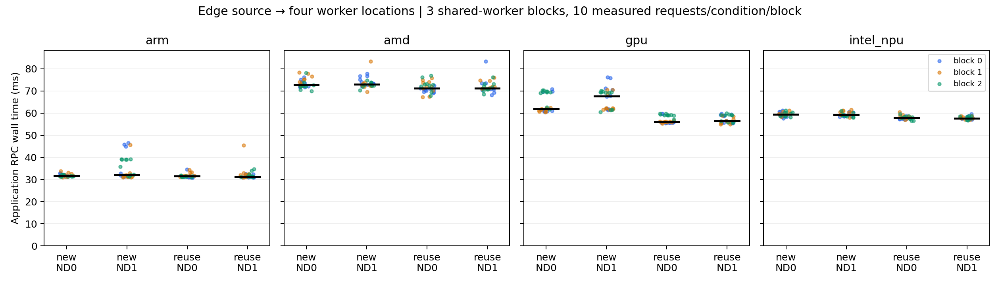

# E0: 엣지–가속기 전달 프로파일과 정적 위치 선택

설계 고정일: 2026-10-16. 상태: 576요청·양쪽 receipt 검증과 정적 위치 선택의 holdout 검증 완료. 앞선 [가속기 실행 검증](e0-accelerators.md)의 모델과 입력을 유지했다. 아래 배정·비교 규칙은 요청 측정 전에 정했으며 [당시 설계 원본](../../artifacts/e0-rpc-profile/design-preregistered.md)과 hash를 보존했다.

## 질문과 실행 경계

엣지의 T1 전처리 → 선택한 worker의 T2 분류 → 같은 엣지의 T3 결과 검사·후처리를 실행한다. 후보 T2는 같은 ARM 엣지 노드의 별도 CPU Pod, x86 서버 CPU, 서버 GB10 GPU, 서버 Intel NPU다. GPU·NPU는 EdgeCore 엣지 가속기가 아닌 서버 장치다. 입력 602,112byte, 출력 4,000byte, 원본 모델·전처리 hash·top-5 계약을 유지한다.

host 입력→host 출력의 backend 시간과 전체 HTTP/RPC·워크플로 시간을 구분한다. GPU는 동기화한 H2D/D2H host wall 구간과 CUDA compute event도 기록한다. 복사 구간에는 할당·framework 처리 등이 포함되며 순수 DMA 시간이 아니다. OpenVINO NPU는 plugin 내부 복사·연산을 개별 분해하지 않고 host 경계의 통합 비용으로 기록한다. CPU는 ORT1.23.2 한 thread다.

## 사전 고정한 배정

- 네 worker에 HTTP/1.1과 같은 헤더/본문 쓰기 순서를 적용한다. 새 TCP/같은 TCP 재사용 × 양끝 TCP_NODELAY=0/1의 2×2를 모두 실행한다. 클라이언트 기본 NODELAY에 의존하지 않고 명시 설정·조회한다.
- 각 client 실행 블록에서 16개 조건의 순서를 `experimental-design`의 `assign_factorial_runs`로 무작위 배정한다. seed는 20261016+block이며 [배정표](../../artifacts/e0-rpc-profile/schedule.json)를 동결했다.
- 블록 3개를 별도 client Job으로 **순차 실행**한다. 조건마다 warmup2·측정10: 총 576요청, 측정480요청이다. 네 worker는 계속 상주하며 다시 배포하지 않는다. 요청을 독립 반복으로 세거나 세 블록을 독립적인 배포 재현으로 부르지 않는다.
- 동시 요청은 1개, 각 처리 사이클은 최소 0.2초로 pacing한다. 목표 상한은 5요청/초이며 처리시간이 넘으면 기다림을 생략하고 overrun을 기록한다. open-loop 고정 도착률·처리량/포화도 실험은 아니다. 세 블록과 요청 수는 탐색용 실행 예산이며 검정력/MDE에 근거한 본 실험 표본 수가 아니다.
- 신규군은 매 요청 연결을 만들고 응답 완독 후 닫는다. 재사용군은 각 조건의 warmup부터 같은 연결을 유지한다. 서버 connection ID·클라이언트 local/peer 주소·port로 검증한다. 접속과 RPC 시간을 나누고 전체 workflow에는 모두 포함한다.
- 정상 요청은 입력·출력 길이/hash·원본 모델·실행 node/backend·request ID·top-5를 검증한다. GPU 출력 CUDA와 양의 timing event, NPU 실행 device를 매 요청 receipt로 남긴다. 오류를 자동 재시도로 숨기거나 통계에서 제외하지 않고 블록의 미완료를 표시한다.
- worker 준비와 pip 설치·download·compile·warmup은 요청 측정 밖이다. 양끝 NODELAY를 함께 바꾸므로 방향별 원인 분리는 못 한다. 패킷·ACK 추적이 없어 지연 원인을 특정 TCP 현상으로 확정하지 않는다. [공식 HTTP 계약 조사](../research/kubeedge-e0-http-notes.md)를 참고한다.

## 이어서 실행할 정적 선택 검증

주 전달 조건은 **TCP 재사용·NODELAY=1**로 사전 선택한다. 나머지 조건은 프로토콜 민감도 분석이다. 블록0·1의 주 조건만으로 후보별 중앙값을 만들고 다음 위치를 고른다.

1. B2 fastest-feasible: server의 host 입력→host 출력 backend 중앙값 최소.
2. C1 데이터 인지 greedy: 접속을 포함한 RPC 중앙값 최소. T1/T3 위치와 처리 계약은 고정이다.

동률은 alias 사전순으로 결정한다. 블록2를 실행하기 **전에** 선택 결과와 근거를 파일로 고정하고, 새 요청인 블록2의 해당 위치 성능을 비교한다. 블록2의 가장 빠른 결과를 사후에 정책으로 선택하지 않는다. 실패·정확성 불일치는 유효 완료로 세지 않는다. 추론 통계 검정·신뢰구간·p95 우위를 주장하지 않고 블록별 중앙값과 요청 범위를 기술한다.

이 DAG는 T1/T3가 고정이고 T2만 이동하므로 가능한 배치가 네 개다. 같은 목적과 정보를 쓰는 DAG 열거 최적화는 C1과 동일한 선택 문제가 된다. 이를 JellyBean·Atlas 재현이나 DAG 공동 결정의 일반적 효과로 부르지 않는다. B2와 C1의 선택이 같으면 그 사실을 그대로 보고한다. 이후 공동 배치 효과를 검증하려면 복수 Task의 위치가 함께 바뀌는 실제 워크플로가 필요하다.

## 실행 근거

- [run·고정 조건](../../artifacts/e0-rpc-profile/run.json), [동결 source·worker·Service](../../artifacts/e0-rpc-profile/workers.json)
- [준비 도구](../../experiments/e0/prepare_rpc_profile.py), [HTTP 실행 코드](../../experiments/e0/rpc_profile.py), [HTTP 통합 검사](../../experiments/e0/test_rpc_profile.py)

기존 workload·EdgeCore/CloudCore·driver·클러스터 네트워크 설정은 변경하지 않는다. 이 run의 정확한 이름으로 만든 리소스만 증거 수집 뒤 삭제한다. kube-scheduler·Koordinator·기존 DAG 구현·DRL의 필수 비교는 이번 단계에서 완료됐다고 주장하지 않는다.

## 관측 결과

576요청(측정480·warmup96)과 서버 receipt 576개가 일치했다. 세 client 블록 모두 완료했으며 입력·출력 무결성, top-5, 장치와 연결 재사용 검사를 통과했다. 0.2초 pacing을 넘긴 요청 3개도 제거하지 않았다. 아래는 주 조건인 TCP 재사용·NODELAY1의 **30개 측정 관측 중앙값**이다. 요청 간 분산은 독립 배포 간 불확실성을 뜻하지 않는다.

| T2 위치 | backend host 입력→출력 | HTTP/RPC | 전체 workflow |
|---|---:|---:|---:|
| 같은 ARM 엣지 CPU | 29.155ms | 31.362ms | 68.468ms |
| x86 서버 CPU | 15.865ms | 71.151ms | 108.182ms |
| 서버 GB10 GPU | 1.742ms | 56.503ms | 93.991ms |
| 서버 Intel NPU | 3.278ms | 57.718ms | 94.972ms |

앞의 두 블록은 B2에서 GPU, C1에서 ARM을 선택했다. 선택 파일을 07:20:08.518 UTC에 저장했고 holdout container는 07:20:09 UTC에 시작했다. Kubernetes Job 생성 시각은 초 단위여서 같은 초 안의 순서를 소수점과 직접 비교하지 않았다. 실행기 코드가 선택 저장 후 Job을 생성하며, container 시작 전 고정도 확인했다.

| 고정된 선택 정책 | 선택 위치 | 새 블록2의 전체 workflow 중앙값·관측 범위 |
|---|---|---|
| B2 Task 자체 최단 실행 | GPU | 95.897ms, 93.053–96.798ms, 10요청 |
| C1 데이터 전달 포함 선택 | 같은 ARM 엣지 CPU | 68.446ms, 67.835–72.040ms, 10요청 |

이 holdout에서 중앙값 차이는 27.451ms, B2 대비 28.63%였다. 단일 fixture·한 holdout 블록의 기술적 관측이다. 더 빠른 추론 자원 선택이 전체 완료 시간을 늘리는 사례지만, **단순 데이터 인지 C1으로 해소됐으므로 새로운 DAG 알고리즘의 필요성을 보이지 않는다.** T2만 움직이는 구조에서 C1과 DAG 열거는 같은 문제다.



NODELAY0/1 변경은 이 파일럿에서 원격 RPC의 큰 잔여 비용을 제거하지 않았다. 앞선 파일럿의 지연을 Nagle/delayed ACK 탓으로 확정할 근거를 얻지 못했다. 연결 재사용에서는 GPU backend 중앙값도 신규 연결보다 작았다. ThreadingHTTPServer가 TCP 연결별 thread를 사용하므로, 신규/재사용 효과에는 application thread 수명과 실행 상태도 섞인다. 순수 handshake 비용이나 packet 경로 원인으로 단정하지 않는다.

GPU 복사 구간은 host 동기화 경계이며, NPU는 plugin 통합 비용이다. GPU capability 경고·kernel trace 미확보는 계속 남아 있다. 모델·출력의 CUDA 장치와 매 요청 양의 CUDA event, NPU 직접 실행 device는 검증했다. 데이터셋 정확성이나 동등 정밀도 검증으로 일반화하지 않는다.

## 준비 실패와 재현 기록

서버 CPU의 최초 pip 설치는 공개 package download read timeout으로 실패했다. [실패 로그](../../artifacts/e0-rpc-profile/worker-amd-attempt1.log)·Pod 상태를 보존하고, 같은 코드/런타임의 별도 Pod에서 설치 read timeout만 늘려 준비했다. GPU의 느린 공개 다운로드도 측정 전에 수동 중단하고 로그·Pod 상태를 보존했다.

공식 wheel 39개 약 2.93GB를 작업 서버에서 범위 다운로드해 [상류 SHA256](../../artifacts/e0-rpc-profile/wheel-manifest.json)을 모두 확인하고 임시 namespace 내 cache로 옮겼다. GPU·client는 `--no-index --require-hashes`로 고정된 파일만 설치했다. [cache용 source·GPU 재시도](../../artifacts/e0-rpc-profile/gpu-cached-attempt.json)의 측정 코드는 처음 동결한 source와 일치한다. 준비 실패/변경은 요청 측정 전에 발생했으며 운영 cold-start 비교에 사용하지 않는다.

[구조화 결과](../../artifacts/e0-rpc-profile/results.json), [사전 선택과 학습 로그 hash](../../artifacts/e0-rpc-profile/selection.json), [요청](../../artifacts/e0-rpc-profile/requests.jsonl)·[서버 receipt](../../artifacts/e0-rpc-profile/receipts.jsonl), [분석 코드](../../experiments/e0/analyze_rpc_profile.py)에 전체 관측·블록별 중앙값·평균/SD·범위·검증 근거를 보존했다. HTTP 통합 검사 3개가 로컬 실제 ORT CPU 서버에서 통과했다. Git 저장소가 없어 commit diff 기반 code-review 스킬은 실행하지 못했고 source/동결 manifest와 실제 양쪽 실행을 점검했다.

실제 실행 명령:

```bash
rtk proxy uv run --python /usr/bin/python3 --no-build --with numpy==2.2.6 --with pandas==2.2.3 python experiments/e0/prepare_rpc_profile.py --randomization /home/jinuk/.codex/skills/experimental-design/scripts/randomization.py
rtk proxy kubectl apply -f artifacts/e0-rpc-profile/workers.json
rtk proxy uv run --python /usr/bin/python3 --no-build --with packaging==26.3 python experiments/e0/prepare_rpc_wheels.py
rtk proxy kubectl apply -f artifacts/e0-rpc-profile/wheel-cache.json
rtk proxy python3 experiments/e0/apply_rpc_cache.py
rtk proxy python3 experiments/e0/run_rpc_profile.py
rtk proxy uv run --python /usr/bin/python3 --no-build --with numpy==2.2.6 --with matplotlib==3.10.7 python experiments/e0/analyze_rpc_profile.py
```

후속 [세 Task 공동 배치 파일럿](e1-dag.md)에서는 모든 Task의 위치를 바꾸고 worker 사이에서 직접 데이터를 전달했다. 이 페이지의 T2만 이동한 결과와 실행 경계가 다르므로 개선율을 섞지 않는다. 후속까지 마친 뒤 [전용 리소스 정리](../../artifacts/e0-rpc-profile/cleanup.json)에서 잔여 0개를 확인했다. namespace와 기존 workload는 유지했다. 상류 hash manifest를 남기고 [임시 wheel 43개](../../artifacts/e0-rpc-profile/local-cache-cleanup.json)를 삭제했다.
