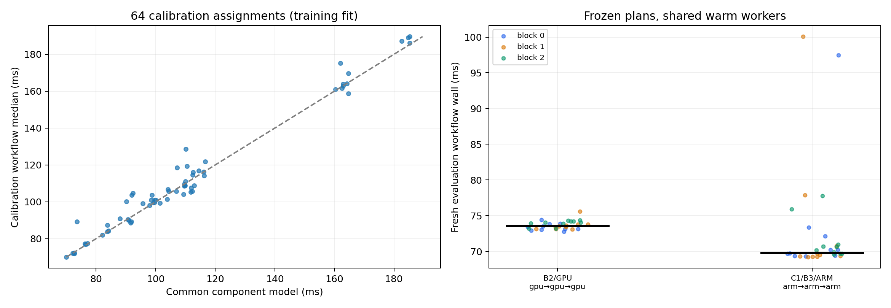

# E1 준비 실험: 세 Task의 공동 위치 선택

설계일: 2026-10-16. 상태: 64개 배치 보정과 고정 선택 평가 완료. 520 workflow·1,560 stage receipt를 검증했다. [T2만 이동한 E0](e0-rpc-profile.md) 뒤에 사용자가 승인한 정적 배치 검증을 계속한 결과다. kube-scheduler·Koordinator·논문 DAG 구현·DRL의 필수 비교 전체와는 구분한다. [측정 전 설계](../../artifacts/e1-dag/design-preregistered.md)와 source hash를 보존했다.

## 실행과 비용 경계

같은 JPEG·원본 SqueezeNet·top-5 smoke 계약을 유지한다. T1 JPEG 전처리, T2 실제 분류 추론, T3 top-5 후처리의 위치를 각각 ARM 엣지 CPU·x86 서버 CPU·서버 GPU·서버 Intel NPU worker 중에서 고른다. T1/T3는 해당 worker의 CPU에서 실행한다. 입력은 엣지 client에 있고, 첫 worker로 JPEG 661,378byte를 보낸다. Task 간 payload는 T1→T2 602,112byte, T2→T3 4,000byte다.

서로 다른 worker면 직접 HTTP로 전달하며, 같은 worker면 함수 호출로 이어간다. 모든 정책이 같은 실행기를 쓴다. 비인접 Task의 worker가 같아도 A→B→A 전달을 허용한다. HTTP 통합 검사로 이 경로와 전부 같은 worker의 경로를 실제 CPU 추론으로 확인한다. 모든 TCP endpoint에 NODELAY1·HTTP1.1을 쓰고 조건 내 연결을 재사용한다. GPU/NPU는 검증한 원본/파생 준비 경로를 유지한다. 새 server와 client의 asset/SDK는 이전 임시 cache에서 SHA를 확인하며 준비한다.

Task 시간은 입력 hash/통신 뒤 실제 Task의 decode/전처리·추론·직렬화 또는 후처리 구간이다. GPU host/device 복사는 T2 안에 포함되며 별도 CUDA event를 더해 중복 계상하지 않는다. 각 stage는 자식 호출 wall time을 기록한다. 통신 및 실행기 잔여 비용은 다음처럼 분해한다.

- `c0 = client workflow wall − T1 task − T1 child RPC`
- `c1 = T1 child RPC − T2 task − T2 child RPC`
- `c2 = T2 child RPC − T3 task`

세 잔여 비용과 세 Task 시간을 합하면 해당 요청의 전체 시간을 복원한다. 잔여에는 네트워크 왕복·헤더/결과 반환·검증·실행기 처리 등이 포함되며 순수 one-way network 시간은 아니다. 같은 worker의 함수 호출 비용도 이 잔여에 남긴다. 상위 RPC가 포함한 하위 RPC를 다시 전체 시간에 더하지 않는다.

## 측정 전 고정한 설계

1. 4³=64개 배치를 seed20261017로 무작위 배정한다. 각 배치 warmup2·측정5: 보정용 448 workflow다. worker는 상주하며, 동시 workflow1개·최소 사이클0.25초다. 긴 처리의 pacing overrun은 제거하지 않는다.
2. 보정 로그에서 Task–worker별 Task 시간, ingress–T1 및 T1→T2/T2→T3 worker 쌍별 위 잔여 비용의 중앙값을 구한다. 세 정책 모두 이 같은 표를 받는다.
3. B2는 Task별 계산시간 최소, C1은 이미 정한 선행 위치로부터 전달 잔여+현재 Task 시간을 최소화하는 순차 greedy다. B3는 같은 표로 64개 배치의 합을 열거해 최소값을 고른다. 동률은 worker alias 사전순이다. B3는 **작은 DAG의 정확 열거**이며 JellyBean·Atlas 재현이나 온라인 최적해가 아니다.
4. 선택 결과·보정 로그 SHA·비용표를 evaluation 전에 동결한다. 비교 배치는 B2/C1/B3 및 전체 ARM·전체 GPU의 두 기준점이다. 같은 배치가 나오면 중복 실행하지 않고 여러 정책의 동일 선택으로 표시한다.
5. 별도 client Job3개에서 고정된 배치를 조건별 warmup2·측정10으로 평가한다. 순서는 seed20261117+block으로 배정한다. 같은 상주 worker를 공유하므로 독립 배포 반복이 아니다.

보고는 선택 배치, 예측/실측 오차, 블록별 중앙값·관측 범위·모든 실패와 pacing overrun을 포함한다. 요청을 독립 반복으로 세지 않고 p값·신뢰구간·p95 우위를 주장하지 않는다. 보정표로 충분히 해결되거나 C1과 B3가 같으면 그 사실을 그대로 보고한다. 한 입력의 warm 상태 파일럿이므로 새 알고리즘 필요성·데이터셋 품질·동적 전환 순이익을 확정하지 않는다.

## 재현 자료

- [실행기](../../experiments/e0/dag_profile.py), [HTTP 통합 검사](../../experiments/e0/test_dag_profile.py), [manifest 생성](../../experiments/e0/prepare_dag_profile.py)
- [동결 source·worker](../../artifacts/e1-dag/workers.json), [실행 정보](../../artifacts/e1-dag/run.json), [보정 배정표](../../artifacts/e1-dag/calibration-schedule.json)

기존 workload·driver·EdgeCore/CloudCore·클러스터 네트워크는 변경하지 않는다. 전용 리소스와 이전 run에서 재사용한 임시 cache는 증거 수집 뒤 정확한 이름으로 정리한다.

## 실행 결과

64배치×7회=448개 보정 workflow, 선택한 서로 다른 배치 2개×12회×3블록=72개 평가 workflow를 완료했다. 평가 측정값은 배치별 30개다. 모든 workflow에서 실제 T1→T2→T3와 입력/출력 hash·node·device를 대조했고, stage receipt 1,560개가 일치했다. pacing overrun은 0개였다.

| 정책 | T1→T2→T3 위치 | 모델 예측 | 새 평가 중앙값 | 평균·관측 범위 |
|---|---|---:|---:|---|
| B2 Task별 최단 실행 | GPU→GPU→GPU | 73.551ms | 73.584ms | 평균 73.682ms, 72.791–75.584ms |
| C1 데이터 인지 greedy | ARM→ARM→ARM | 70.014ms | 69.818ms | 평균 72.684ms, 69.213–100.071ms |
| B3 동일 표의 DAG 열거 | ARM→ARM→ARM | 70.014ms | 69.818ms | C1과 같은 배치·같은 관측치 |

두 기준점도 위 두 배치와 일치해 중복 실행하지 않았다. B2 대비 B3의 중앙값 차이는 3.766ms(5.12%), 평균 차이는 약 0.998ms(1.35%)였다. ARM 배치에는 긴 관측값이 있어 중앙값 개선을 tail/SLO 우위로 해석하지 않는다. 세 평가 블록의 중앙값은 GPU 73.294/73.480/74.082ms, ARM 69.965/69.473/70.413ms였다. [원시값과 기술통계](../../artifacts/e1-dag/results.json)를 따른다.

**현재 조건에서 DAG 열거가 C1보다 얻은 추가 이득은 없다.** 같은 결정이므로 두 정책의 성능 동등성을 통계적으로 입증한 것도 아니다. 새 DAG/DRL 알고리즘을 도입할 필요성을 이 결과로 주장할 수 없다. 비용표 집계·선택은 이 작업 서버에서 약 0.988ms였지만, 보정 448 workflow와 SDK·모델 준비 비용은 이 값 밖이다.



예측은 component 중앙값의 합이므로 관측 중앙값과 같다고 가정하지 않는다. 그림 왼쪽은 **보정 데이터에 대한 적합**이며 일반화 검증이 아니다. 오른쪽이 사전에 고정한 배치의 새 평가다. 현재는 직렬 DAG여서 위 잔여 분해를 적용했으며, 병렬/fan-out DAG에 그대로 합산하는 규칙이 아니다.

T1을 CPU가 빠른 서버로 옮기는 효과도 포함돼 앞선 E0의 95.897/68.446ms와 측정 경계가 다르다. 두 실험 간 차이를 동일 실행기의 정책 개선율로 비교하지 않는다. Task payload 크기에는 HTTP header와 응답의 관측 trace가 포함되지 않는다. 이 trace 처리·전달 비용은 실제 전체 지연과 잔여에 들어 있으므로 순수 네트워크 throughput으로 해석하지 않는다.

## 측정 뒤 EdgeCore·링크 관측

모든 보정·평가가 끝난 07:35:07 UTC에 ARM 엣지를 읽기 전용으로 확인했다. EdgeCore 프로세스 1개, 상태 S, RSS 114,624kB, thread15를 관측했다. 호스트 `/proc`·`/sys`만 read-only mount한 별도 진단 Pod이며 privileged·hostPID·hostNetwork·추가 capability·서비스계정 token을 사용하지 않았다. 프로세스 환경변수·명령행·MAC 주소는 읽지 않았다.

`eth0`는 up, carrier1, **100Mbps/full duplex**였고 wlan0는 down이었다. 이 협상값에서 602,112byte와 661,378byte의 단순 `bytes×8/rate` 환산은 각각 48.169ms·52.910ms다. 관측 잔여와 같은 규모지만 **실효 throughput 측정이나 실제 packet 경로의 원인 확정은 아니다.** cable/switch 설정·경로·rate limit 원인은 조사하지 않았고 NIC 설정을 바꾸지 않았다. 앞선 EdgeCore watch/serviceaccount 로그 오류의 해결 여부도 이번 snapshot으로 판단하지 않는다.

[상태 JSON](../../artifacts/e1-dag/edge-snapshot.json), [진단 source](../../experiments/e0/edge_snapshot.py), [read-only Pod](../../artifacts/e1-dag/edge-snapshot-pod.json)을 보존했다.

## 재현·검증과 다음 조건

- [사전 선택과 공통 비용표](../../artifacts/e1-dag/selection.json), [전체 workflow](../../artifacts/e1-dag/workflows.jsonl), [stage receipt](../../artifacts/e1-dag/stage-receipts.jsonl)
- [실행 제어 도구](../../experiments/e0/run_dag_profile.py), [검증·분석 코드](../../experiments/e0/analyze_dag_profile.py), [최종 Pod](../../artifacts/e1-dag/pods-final.json), [Job](../../artifacts/e1-dag/jobs-final.json)

```bash
rtk proxy uv run --python /usr/bin/python3 --no-build --with numpy==2.2.6 --with pandas==2.2.3 python experiments/e0/prepare_dag_profile.py --randomization /home/jinuk/.codex/skills/experimental-design/scripts/randomization.py
rtk proxy kubectl apply -f artifacts/e1-dag/workers.json
rtk proxy uv run --python /usr/bin/python3 --no-build --with numpy==2.2.6 --with pandas==2.2.3 python experiments/e0/run_dag_profile.py --randomization /home/jinuk/.codex/skills/experimental-design/scripts/randomization.py
rtk proxy uv run --python /usr/bin/python3 --no-build --with numpy==2.2.6 --with matplotlib==3.10.7 python experiments/e0/analyze_dag_profile.py
rtk proxy python3 experiments/e0/cleanup_profiles.py
```

새 run에서는 이름·ConfigMap·출력 경로를 새로 만들어야 한다. 동결 manifest의 image/source/hash·버전이 재현 기준이다. 임시 cache는 이전 run의 wheel manifest와 이 실험의 추가 cp312/x86 wheel manifest·model/image를 SHA 확인 후 채웠다. SDK cache를 지운 뒤에는 먼저 이 준비 단계를 재구성해야 한다.

다음은 고정된 정적 조건을 늘려 성능을 주장하는 작업이 아니다. 네트워크/준비 상태 변화 일정을 사전 고정한 뒤, 같은 관측값을 주는 기존 DAG 재최적화와 단순 C1/hysteresis로도 남는 손실이 있는지 검증해야 한다. 본 실험용 데이터셋 품질·독립 배포 반복·주 지표 p95/SLO와 네 필수 정책군 구현은 계속 미완료다.

전용 Job/worker/Service/ConfigMap과 읽기 전용 진단 Pod를 정확한 이름으로 삭제했다. [정리 결과](../../artifacts/e1-dag/cleanup.json)의 잔여는 0개다. 재사용한 E0의 임시 cache Pod/Service도 정리했다. [기존 가속기 workload 3개](../../artifacts/e1-dag/existing-workloads.json)는 모두 Running/Ready로 관측됐다. Git 저장소가 없어 commit diff를 요구하는 code-review 스킬 대신 동결 source·실제 HTTP 검사·양쪽 stage receipt와 할당/종료 상태를 점검했다.
