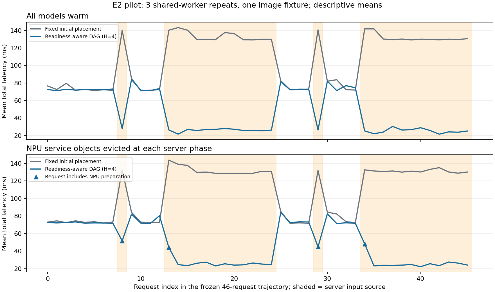

# E2 부분 실험: 입력 위치·NPU 서비스 객체 준비 상태 변화

실행일: 2026-10-16. run `20261016t082220`. [수집 전 명세](../../.scratch/e2-dynamic/spec.md), [동결 일정](../../artifacts/e2-dynamic/design.json), [실행 manifest](../../artifacts/e2-dynamic/run.json)를 기준으로 한다. 평가 1,380회, 전체 workflow 1,514회와 Task receipt 4,542개를 검증했다. 아래 수치는 단일 입력·공유 worker 파일럿의 기술 통계다.

## 1. 질문과 범위

[E1](e1-dag.md)의 실제 JPEG 전처리→SqueezeNet 추론→top5 후처리 세 Task를 유지한다. ARM 엣지 CPU `etri-dev0003-raspi5`와 Intel NPU 서버 `etri-ser0002-cgnmsb` 두 worker에서 모든 Task의 위치를 선택한다. T1/T3는 선택한 worker의 CPU에서, T2는 ARM CPU 또는 Intel NPU에서 실행한다. GPU·다른 NPU는 이번 부분 실험의 후보가 아니다. Intel NPU 서버의 기존 NVIDIA workload는 건드리지 않는다.

두 client Pod를 실제 엣지와 NPU 서버에 배치하고 순서대로 요청한다. 따라서 입력 발생 위치와 실제 데이터 경로가 달라진다. **물리 링크의 대역폭·지연을 바꾸는 실험은 아니다.** 기존 계획의 E2 링크 변화 전체나 E3 실행환경 변화 전체의 완료를 뜻하지 않는다.

두 시나리오는 warm과 NPU 서비스 객체 eviction이다. 후자는 전용 worker의 동기 추론 완료 뒤 compiled model/infer request를 포함한 추론 closure 참조를 제거하고 GC를 수행한다. 다음 NPU T2 요청에서 실제 모델 읽기→NPU compile→request 생성→fixture 2회 검증→본 추론을 수행한다. OpenVINO `CACHE_DIR=''`, Core/plugin 유지, driver/OS cache 유지다. 이는 서비스 객체 재준비이며 장치 reset·완전 cold compile·모델 다운로드·전체 배포 cold start가 아니다. API 근거와 버전 경계는 [수명주기 메모](../research/kubeedge-e2-lifecycle-notes.md)를 따른다.

## 2. 수집 전 고정한 설계

- source 2개 × 가능한 배치 8개 × warmup2+측정5로 112회 보정한다. 배치 순서는 `experimental-design`의 `assign_factorial_runs`, seed20261018/19로 배정했다.
- NPU 재준비 5회를 따로 측정해 공통 준비 비용 추정값을 동결한다. 각 source의 같은 계산·ingress/간선 잔여 표와 현재 NPU health를 모든 정책이 공유한다. 프로파일은 현재 source 조건에 맞는 사전 보정 표를 선택하며, 매 요청마다 실시간 성능 표를 새로 수집하는 구현은 아니다.
- 실제 source/요청 수는 `edge8 → server1 → edge4 → server12 → edge4 → server1 → edge4 → server12`, trajectory당 46회다. eviction은 trajectory 시작과 각 server phase 시작에 적용한다. warm은 trajectory 시작에 NPU 준비를 확인한다.
- 2시나리오×5정책의 순서를 block별 seed20261019+block으로 무작위 배정한다. 3개 block, 30개 trajectory, 1,380개 평가 요청이다. worker를 공유하며 독립 배포 반복·검정력을 갖춘 우월성 실험은 아니다. 같은 배치 궤적이 나온 정책의 반복 측정 차이를 알고리즘 차이로 세지 않는다.
- 정책 결정 함수에는 현재 source·health·보정 표·이전 credit만 전달한다. 미래 phase 길이·순서를 입력하지 않는다. 준비 비용 상각의 `H=4`는 사전 고정한 가정이다.

| 정책 | 결정 규칙 |
|---|---|
| fixed | 최초 edge source의 최적 배치를 계속 유지 |
| warm_dag | 현재 source의 warm 종단 비용이 최소인 8배치 열거; **준비 비용 제거 ablation** |
| ready_dag | 같은 열거에 현재 cold인 NPU T2의 준비 비용/H=4 추가 |
| ready_greedy | 같은 표·health·준비 비용/H=4로 ingress부터 단계별 최소 선택 |
| credit_hysteresis | 현재 warm 최선이 cold NPU를 필요로 하면 warm 후보 대비 누적 예상 절감이 준비 비용을 넘을 때 선택. source/목표 변화 시 credit 초기화; 준비된 후보 전환에는 추가 threshold 없음 |

이 열거는 작은 DAG의 대조 구현이며 JellyBean·Atlas 원 구현이나 동적 온라인 최적해가 아니다. cost-aware DAG 기준선에도 준비 비용을 제공한다. warm_dag만 이기는 결과를 기존 DAG 방법 전체의 한계로 주장하지 않는다.

## 3. 측정 경계와 검증

주 지표는 매 요청의 `total_ms = NPU health 관측 + 정책 결정 + 실제 workflow`다. 실제 cold T2의 준비·검증 시간을 workflow 안에서 지불한다. 같은 worker는 함수 호출, 다른 worker는 직접 HTTP1.1/NODELAY1 전달을 사용하며 E1의 hash·장치·top5·3단계 receipt 계약을 유지한다.

0.25초 최소 요청 주기를 적용하되 초과 요청도 보존한다. 각 phase 사이 `kubectl exec`·Python 프로세스 시작, pacing 대기, trajectory setup와 외생 eviction control 시간은 요청 지연에서 제외하고 원시 로그로 남긴다. SDK 설치·worker 시작·보정 비용도 주 지표에서 제외한다. 따라서 이 결과는 연속 open-loop 부하의 큐·처리량·전체 운영 시간 또는 초기 배포 비용을 포함한 평가가 아니다. eviction은 객체 해제·GC 비용을 별도 기록하며, 준비는 실제 요청 안에 포함한다.

평균·합·중앙값·최대, block별 trajectory 합, 준비 횟수/시간, 배치 변경 수, 오류·초과 요청을 보고한다. 한 이미지 smoke만 검증하므로 데이터셋 품질 동등성·p95/SLO 우위·일반적인 가속기 순위를 주장하지 않는다.

## 4. 재현 명령과 구현

기존 E0/E1 checksum manifest와 모델/JPEG를 재사용한다. 출력 디렉터리가 존재하는 실행은 덮어쓰지 않으며, 재실행은 이전 산출물을 별도 보관한 새 작업 사본에서 수행한다. 내부 cache는 공개 SHA256으로 검증한 CPU/NPU용 14개 wheel만 제공한다. 패키지 설치 지연을 모델 준비 비용으로 섞지 않는다.

```bash
rtk proxy uv run --python /usr/bin/python3 --no-build --with numpy==2.2.6 --with onnxruntime==1.23.2 --with Pillow==11.3.0 python -m unittest discover -s experiments/e0 -p test_model_lifecycle.py
rtk proxy uv run --python /usr/bin/python3 --no-build --with numpy==2.2.6 --with pandas==2.2.3 python experiments/e0/prepare_dynamic.py
rtk proxy python3 experiments/e0/run_dynamic.py
rtk proxy python3 experiments/e0/analyze_dynamic.py
rtk proxy python3 experiments/e0/postcheck_dynamic.py
rtk proxy uv run --python /usr/bin/python3 --no-build --with matplotlib==3.10.7 python experiments/e0/plot_dynamic.py
rtk proxy python3 experiments/e0/cleanup_dynamic.py
```

실행기는 [dag_profile.py](../../experiments/e0/dag_profile.py)의 선택적 lifecycle과 [model_lifecycle.py](../../experiments/e0/model_lifecycle.py), client/정책은 [dynamic_client.py](../../experiments/e0/dynamic_client.py)다. HTTP에서 health→evict→첫 요청 준비→후속 요청 재사용을 실제 CPU ORT로 red/green 검증했고 기존 HTTP 회귀 테스트를 포함한 7개 테스트가 통과했다. NPU 시간·장치 증거는 실제 클러스터 로그로 검증했다. 기존 E0/E1 결과는 당시 동결 ConfigMap을 기준으로 읽는다.

[code-review 스킬](/home/jinuk/.agents/skills/code-review/SKILL.md)은 “confirm the fixed point resolves (`git rev-parse <fixed-point>`) and the diff is non-empty”를 요구한다. 현재 폴더에서 `git rev-parse --show-toplevel`이 `not a git repository`로 실패하므로 Git 차분 기반 두 축 리뷰는 수행하지 못했다. HTTP 회귀·소스/receipt 검증으로 대체 확인한 것이며 해당 스킬 리뷰 완료로 표시하지 않는다.

## 5. 결과·해석

[정책 동결](../../artifacts/e2-dynamic/selection.json)은 `2026-10-16T08:24:28.447809+00:00`에 평가 이전에 완료했다. warm 예측 최선은 edge source에서 `arm,arm,arm` 69.77ms, server source에서 `intel_npu,intel_npu,intel_npu` 25.23ms였다. server source에서 NPU T2를 사용하지 않는 가장 빠른 배치는 `intel_npu,arm,arm` 105.18ms였다. 준비 비용 보정 5회는 24.54/26.49/27.48/27.01/27.05ms, 중앙값 27.01ms다.

이 표의 예상 절감 79.95ms와 준비 비용 27.01ms의 비는 약 0.34요청이다. 따라서 첫 요청에서도 준비 비용을 회수할 것으로 예측하여 네 적응 정책이 모두 바로 NPU를 선택했다. 이 계산은 보정 표의 예측이며 실측/온라인 최적 보증이 아니다.

주 지표 `total_ms`의 평균. 각 셀은 세 trajectory×46요청=138회이며 독립 표본 수를 뜻하지 않는다.

| 정책 | warm 평균 ms | 객체 eviction 평균 ms | eviction에서 NPU 재준비 횟수 | trajectory당 배치 변경 |
|---|---:|---:|---:|---:|
| fixed | 108.07 | 107.08 | 0 | 0 |
| warm_dag: 준비 비용 제거 ablation | 46.97 | 48.38 | 12 | 7 |
| ready_dag: 준비 비용 포함, H=4 | 46.87 | 48.16 | 12 | 7 |
| ready_greedy: 같은 준비 비용/H | 47.43 | 48.69 | 12 | 7 |
| credit_hysteresis | 46.86 | 48.44 | 12 | 7 |

네 적응 정책 모두 각 trajectory에서 edge 입력 20회는 전 ARM, server 입력 26회는 전 NPU 서버를 선택했다. 같은 배치 궤적이므로 소수점 차이를 알고리즘 우위로 해석하지 않는다. 준비 비용을 추가해도 선택이 바뀌지 않아 이번 조건은 준비 비용 누락의 손실도 보여주지 못했다. hysteresis의 전환 억제가 필요해지는 조건은 검증하지 않았다.

사전 명시한 ready_dag의 eviction 평균은 fixed보다 58.92ms/55.03% 짧았다. warm은 61.20ms/56.63%다. 이는 초기 계획 유지 대비 **현재 source에 맞춘 재배치**의 기술적 차이다. DAG 공동 최적화나 새 방법의 우월성을 뜻하지 않는다. 같은 환경 안에서의 사전 지정 비교이며 E1과 직접 개선율을 계산하지 않는다.

eviction에서 block별 46요청의 총 `total_ms`는 fixed 4,899.18/4,972.88/4,904.79ms, ready_dag 2,210.94/2,215.95/2,218.67ms였다. ready_dag의 실제 재준비 12회는 중앙값27.05ms, 범위24.48–41.23ms이며 요청 지연 안에 들어 있다. 전체 workflow 최대 지연은 정책별 [결과 JSON](../../artifacts/e2-dynamic/results.json)에 보존했다. p95/SLO·통계적 유의성은 주장하지 않는다.

공통 관측·결정 경로는 fixed에도 적용했다. eviction에서 이 경로를 제외한 workflow 평균도 fixed104.64ms, ready_dag45.65ms다. ready_dag의 health 관측 평균2.40ms/결정0.114ms를 별도 기록했다. 운영 fixed 정책은 불필요한 관측을 생략할 수 있으므로 여기의 total을 그 구현의 최소 비용으로 부르지 않는다.



## 6. 검증·환경·정리

- [검증 JSON](../../artifacts/e2-dynamic/verification.json): 보정112 + 준비 보정5 + 평가1,380 + setup17 = 1,514 workflow, 정확히 4,542 stage receipt. 해시 연결·top5·실제 Task/노드·CPU/NPU 장치·cold 준비 시간·설계별 분모·평가 이전 정책 동결을 대조했다. workflow 실패0, 0.25초 주기 초과0. 모든 측정 worker/client Pod 재시작0.
- [실제 ConfigMap 재대조](../../artifacts/e2-dynamic/live-configmap-verification.json)는 동결 소스 SHA와 일치했다. [실제 버전](../../artifacts/e2-dynamic/runtime-versions.json): ARM Python3.11.16/NumPy2.2.6, NPU host Python3.12.3/NumPy1.26.4, 공통 ORT1.23.2/Pillow11.3.0. OpenVINO `2026.3.1-22476-759c5a6ab8c-releases/2026/3`, Intel AI Boost, NPU driver1776845405/compiler458781.
- 사후 버전 조회 첫 시도의 `DRIVER_VERSION` 키는 미지원이었다. [해당 시도](../../artifacts/e2-dynamic/runtime-probe-attempt1.json)를 보존하고 `SUPPORTED_PROPERTIES`에서 확인한 `NPU_DRIVER_VERSION`/`NPU_COMPILER_VERSION`으로 조회했다. 측정 이후 메타데이터 조회 오류이며 workflow 실패·재실행·장치 변경은 아니다.
- [사후 EdgeCore/링크](../../artifacts/e2-dynamic/edge-snapshot.json): `08:32:45UTC`, EdgeCore 1프로세스, RSS112,768kB/15threads/StateS. eth0 up·carrier1·100Mbps/full. NIC 협상값이며 실효 throughput·실제 packet 경로나 기존 watch 오류 원인의 증거가 아니다. E0의 EdgeCore watch/metadata 오류 인과는 여전히 미해결이다.
- [정리 증거](../../artifacts/e2-dynamic/cleanup.json): 전용 Pod6/Service3/ConfigMap1와 임시 wheel14개 삭제, 해당 run 잔여0. namespace와 증거용 모델/JPEG는 보존했다. 기존 세 accelerator workload는 [정리 이후에도](../../artifacts/e2-dynamic/preexisting-after-cleanup.json) Running/Ready였다. 운영 workload·driver·EdgeCore/CloudCore·NIC/네트워크 설정 변경 없음. 문서·소스 검증 결과는 [로컬 검증 JSON](../../artifacts/e2-dynamic/local-validation.json)을 따른다.

## 7. 이번 판단과 다음 검증

이 조건에서 고정 배치는 source 변화로 손실을 보였지만 기존 작은 DAG 재계산과 단순 greedy로 해결됐다. **새 알고리즘 필요성은 아직 확인하지 못했다.** 빠른 서비스 객체 재준비가 가능한 이 fixture를 임의 sleep이나 드라이버 reset으로 느리게 만들어 신규성을 주장하지 않는다.

다음은 여러 실제 입력과 독립 worker 배포 반복으로 결과를 재현하고, 실제 모델 크기·검증된 준비 경로·입력 부하를 바꿔 비용 회수 경계를 확인하는 것이다. 기존 5-Task 후보처럼 분기·합류와 여러 추론 단계가 있는 실제 DAG 선정도 남았다. 링크 대역폭/지연 변화, runtime 호환성 자체의 변경, 품질 데이터셋, 관측 지연·큐·공유 경합, kube-scheduler/Koordinator/논문 원 구현/DRL 비교는 이번에 검증하지 않았다.
