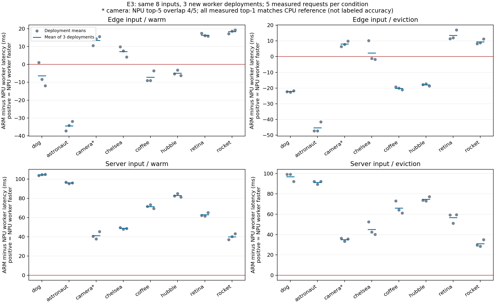

# E3: 입력 다양화·새 worker 배포 재현

실행일: 2026-10-16. run `20261016t085016`. [수집 전 명세](../../.scratch/e3-input-replication/spec.md), [동결 설계](../../artifacts/e3-input-replication/run.json), [corpus·CPU 기준](../../artifacts/e3-input-replication/corpus.json)을 따른다. 8입력×3회 새 배포에서 전체1,344 workflow/측정960회를 완료하고4,032 stage receipt와 대조했다. 아래는 같은 host·날짜의 기술 통계다.

## 1. 이번 질문과 AnchorDL 경계

[E2](e2-dynamic.md)의 dog 기반 source별 계획이 새로운 실제 이미지와 새 워커 배포에서도 적절한지 확인한다. 작은 3Task chain에서 두 실행 후보인 전 ARM worker와 전 Intel NPU 서버 worker를 짝지어 비교한다. T1/T3는 선택한 worker의 CPU, T2는 ARM CPU 또는 Intel NPU다. 수치 품질 요구 충족 여부는 실행 성공과 별도로 아래에 보고한다.

사용자가 제시한 **AnchorDL**의 공식 초록은 데이터 전송·모델 상주/로딩 joint cost와 look-ahead, chain/fan-in/fan-out·greedy joint-cost 비교를 명시한다. 이 결합을 새 기여로 삼을 수 없다. [확인 수준](../research/ieee-11662529-review.md)에는 원문/코드 미확보와 NPU/runtime/compile/전환 범위 미확인을 기록했다. 이번 실험은 **실행·프로파일 전이 재현성**의 확인이며 AnchorDL 재현·실패·새 알고리즘 우위의 증거가 아니다.

E2의 source별 동일 배치 정책들은 같은 관측을 공유한다. source=edge이면 ARM anchor, source=server이면 NPU-server anchor의 관측을 E2 동결 계획 결과로 사용한다. 이번 입력의 결과를 보고 E2 비용표·정책을 재학습하거나 배치를 다시 고르지 않는다. 더 빠른 anchor를 발견해도 전체 8배치 최적해라고 부르지 않는다.

## 2. 고정 입력과 품질 경계

기존 dog를 bridge control로 두고, 공식 scikit-image v0.25.2 asset 7개를 추가했다. 목록은 출력 보기 전에 고정했으며 개별 귀속·권리 조건·registry hash는 [corpus 메모](../research/kubeedge-e3-corpus-notes.md)에 있다. JPEG/PNG·gray/RGB와 실제 파일/해상도 차이를 유지한다. asset bytes를 재압축·인위적으로 늘리거나 추가 resize하지 않고 기존 RGB/Resize256/CenterCrop224 전처리만 적용한다. 모든 추론 입력은 float32 NCHW 1×3×224×224,602,112bytes다.

| 입력 | 원본 asset 크기 | bytes |
|---|---:|---:|
| dog | 1546×1213 RGB JPEG | 661,378 |
| astronaut | 512×512 RGB PNG | 791,555 |
| camera | 512×512 gray PNG | 139,512 |
| chelsea | 451×300 RGB PNG | 240,512 |
| coffee | 600×400 RGB PNG | 466,706 |
| hubble_deep_field | 1000×872 RGB JPEG | 527,940 |
| retina | 1411×1411 RGB JPEG | 269,564 |
| rocket | 640×427 RGB JPEG | 112,525 |

SHA256 검증을 통과한 SqueezeNet 원본과 ORT CPU1.23.2/NumPy2.2.6/Pillow11.3.0으로 이미지별 tensor hash·1,000점 score·top5를 동결했다. [CPU 기준 환경](../../artifacts/e3-input-replication/reference-environment.json). **CPU 예측은 ground truth가 아니다.** Top-1, Top-5 set·순서·overlap과 maxabs/RMSE를 구분하며 불일치 입력을 제외하지 않는다. ImageNet accuracy나 품질 동등성을 주장하지 않는다.

초기 asset URL은 annotated tag object SHA를 commit SHA로 오인해404가 났다. [해당 시도](../../artifacts/e3-input-replication/corpus-fetch-attempt1.json)를 보존하고 실제 commit `e8a42ba85aaf5fd9322ef9ca51bc21063b22fcae`로 수정했다. 7개 bytes와 공식 SHA는 모두 같았고 입력 목록은 바꾸지 않았다. 새 입력 모델 출력/정책 측정으로 제외 대상을 고른 것이 아니다.

## 3. 배정과 측정

- ARM `etri-dev0003-raspi5`, Intel NPU 서버 `etri-ser0002-cgnmsb`의 worker2/client2 전체를 순차3회 새 Pod로 배포한다. source 2 × 입력8 × anchor2 × warm/eviction2 =64조건/배포다.
- 조건당 warmup2 뒤 측정5. 총1,344 workflow 중960회 측정이다. source내 순서는 `experimental-design`의 `assign_factorial_runs`, seed20261021+배포; source 전체 구간 순서는 seed20261025+배포로 배정했다. source를 묶어 실행하는 배정이며 조건별 비교는 같은 배포에서 짝지었다.
- eviction 조건은 warmup 뒤 NPU 서비스 객체를 해제한다. 첫 측정 요청에서 NPU T2가 실제 read/compile/request생성/고정 dog fixture 검증2회/본 입력 추론을 수행한다. allARM은 NPU를 쓰지 않으므로 준비 비용을 내지 않는다. E2와 같이 OpenVINO 파일 cache 비활성, Core/plugin·driver/OS cache 유지다.
- 새 Pod UID·컨테이너 ID를 검증하지만 동일 날짜·host·driver/OS/image cache를 공유한다. **독립 하드웨어/날짜 또는 완전히 독립인 환경 표본은 아니다.** SDK cache Pod만 전달용으로 공유하고 모든 worker의 `/work`는 새 emptyDir다. SDK 설치시간은 정책 지연에 넣지 않는다.
- `total_ms = health 관측 + workflow`로 5요청 episode의 평균·합과 배포별 paired 차이를 본다. E2와 제어 경로/입력/trace가 달라 직접 실험 간 개선율을 계산하지 않는다. 0.25초 최소주기 초과·실패를 보존한다. Pod/SDK시작·client exec·pacing대기·외생 eviction control은 별도 제외한다. 연속 open-loop 큐/처리량·전체 배포 비용 실험이 아니다.
- `statistical-analysis`의 기술 통계 원칙에 따라 모든 입력/조건의 n·mean/median/SD/range·결측과 배포별 원시 짝 차이를 남긴다. p값/CI/p95/SLO·통계적 우위는 주장하지 않는다. 같은 배치를 고르는 E2 정책을 별개 알고리즘 표본으로 중복 계산하지 않는다.

## 4. 구현과 재현

`CORPUS_FILE`이 설정된 경우에만 기존 [HTTP 실행기](../../experiments/e0/dag_profile.py)를 입력 ID/이미지·tensor hash/CPU 기준에 연결한다. whitelist의 입력 ID를 모든 Task 호출에 전달한다. 순서 차이나 NPU 출력 오차를 HTTP 오류와 혼동하지 않고 기록한다. corpus 미설정 경로는 기존 단일 fixture 계약을 유지하며, 과거 결과는 당시 동결 ConfigMap을 따른다.

실제 HTTP의 gray-image A→B→A 경로를 red/green 확인했고 기존 회귀를 포함해10개 테스트가 통과했다. [배포 준비](../../experiments/e0/prepare_replication.py), [수집](../../experiments/e0/run_replication.py), [client](../../experiments/e0/corpus_client.py), [분석](../../experiments/e0/analyze_replication.py), [종료/정리](../../experiments/e0/finish_replication.py)를 사용한다. source·corpus를 동결한 ConfigMap은 immutable이다. 큰 reference JSON을 last-applied annotation에 복제하지 않도록 새 ConfigMap을 `kubectl create`로 생성한다.

```bash
rtk proxy uv run --python /usr/bin/python3 --no-build --with numpy==2.2.6 --with onnxruntime==1.23.2 --with Pillow==11.3.0 python experiments/e0/prepare_corpus.py
rtk proxy uv run --python /usr/bin/python3 --no-build --with numpy==2.2.6 --with onnxruntime==1.23.2 --with Pillow==11.3.0 python -m unittest discover -s experiments/e0 -p 'test_*.py'
rtk proxy uv run --python /usr/bin/python3 --no-build --with numpy==2.2.6 --with pandas==2.2.3 python experiments/e0/prepare_replication.py
rtk proxy python3 experiments/e0/run_replication.py
rtk proxy python3 experiments/e0/analyze_replication.py
rtk proxy uv run --python /usr/bin/python3 --no-build --with matplotlib==3.10.7 python experiments/e0/plot_replication.py
rtk proxy python3 experiments/e0/finish_replication.py
```

실행 산출물을 덮어쓰지 않으며 재현은 이전 결과를 보존한 새 작업 사본에서 수행한다. [code-review 스킬](/home/jinuk/.agents/skills/code-review/SKILL.md)의 “confirm the fixed point resolves (`git rev-parse <fixed-point>`) and the diff is non-empty”는 Git 저장소/기준 commit이 없는 현재 폴더에서 충족하지 못한다. 따라서 Git 차분 두 축 리뷰 완료로 표시하지 않고 실제 HTTP·양끝 receipt·동결 source로 확인한다.

## 5. 입력별 배치 순위

아래는 **엣지 입력**에서 5회 episode 평균을 배포별로 계산한 뒤 3배포를 동일 가중한 `total_ms`다. 각 배포의 paired 차이는 [결과 JSON](../../artifacts/e3-input-replication/results.json)에 전부 보존했다. '3회'는 관측 방향이며 통계적 우위를 뜻하지 않는다. 준비 비용은 eviction episode의 첫 요청에 포함한다.

| 입력 | warm ARM ms | warm NPU 서버 ms | warm 3배포 방향 | eviction 3배포 방향 |
|---|---:|---:|---|---|
| dog | 76.47 | 82.88 | ARM2/NPU1 혼재 | ARM3 |
| astronaut | 47.72 | 82.16 | ARM3 | ARM3 |
| camera* | 41.32 | 27.84 | NPU3 | NPU3 |
| chelsea | 44.02 | 36.85 | NPU3 | NPU1/ARM2 혼재 |
| coffee | 48.66 | 55.88 | ARM3 | ARM3 |
| hubble_deep_field | 59.24 | 64.17 | ARM3 | ARM3 |
| retina | 61.05 | 44.62 | NPU3 | NPU3 |
| rocket | 42.11 | 23.76 | NPU3 | NPU3 |

E2 dog 비용표의 엣지 입력 계획은 모든 입력에서 ARM을 고른다. 이번 warm 관측에서 새 입력 camera/chelsea/retina/rocket에는 세 배포 모두 더 빠른 NPU anchor가 있었다. **camera는 아래 Top-5 불일치가 있어 같은 출력 품질의 성능 이득으로 해석하지 않는다.** 입력에 따라 실제 전송 bytes·decode/전처리 비용 등이 함께 달라졌으며, 이번 배정으로 각 요인의 개별 인과 효과를 분리하지 않았다.

chelsea의 eviction paired 차이 `ARM−NPU`는 배포별 +10.20/−1.20/−1.76ms로 혼재했다. dog warm도 +1.02/−8.33/−11.91ms였다. 한 번의 평균이나 전체 합계만으로 안정적인 순위를 단정하지 않는다. **server 입력에서는 모든 8입력·두 상태에서 세 배포 모두 NPU anchor가 빨랐다.**



모든 입력/source를 균등하게 모은 관측 평균은 다음과 같다. NPU 출력의 camera Top-5 차이가 포함되어 있으므로 **동일 품질을 전제한 우월성 수치가 아니다.** E2와 직접 개선율을 계산하지 않는다.

| 같은 배포의 관측 재사용 규칙 | warm 평균 ms | eviction 평균 ms |
|---|---:|---:|
| 모든 source에서 ARM anchor | 69.55 | 68.94 |
| E2 동결 source 계획: edge ARM/server NPU | 35.27 | 37.90 |

후자의 배포별 평균은 warm35.38/35.05/35.39ms, eviction37.27/38.19/38.25ms다. 같은 source·입력·외생 준비 상태의 anchor 관측을 선택한 배치 규칙 요약이다. 정책이 만드는 장기 cache/큐 상태와 E2의46요청 변화 궤적 전체는 이번 배정에서 재현하지 않았다. 준비48회는 중앙값47.14ms/평균40.18ms/범위23.80–52.53ms였다. E2의27.01ms 보정값을 모든 호출의 상수로 해석할 수 없으며 차이의 thread/cache/경합 원인은 분리 확인하지 않았다.

## 6. 수치 품질과 검증

측정960회 가운데 CPU/NPU anchor가 각각480회다. CPU 기준과의 일치는 다음과 같다. 반복 요청의 비율이며 데이터셋 accuracy·신뢰구간·독립 sample 비율이 아니다.

| 항목 | ARM CPU | Intel NPU |
|---|---:|---:|
| Top-1 일치 | 480/480 | 480/480 |
| Top-5 집합 일치 | 480/480 | 420/480 |
| Top-5 순서 일치 | 480/480 | 420/480 |
| 최소 Top-5 overlap | 5/5 | 4/5 |
| 최대 절대 score 오차 | 0.00000954 | 0.02548981 |
| 최대 RMSE | 0.00000207 | 0.00548251 |

불일치60회는 모두 **camera**다. CPU Top-5 `[872,523,875,486,889]`, NPU `[872,523,875,486,776]`으로 다섯 번째 class가 바뀌었다. 순서 차이만 있는 것이 아니라 집합도 다르다. 이60회를 제외하거나 결과를 맞추기 위해 정밀도/입력/모델을 바꾸지 않았다. 품질 요구가 정확한 Top-5 집합이면 이 NPU 경로는 해당 입력에서 요구를 충족하지 못한다. Top-1 일치만으로 전체 품질 동등성을 선언하지 않는다.

[검증 JSON](../../artifacts/e3-input-replication/verification.json): 전체1,344 workflow, 측정960회,4,032 receipt의 입력 ID/shape/hash 연결·실제 node/CPU/NPU 장치·3Task·원시 출력 집계·cold 첫 요청·64조건 분모·source 일정·동결 순서를 확인했다. [Pod/컨테이너 ID](../../artifacts/e3-input-replication/pod-identities.json)는12개 모두 달랐고 측정 Pod의 재시작0, workflow 무결성 실패0, 측정 주기 초과0이었다. 수치 품질 불일치를 protocol 실패0에 숨겨 같은 품질이라고 부르지 않는다.

immutable ConfigMap의 실제 source hash가 [동결 소스와 일치](../../artifacts/e3-input-replication/live-source-verification.json)했다. Python/ORT/NumPy/Pillow/OpenVINO 경로는 E2의 동일 image digest와 같은14개 SHA-pinned SDK를 사용했고, 실행은 각 새 Pod의 NPU 직접 지정과 `EXECUTION_DEVICES=['NPU']`로 대조했다. GPU 및 다른 NPU runtime 확장 검증은 아니다.

## 7. EdgeCore·정리·다음 판단

[사후 읽기 전용 관측](../../artifacts/e3-input-replication/edge-snapshot.json)은 `08:59:06UTC`에 EdgeCore1프로세스/RSS117,152kB/15threads/StateS, eth0 up·carrier1·100Mbps/full을 확인했다. NIC 협상값으로 packet 경로·실효 throughput·기존 watch 오류 원인을 확정하지 않는다. EdgeCore/CloudCore·driver·NIC/네트워크 설정은 변경하지 않았다.

배포별 worker/client를 다음 배포 전에 내렸고, [최종 정리](../../artifacts/e3-input-replication/cleanup.json)에서 cache·ConfigMap·사후 진단까지 run 잔여0과 임시wheel14개 삭제를 확인했다. namespace와 입력/결과 증거는 보존했다. 기존 세 accelerator workload는 [정리 후에도 Running/Ready](../../artifacts/e3-input-replication/preexisting-after-cleanup.json)였다.

**이번 발견은 단일 입력 비용표 재사용의 적용 경계와 출력 품질 확인 필요성이다.** 현재 source가 같아도 실제 입력이 바뀌면 빠른 anchor가 달랐고, camera에는 NPU Top-5 차이가 있었다. 이는 최신 입력별 비용·품질 제약을 받은 기존 방법의 실패를 입증한 것이 아니다. 새로운 입력을 보고 유리한 subset·기준선을 다시 고르지 않았다.

AnchorDL 원문의 비용식·look-ahead/cache·baseline 계약을 확보하고 같은 상태/비용/품질 정보를 제공한 비교가 다음 연구적 우선순위다. 분기/합류와 여러 추론 단계, 실제 runtime 호환성 변경·링크 변화·관측 지연·큐/경합, kube-scheduler/Koordinator/논문 정책/DRL의 네 필수 정책군 비교는 아직 남아 있다. 새 알고리즘 필요성을 전제하지 않는다.
