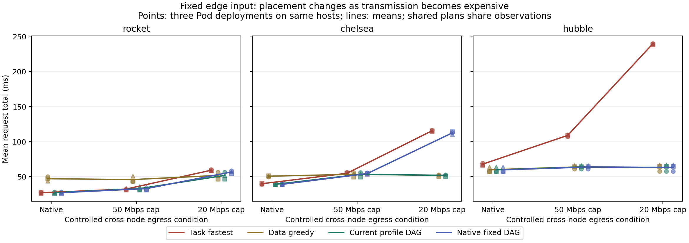

# 고정 엣지 입력: 실제 전달 제약에 따른 워크플로 배치

Status: COMPLETED — 2026-10-16, run `20261016t111955534665`.

## Material Passport

- Origin Skill: experimental-design; academic-research-suite / experiment-agent
- Origin Mode: run
- Verification Status: UNVERIFIED — 내부 무결성 감사 통과, 외부 독립 재현 미실시
- Version Label: edge_network_placement_v1

## 연구 질문에 대한 결과

**엣지에 고정된 입력에서 연산시간만으로 위치를 고르면 전달 비용이 큰 조건에서 손실이 커진다. 기존 DAG도 기본 네트워크에서 선택한 계획을 계속 유지하면 손실이 생긴다. 그러나 이번 격자에서는 동일 비용표를 사용한 8개 배치의 정확 열거와 단순 greedy만으로 큰 손실을 줄였으며, 새로운 알고리즘의 필요성을 입증하지는 않았다.**

- 큰 입력 hubble·20Mbps: Task-fastest **239.12ms → current-DAG 63.05ms**, 176.06ms/73.63% 감소. 세 배포 모두 같은 방향이다. 이 조건에서 greedy와 DAG는 같은 AAA 실행을 공유한다.
- 중간 입력 chelsea·20Mbps: native 고정 DAG **112.25ms → current-DAG 51.75ms**, 60.50ms/53.89% 감소. 배포별 차이는 60.27/63.38/57.84ms다.
- 작은 입력 rocket·native: current-DAG 27.04ms, greedy 46.93ms. 하지만 Task-fastest는 26.89ms여서 DAG가 무조건 우월하지 않다.
- chelsea·50Mbps는 판단 경계다. current-DAG는 세 배포 모두 AAA를 선택했지만 native 고정 NNN 대비 배포별 이득은 **−0.52/+4.75/−1.16ms**로 방향이 갈렸다. 평균 1.03ms 이득을 안정적인 우위로 해석하지 않는다.

이 결과는 ‘네트워크 비용도 비교했는가’에 대해 실제 커널 제한·HTTP 전송으로 답한다. 모든 입력의 source는 ARM 엣지다. 서버 source 평균을 섞지 않았다. 실제 센서 대신 엣지 Pod에 고정한 JPEG를 재생했으므로 센서 장치 수집 성능을 검증한 것은 아니다.

## 설계와 비용 경계

[사전 동결 명세](../../artifacts/edge-network-placement/spec-frozen.md), [실행 manifest](../../artifacts/edge-network-placement/run.json), [전체 원자료](../../artifacts/edge-network-placement/).

ARM `etri-dev0003-raspi5`와 Intel NPU 서버 `etri-ser0002-cgnmsb`에서 T1 전처리 → T2 SqueezeNet 추론 → T3 후처리의 3Task chain을 실행했다. A는 ARM, N은 NPU **서버 위치**다. T1/T3는 어느 위치에서도 CPU이며, T2만 N 위치에서 실제 NPU를 사용한다. 모든 8배치를 보정했다.

입력 JPEG는 rocket112,525B, chelsea240,512B, hubble527,940B이고 전처리 출력은 모두602,112B, 추론 출력은4,000B다. AAA의 원격 Task payload는0B, NNN은 원본 JPEG 크기다. NNA는 여기에 추론 출력4,000B가 추가된다. 중간 tensor를 넘기는 배치는602,112B 전송 비용을 부담한다. 이 수치는 Task payload이며 HTTP header·trace·응답·제어 트래픽의 실제 wire bytes 합계가 아니다.

세 번 새 Pod 배포에서 각각 native/50/20Mbps 조건을 보정한 뒤 계획을 동결하고, 별도 무작위 순서로 평가했다. 동일 물리 host·날짜·driver/OS cache를 공유하므로 독립 환경3개가 아니다. regime별 입력별 고유 선택계획을 warmup2회+측정5회 실행했고, 같은 계획을 선택한 정책은 같은 관측치를 공유한다. 표는 각 배포의 측정5회 평균을 배포 간 균등 평균한 기술 통계다.

- `task_fastest`: 현재 비용표에서 Task 연산시간만 최소화.
- `data_greedy`: 같은 표의 데이터 이동과 현재 Task 비용을 단계별 고려.
- `current_dag`: 같은 표로 전체8계획 정확 열거. 미래 평가값은 사용하지 않았다.
- `fixed_native_dag`: native 보정 계획을 모든 조건에서 유지. 현재 정보 제공 여부를 분리한 대조이며 동등 정보 정책 비교가 아니다.

current-DAG는 **미리 보정한 현재 regime 정보**를 받았다. 실제 온라인 추정, 관측 지연, 비정상 상태의 감지·프로파일 획득·재배포 문제를 해결한 것이 아니다. 요청 total에는 관측·계획조회·상태검사·workflow가 포함되며 warm 서비스 간 요청 경로 선택이다. Pod 재배포, 모델 이동, 재컴파일, 모델 cold-start 비용을 포함한 동적 전환 전체의 순이익으로 부르지 않는다.

## 정책별 관측 평균

단위 ms, 낮을수록 좋다. p값·CI·p95·SLO·동등성 검정은 하지 않는다.

| 입력 | 전달 조건 | Task-fastest | Data greedy | Current DAG | Native 고정 DAG |
|---|---|---:|---:|---:|---:|
| rocket | native | 26.89 | 46.93 | 27.04 | 27.04 |
| rocket | cap50 | 32.14 | 45.69 | 32.82 | 32.82 |
| rocket | cap20 | 58.99 | 51.59 | 51.59 | 56.53 |
| chelsea | native | 39.79 | 50.50 | 38.91 | 38.91 |
| chelsea | cap50 | 54.57 | 53.20 | 53.20 | 54.23 |
| chelsea | cap20 | 115.20 | 51.75 | 51.75 | 112.25 |
| hubble_deep_field | native | 67.66 | 59.58 | 59.58 | 59.58 |
| hubble_deep_field | cap50 | 108.69 | 63.61 | 63.61 | 63.61 |
| hubble_deep_field | cap20 | 239.12 | 63.05 | 63.05 | 63.05 |



[기계 판독 결과](../../artifacts/edge-network-placement/results.json)에 배포·입력·regime·계획별 n/평균/중앙값/SD/범위, 정책별 차이, 보정8배치, 선택시간, 전달 잔여와 bytes를 모두 보존했다. 그림의 점은 배포별 평균이며 독립 프레임 표본이나 신뢰구간이 아니다.

현재 DAG의 계획은 세 배포에서 일치했다.

| 입력 | native | 50Mbps | 20Mbps |
|---|---|---|---|
| rocket | NNN | NNN | AAA |
| chelsea | NNN | AAA | AAA |
| hubble | AAA | AAA | AAA |

greedy는 전 조건 AAA였다. 현재 DAG와27조건 중18개에서 같은 계획, 다른9개에서 DAG의 관측 평균이 낮았다. Task-fastest와는 같은 계획2개, DAG 평균이 낮은20개/높은5개였다. native 고정 DAG와는 같은18개, 현재 DAG 평균이 낮은7개/높은2개였다. 이는 공유 관측과 같은 host 반복을 포함한 조건별 기술 집계이며 승률 추정이 아니다.

## 실제 네트워크 제어와 검증

실험 소유 ARM client/ARM worker/NPU worker의 Pod network namespace에만 destination-filtered TBF를 설치했다. 원격 실험 Pod/Service IP를 분류하고 host NIC·EdgeCore·CloudCore 설정은 바꾸지 않았다. root prio의 기본 band는 비대상 트래픽을 통과시키고 선택 band에20/50Mbps TBF를 붙였다. burst16,000B, queue2,000,000B. 방향별·Pod별 제한으로 공유 WAN 전체 경합을 모사하지 않는다. 목적지가 일치하는 health/control/ACK도 제한될 수 있다.

초기 [netem preflight 실패](../../artifacts/edge-link-preflight/)는 별도 보존했다. 커널이 rate 요청을 `NetlinkError34`로 거부한 정확한 원인은 미확정이다. 이후 [TBF preflight](../../artifacts/edge-link-preflight-tbf/)의48회 hash 검증 전송에서602,112B payload 평균은 native63.61 → 50Mbps103.05 → 20Mbps253.08 → 복귀60.70ms였다(각 조건 첫 전송을 제외한3회의 기술 평균, 원자료 전체 보존).

본 실행은 각 regime 설정과 다음 전환 직전 TBF counter, 마지막 복귀를 모두 감사했다. 기록된 TBF drop 합계0이고 마지막에는 세 Pod 모두 default noqueue로 복귀했다. u32 readback의 key 표현에는 고정 pyroute2 decoder offset 문제가 관찰돼 readback 필드만으로 분류의 정확성을 단정하지 않는다. 설정 소스·선택 목적지·실제 전달 변화·counter를 함께 보존했다. 완전한 독립 패킷 캡처 기반 선택성 검증은 남는다.

중첩 RPC에서 하위 실행을 빼서 얻은 ingress/edge 잔여는 HTTP·직렬화·스케줄링 등을 포함한다. 순수 네트워크 지연으로 부르지 않는다. eth0 100Mbps 협상값은 native 실효 대역폭 측정값이 아니다.

## 수집·품질·비용 감사

- 총1,340회 = 보정864 + 평가476(warmup136/측정340). 유효 완료1,340, protocol 실패0, CPU reference Top5 순서 불일치0. 정답 label accuracy를 검증한 것은 아니다.
- stage receipt4,020개와 요청별 stage·노드·실행 device·input/output hash·반환 trace를 대조했다. Pod UID12개/container ID21개, 재시작0, frozen runtime14개 일치.
- 요청 최소 주기0.25초 초과148건을 보존했다. 보정147건, 평가 warmup1건이고 평가 측정 구간에는0건이다. 주기를 넘긴 느린 배치를 누락하거나 일정 처리량을 유지했다고 주장하지 않는다.
- 배포별 worker 준비 대기는15.96/15.87/15.85초, 보정 client 실행 합계78.68/78.59/78.71초, 평가 합계41.88/40.17/41.91초다. 준비 대기는 이미지 다운로드·모델 컴파일 각각의 순수 비용이 아니다. 정책 선택은 제어 host에서0.0021–0.0735ms 범위였고 요청 total과 별도로 기록했다. qdisc 적용시간은 각 network artifact에 있다. 전체 수집은730.68초다.
- 종료 시 소유 리소스0, wheel15개 정리, 기존 workload3개 Running/Ready. EdgeCore는11:32:07UTC 관측에서 RSS114,656kB/15threads, eth0 up였다. 시점 관측이며 장기 가용성 보증은 아니다.

## 분석 재현과 검토 수정

```bash
rtk proxy python experiments/e0/analyze_edge_network_placement.py --check
rtk proxy python experiments/e0/analyze_placement_cost_diagnostic.py --check
rtk proxy python -m unittest discover -s experiments/e0 -p test_phase_capture.py
```

[새 Git clone 검증](../../artifacts/edge-network-placement/clone-verification.json)에서 두 분석의 `--check`가 모두 통과했다. 분석은 표준 Python으로 실행된다. 원래 collector는 `uv run --python /usr/bin/python3 --no-build --with numpy==2.2.6 --with pandas==2.2.3 python experiments/e0/run_edge_network_placement.py`로 실행했고 모든 셸 호출에rtk를 사용했다. 그림은matplotlib3.10.1이다. collector는 기존 artifact를 덮어쓰지 않으므로 같은 경로에서 재실행하면 중단한다. 새로운 수집은 별도 run 경로와 명세가 필요하다.

[실행 당시 collector 소스](../../artifacts/edge-network-placement/implementation.json)와 [runtime ConfigMap](../../artifacts/edge-network-placement/configmap.json)은 그대로 보존했다. 수집 후 검토에서 timeout 부분 출력 보존을 개선했다. 이번 수집에는 timeout이 없었으며 개선 후 collector를 이번 측정에 사용했다고 주장하지 않는다. 실제 child process timeout의 stdout/stderr 보존 테스트를 통과했다. 고정 numpy2.2.6/onnxruntime1.23.2/Pillow11.3.0 환경의 관련 HTTP·정책·timeout 회귀17개도 통과했다. 최초 system Python 실행은 numpy 부재로, 다음 실행은 기존 HTTP fixture의 loopback 예약/wildcard bind 불일치에 따른 포트 충돌로 실패했다. 테스트 예약 주소를 worker와 맞춰 수정했으며 실패·최종 명령은 review-validation.json에 보존했다. 클러스터 runtime은 바꾸지 않았다.

Git checkout이 mtime을 바꾸므로 [원래 host의 파일 시각+hash 증거](../../artifacts/edge-network-placement/phase-order-evidence.json)를 별도 보존하고 분석은 이를 사용한다. 이는 사후 수집한 보조 증거이며 서명된 event log가 아니다. 보정 log hash → frozen profile hash → 평가 설계와 실행 snapshot의 연결을 별도로 검증한다. 개선 collector는 phase 시작/종료 host event도 저장한다. [두 축 검토](../../artifacts/edge-network-placement/review.md) 참조.

## 남은 연구 질문

이번 격자는 RQ1의 실제 차이와 전달 조건별 계획 전환을 답하는 의미 있는 파일럿이다. 작은 입력·50Mbps 같은 경계의 단발 변동을 따라 정책을 복잡하게 만들 근거는 부족하다. **다음 핵심은 현재 정보를 무료로 제공한 조건을 벗어나, 관측 지연·프로파일 획득 비용·변화 지속시간을 포함해 기존 DAG 재최적화와 단순 hysteresis 이후에도 손실이 남는지**다. 동일 정보로 비교하고 전체 변화·회복 구간 비용을 포함해야 한다.

이번 정확 열거는 AnchorDL/JellyBean/Atlas의 구현 재현이 아니다. kube-scheduler·Koordinator·DRL 본 비교, 실제 센서 스트림, 모델 업데이트/런타임 호환성 변화, 모델·상태 재배치 비용, branch/join DAG, 다중 센서 공유 링크 경합, 독립 날짜/환경 재현은 미완료다. 이 실험만으로 해당 선행연구의 실패나 새 스케줄러의 필요성을 확정하지 않는다.
