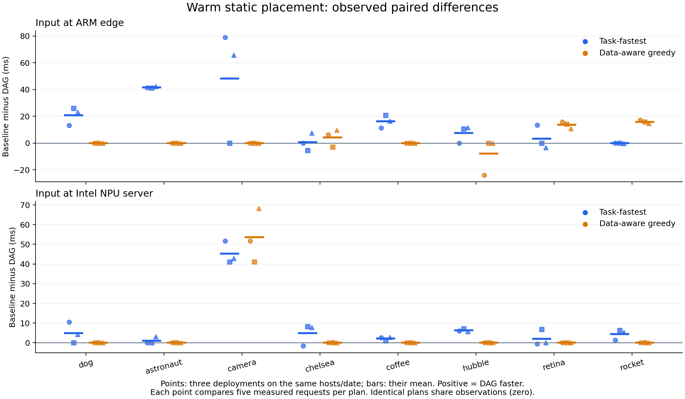

# 최신 보정표·품질 후보 동결 후 정적 배치 비교

## Material Passport

- Origin Skill: academic-research-suite / experiment-agent
- Origin Mode: run
- Origin Date: 2026-10-16
- Verification Status: UNVERIFIED
- Version Label: fresh_placement_v2

실행 상태: **COMPLETED**. run `20261016t102843070125`. [수집 전 명세](../../.scratch/fresh-placement/spec.md), [동결 실행 manifest](../../artifacts/fresh-placement/run.json), [완료 검증](../../artifacts/fresh-placement/verification.json)을 따른다. 이 문서의 Verification Status는 독립 재현 검증을 완료하지 않았다는 뜻이며 실행 완료 상태와 구분한다.

이번8입력·동일 host/날짜의3배포에서 균등 집계 평균 total_ms는 **Task-fastest51.64ms, greedy43.56ms, DAG38.59ms**였다. greedy와 DAG는48개 입력/source/배포 조건 중35개에서 같은 계획을 골랐고, 다른13개 중11개에서 DAG의 관측 평균이 낮고2개에서 높았다. 이 차이를 기존 논문 방식의 실패나 새 알고리즘 필요성으로 일반화하지 않는다.

## 비교 계약

기존 [PolicyRunner](common-policy-runner.md)에 **현재 HTTP 경로에서 새로 보정한 비용표**를 제공한다. ARM edge `etri-dev0003-raspi5`와 Intel NPU 서버 `etri-ser0002-cgnmsb`의 worker2/client2를 순차3회 새 배포한다. 같은 물리 host·날짜·driver/OS cache를 공유하며 독립 환경3개로 간주하지 않는다.

T1은 CPU 이미지 전처리, T2는 ARM CPU 또는 Intel NPU SqueezeNet 추론, T3는 CPU Top-5 추출이다. `N`은 NPU 서버 worker의 **위치**이며 T1/T3의 실행 장치는 CPU다. 8개 입력의 이미지·tensor·모델 hash와 CPU reference는 [E3 corpus](../../artifacts/fresh-placement/corpus.json)를 유지한다. T1 출력602,112bytes, T2 출력4,000bytes를 실제 전달한다.

| 정책 | 동결 시 사용하는 비용 | 의미 |
|---|---|---|
| Task-fastest | 각 Task의 실행시간만 | 실행 가능 후보 중 Task별 최소, alias 순 동률 처리 |
| 데이터 인지 greedy | 첫 ingress+T1, 이후 직전 간선+현재 Task | 미래 Task·간선을 함께 최적화하지 않는 순차 결정 |
| 작은 DAG 열거 | ingress+세 Task+두 간선 | 품질 후보에서 최대8배치를 열거한 보정표의 합 최소 |

[정책·보정 구현](../../experiments/e0/fresh_placement.py)은 모든 정책에 같은 입력/source별 비용표와 품질 후보를 제공한다. 이 세 정책은 정적 비교용 기준선이다. 작은 DAG 열거는 AnchorDL 재현이나 새로운 알고리즘이 아니며, 실측 가능한 모든 실행 상태의 최적해도 아니다.

보정은 배포마다 source2×입력8×배치8×(warmup1+측정3)=512 workflow다. 같은 노드의 local call도 측정하며 간선 비용을0으로 고정하지 않는다. Task·ingress·간선별 잔여값의 중앙값을 사용한다. ingress 잔여는 전체 workflow에서 최상위 Task와 그 하위 RPC를 뺀 값, 각 간선 잔여는 상위 RPC에서 하위 Task와 더 아래 RPC를 뺀 값이다. 직렬화·스케줄링·HTTP 등을 포함하며 순수 네트워크 시간으로 해석하지 않는다. 서로 다른 관측의 성분 중앙값을 합한 예측값과 실제 계획의 지연은 다를 수 있다.

**품질 후보는 평가 전에 정한다.** 한 입력·T2후보에 대해 warmup을 포함한 보정 출력32회가 모두 CPU reference와 Top-5 순서까지 같아야 후보로 남긴다. 입력은 제외하지 않는다. 후보가 하나도 없으면 평가를 중단한다. 이는 reference 일치 제약이며 정답 라벨 accuracy·분포 전체의 품질 동등성 검증은 아니다.

두 source 보정 후 비용표·후보·정책별 계획·1회 선택시간을 파일과 immutable ConfigMap으로 동결한다. 이후 평가값을 이용해 계획을 바꾸지 않는다. 같은 입력/source에서 같은 계획이면 하나의 실행 관측을 공유한다. 고유계획당 warmup2+측정5회이며 동일 계획을 독립 정책 표본으로 중복 세지 않는다. 같은8입력의 시간상 holdout이고 미관측 이미지 일반화 검증은 아니다.

배정은 experimental-design의 실제 `assign_factorial_runs`를 사용한다. source를 whole-plot 구간으로 묶고 보정 source 순서20261101+block, 보정 조건20261111+10×block+source_index, 평가 source 순서20261121+block, 평가 조건20261131+10×block+source_index의 seed를 사용했다. 최소 주기0.25초이며 초과·오류·품질 불일치를 보존한다.

## 비용 경계와 분석 단위

주 지표는 고유계획별5개 측정 요청의 평균 `total_ms`와 유효 완료 수다. `total_ms`에는 공통 profile/health 검사·동결 계획 조회·적용 직전 상태 확인·실제 HTTP workflow·반환 receipt 검증이 들어간다. 단일 요청의 실행 중 최적화는 수행하지 않는다. 정책별 최초 선택시간은 제어 host에서 따로 측정하며 동적 온라인 재최적화 비용으로 주장하지 않는다.

SDK/Pod·worker 초기 준비, 보정 획득, 최초 정책 선택, 평가 시간을 따로 남긴다. 모델 객체는 warm이며 인위적 eviction·링크 변경은 없다. Pod 재배포는 driver/OS cache 초기화가 아니다. 전체 준비·보정 비용이 운영 중 상각된다고 가정하지 않는다.

입력/source/배포별 `baseline 평균−DAG 평균`과 계획 일치 여부를 보고한다. 동일 계획은 같은 관측이므로 차이0이다. 배포별 집계는8입력 또는16입력/source case의 균등 평균이며 실제 트래픽 가중 평균이 아니다. raw n/mean/median/SD/range와 모든 시도 분모를 보존한다. 세 배포의 기술 통계만 제시하며 p값·CI·p95/SLO 우위·동등성을 주장하지 않는다.

## 결과

[분석 코드](../../experiments/e0/analyze_fresh_placement.py)로 동결 hash·snapshot/profile·입력/tensor 연결·warm 상태·시간 성분 합·보정→동결→평가 순서를 검사했다. [원시 집계 JSON](../../artifacts/fresh-placement/results.json)에97개 고유계획 episode의5측정 n/mean/median/SD/range, 정책별 공유 관측 참조,96개 paired 비교를 보존한다.

| 새 배포 | 보정 workflow | 평가 전체 | 평가 측정 | 고유계획 | stage receipt |
|---|---:|---:|---:|---:|---:|
| b0 | 512 | 224 | 160 | 32 | 2,208 |
| b1 | 512 | 210 | 150 | 30 | 2,166 |
| b2 | 512 | 245 | 175 | 35 | 2,271 |
| 합계 | 1,536 | 679 | 485 | 97 | 6,645 |

v2 전체2,215workflow의 protocol 실패는0이었다. 보정의 품질 불일치96회는 모두 camera/NPU였고, 세 배포 각각 ARM32/32일치·NPU0/32일치에 따라 NPU 추론 후보를 제외했다. 나머지7입력은 두 후보 모두32/32일치/배포였다. 평가에서는 warmup 포함679/679, 지표용 측정485/485가 기준 Top-5 순서까지 유효 완료됐다. NPU1,216회와 ARM CPU999회의 실제 T2 장치를 양끝 receipt로 대조했다. 속도 제한 초과1건은 b0 서버 source 보정의 hubble/전ARM **사전 지정 warmup**322.61ms였으며 원자료에 남아 있다.

아래 값은 각 입력/source/배포 episode의5요청 평균을 먼저 구한 뒤 균등 평균한 기술 통계다. 같은 계획의 관측은 공유한다. 실제 트래픽 가중 성능이나 독립 정책 표본 수로 해석하지 않는다. 차이는 baseline−DAG이므로 양수이면 이번 관측에서 DAG가 빨랐다.

| 입력 위치 | Task-fastest ms | greedy ms | DAG ms | Task-fastest−DAG ms | greedy−DAG ms |
|---|---:|---:|---:|---:|---:|
| ARM edge | 67.24 | 53.23 | 50.00 | 17.24 | 3.23 |
| Intel NPU 서버 | 36.04 | 33.89 | 27.18 | 8.87 | 6.71 |
| 두 위치·8입력 균등 | 51.64 | 43.56 | 38.59 | 13.05 | 4.97 |

배포별 두 위치 균등 평균은 Task-fastest53.65/48.86/52.42ms, greedy43.57/42.89/44.22ms, DAG39.37/38.64/37.75ms였다. Task-fastest와 DAG는48조건 중10개에서 계획이 같았고, 다른38개 중33개에서 DAG의 관측 평균이 낮고5개에서 높았다. greedy와 DAG는 ARM입력14/24, 서버입력21/24조건에서 같은 계획이었다.



[SVG 원본](../../artifacts/fresh-placement/paired-differences.svg). 점 모양은 b0/b1/b2이고 짧은 선은 세 배포 차이의 평균이다. camera는 두 정책 모두 같은 사전 품질 제약으로 ARM 추론만 허용했다. 점은 독립 물리 환경의 표본이 아니며 오차막대·유의성 표기를 사용하지 않았다.

서버 입력에서 greedy와 DAG가 달랐던 입력은 camera뿐이다. 계획은 `N→A→A`와 `A→A→A`였고, 전송 payload는 T1 뒤602,112B tensor와 T1 전139,512B JPEG로 달랐다. 관측 total_ms 차이는 b0/b1/b2에서51.66/41.13/68.27ms였다. 이 한 입력의 영향이 해당 source 전체 평균에도 포함된다. ARM입력의 retina·rocket은 세 배포 모두 DAG의 관측 평균이 낮았지만 chelsea는 방향이 섞였고 hubble은 b0에서 반대였다.

### 역전 사례와 비용 경계

[사후 기술 진단](../../artifacts/fresh-placement/diagnostics.json)은 평가를 다시 선택·실행하지 않고 느려진 사례와 시간 성분을 보존한다. 다음 두 조건에서 DAG의 관측 평균 total_ms가 greedy보다 높았다.

| 조건 | 보정 예측 workflow: greedy / DAG ms | 평가 workflow: greedy / DAG ms | 평가 total: greedy / DAG ms |
|---|---:|---:|---:|
| b0·ARM입력·hubble | 65.88 / 64.06 | 53.66 / 74.69 | 60.76 / 84.63 |
| b1·ARM입력·chelsea | 41.13 / 37.84 | 41.66 / 36.33 | 45.01 / 48.02 |

hubble은 보정표가 약1.82ms 이익을 예측해 전NPU서버를 골랐지만 평가의 workflow 자체 순위가 바뀌었다. 전서버5측정의 total은72.46~100.62ms였고 전ARM은60.02~61.48ms였다. 어느 측정도 사후 제외하지 않았다. 시변 부하·전송·프로파일 성분 결합의 원인을 분리한 실험은 아니므로 특정 하드웨어/네트워크 원인으로 확정하지 않는다.

chelsea는 DAG의 workflow가5.33ms 빨랐지만 workflow 밖의 검사·관측 시간이 greedy3.34ms/DAG11.69ms로 달라 total 순위가 반대였다. 그중 observation은2.74/6.39ms, 선택 T2의 state_validation은0.41/5.11ms였다. **현재 선택식은 workflow 비용만 최소화하고 주 지표는 이 공통 검사 경로까지 포함한다.** 같은 검사 절차라도 선택 위치와 실행 시점에 따라 비용이 달라질 수 있다. 이 비용 경계와 보정 예측 오차부터 맞춰야 하며 새 최적화 알고리즘의 필요성으로 바로 연결하지 않는다.

세 배포에서 같은 계획을 유지한 입력/source 조합은 Task-fastest5/16, greedy16/16, DAG15/16이었다. DAG에서 바뀐 것은 ARM입력 hubble이었다. 이는 재보정표에 따른 정적 선택의 안정성 관측이며 외생 네트워크/runtime 변화에 대한 적응 실험이 아니다.

### 준비·보정·선택 비용

Pod 생성부터 두 worker의 server_ready 관측까지15.84/15.88/15.89초, 두 source 보정 획득은129.46/129.37/129.30초, 평가는56.83/53.31/62.10초였다. 보정·평가 구간에는 source별 client exec·입력 준비가 포함된다. worker 준비값은 cache/wheel 획득·client Ready 대기를 모두 포함한 전체 배포 비용이 아니다. 설계 manifest 동결부터 최종 정리까지686.26초였고 14wheel 획득·cache 준비·검증·정리를 포함한다.

제어 host Linux/x86_64·Python3.12.3에서 정책당48회 측정한 최초 선택시간 중앙값은 Task-fastest0.00320ms, greedy0.00228ms, DAG0.01002ms였다. 작은 표의 계산만 측정한 값이며 edge에서의 최적화 비용이나 SDK/프로파일 획득 비용이 아니다. 이번에는 같은 보정표를 공통 제공했으므로 정책별 최소 프로파일 획득량·비용의 차이와 실제 운영 중 순이익/상각은 평가하지 않았다.

## EdgeCore·정리

[사후 관측](../../artifacts/fresh-placement/edge-snapshot.json)은10:40:00UTC에 EdgeCore1프로세스·RSS116,128kB·15threads·StateS와 eth0 up·carrier1·100Mbps/full을 확인했다. NIC 협상값은 실효 throughput·packet 경로의 확인이 아니다. 12개 worker/client Pod UID와 컨테이너 ID를 [보존](../../artifacts/fresh-placement/pod-identities.json)했다.

[정리 결과](../../artifacts/fresh-placement/cleanup.json)는 소유 리소스 잔여0·임시wheel14개 삭제를 기록하며 namespace·측정 증거는 유지한다. [기존3개 workload](../../artifacts/fresh-placement/preexisting-after-cleanup.json)는 Running/Ready였다. 수집기는 driver·EdgeCore/CloudCore·NIC 설정을 변경하지 않았다.

[최종 로컬 대조](../../artifacts/fresh-placement/final-local-audit.json)는 runtime13개 source와 동결본의 일치, Pod UID12개·컨테이너 ID12개의 고유성, 집계 분모·시간 성분·문서 링크를 확인했다. [10:45UTC 재점검](../../artifacts/fresh-placement/final-cluster-audit.json)에서도 소유 리소스 잔여0·기존3workload Running/Ready를 확인했다.

## 재현·오류 기록

실제로 실행한 명령이다. 수집기는 기존 `run.json`이 있으면 중단하므로 재실행은 새 작업 사본과 별도 증거 경로에서 한다. NPU가 비어 있고 기존 보호 workload가 Ready인 조건을 먼저 검사한다.

```bash
rtk proxy env PYTHONPATH=experiments/e0 uv run --python /usr/bin/python3 --no-build --with numpy==2.2.6 --with onnxruntime==1.23.2 --with Pillow==11.3.0 python -m unittest discover -s experiments/e0 -p 'test_*.py'
rtk proxy uv run --python /usr/bin/python3 --no-build --with numpy==2.2.6 --with pandas==2.2.3 python experiments/e0/run_fresh_placement.py
rtk proxy python3 experiments/e0/analyze_fresh_placement.py
rtk proxy uv run --python /usr/bin/python3 --no-build --with matplotlib==3.10.7 python experiments/e0/plot_fresh_placement.py
rtk proxy python3 experiments/e0/diagnose_fresh_placement.py --check
```

[HTTP red/green·회귀 기록](../../artifacts/fresh-placement/tdd.json)은 greedy의 미래 간선 누락 최소 사례, 실제 HTTP 보정/품질 후보 동결, idle 연결 회귀를 포함한다. 전체 회귀 중 fixture 포트 충돌1건을 확인하고 서버 시작까지 다른 peer의 포트 예약을 유지하도록 고쳐 **전체38개 테스트가 통과**했다. 이후 안쪽 전달만 idle인 조건으로 테스트를 강화했고 과거 소스 실패/현재 소스 통과의 [추가 red/green](../../artifacts/fresh-placement/idle-isolation-tdd.json)을 확인했다. 런타임은 바뀌지 않았으며 영향받는 테스트만 추가 실행했다. 상속·재사용한 계약 검사도 포함된 수다. [수집 전 구현 사본·hash](../../artifacts/fresh-placement/implementation.json), 추가 기록의 테스트 사본과 [수집 코드](../../experiments/e0/run_fresh_placement.py)를 보존한다.

첫 run `20261016t101650429037`은413개 보정 시도 뒤 중첩 전달의 idle 연결 오류로 중단했다. 평가를 시작하지 않았고 소유 리소스 잔여0·wheel14개 정리까지 [별도로 보존](../../artifacts/fresh-placement-attempt1/cleanup.json)했다. [원인·CPU HTTP 재현·수정](transport-idle-diagnosis.md)을 확인한 뒤 같은 입력·seed·표본 수의 v2를 보정부터 실행했다. 첫 부분 보정은 이번 비용표와 평가에 합치지 않는다. 이미 전송한 POST를 자동 재시도하지 않는다.

현재 폴더는 Git 저장소가 아니어서 [code-review 스킬](/home/jinuk/.agents/skills/code-review/SKILL.md)의 “confirm the fixed point resolves (`git rev-parse <fixed-point>`) and the diff is non-empty”를 충족하지 못한다. Git 차분 두 축 리뷰 완료로 표시하지 않는다. 실제 HTTP 회귀·동결 소스·양끝 receipt 대조를 검증 근거로 남긴다.

## 남은 연구 범위

정적 warm3Task chain의 비교를 동적 링크·실행 호환성 변화·준비 비용·cache 경쟁·여러 추론 단계·분기/합류 DAG로 일반화하지 않는다. AnchorDL은 원문 비용식·look-ahead/cache·baseline 계약 확보가 필요하며, kube-scheduler·Koordinator·기존 논문 DAG·DRL의 네 필수 정책군 본 비교도 남았다. 새로운 알고리즘의 필요성은 같은 정보의 기존 재최적화·greedy·hysteresis 후에도 재현 가능한 손실이 남는지 보고 판단한다.

바로 다음 검증은 **workflow 예측 순위의 반복 안정성과 관측/state_validation을 포함한 비용 경계를 분리하는 것**이다. 특히 hubble의 작은 예측 이득과 chelsea의 total 순위 역전을 단순한 비용표 갱신·검사 비용 반영으로 해소할 수 있는지 확인한다. 이후 두 추론 단계·분기/합류와 실제 변화 조건으로 확장한다. 이번 평균 이득은 DAG 공동 결정의 적용 사례이며 근접 선행의 한계 입증은 아니다.
