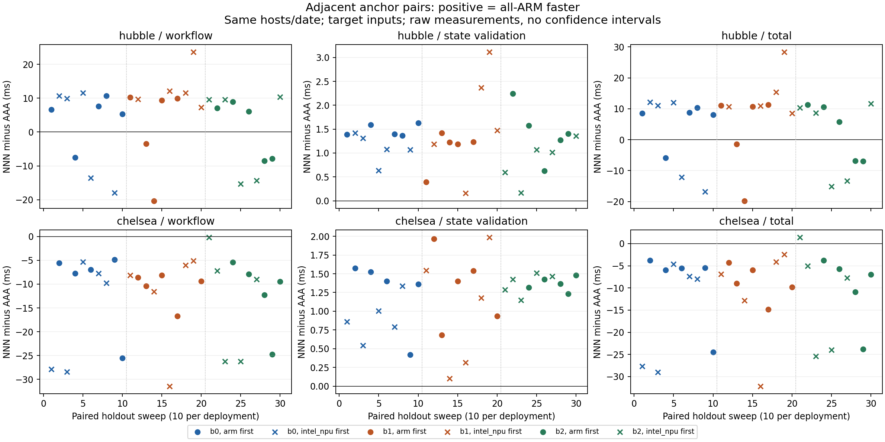

# 배치 순위와 상태 확인 비용의 교차 실행 진단

## Material Passport

- Origin Skill: experimental-design; academic-research-suite / experiment-agent; statistical-analysis
- Origin Mode: run
- Origin Date: 2026-10-16
- Verification Status: UNVERIFIED
- Version Label: placement_cost_diagnostic_v1

실행 상태: **COMPLETED**. run `20261016t105712740044`. [수집 전 계약](../../artifacts/placement-cost-diagnostic/spec-frozen.md), [실행 manifest](../../artifacts/placement-cost-diagnostic/run.json)을 따른다. Verification Status는 독립 재현 검증 여부이며 실행 완료와 구분한다.

## 질문과 설계

[fresh v2](fresh-placement.md)의 ARM-source hubble_deep_field 예측 순위 변화와 chelsea의 workflow/total 역전을 대상으로 한다. 결과를 보고 선택한 두 입력에 대한 표적 후속이다. 기존 AnchorDL·JellyBean 등의 실패나 전체 이종 장비에 대한 일반화 검정이 아니다.

ARM edge와 Intel NPU 서버에 worker2/client2를 순차3회 새 배포하고 ARM에서만 요청한다. T1/T3는 두 위치 모두 CPU, T2는 ARM CPU 또는 Intel NPU다. `AAA`는 세 Task 모두 ARM, `NNN`은 모두 NPU 서버 위치를 뜻한다. 모델 객체는 warm 상태이며 인위적 eviction·링크 변경은 없다. 같은 host/date/driver·OS cache를 공유한다.

배포마다 입력2×배치8×(warmup2 sweep+측정6 sweep)=128회 보정한다. 모든 보정 출력의 CPU-reference Top5 순서가 일치하는 추론 후보만 남긴다. reference 일치는 정답 accuracy가 아니다. Task/ingress/edge 중앙값, 선택 T2의 state_validation 중앙값을 동결하고 세 정책을 한 번 선택한다. 평가 응답으로 재선택하지 않는다.

| 정책 | 최소화하는 비용 |
|---|---|
| data_greedy | 현재 Task와 ingress/직전 간선 |
| dag_enumeration | 전체 workflow의 성분별 중앙값 합 |
| dag_with_state | 같은 workflow 예측 + 선택 T2의 state_validation 중앙값 |

모든 정책에 같은 보정 정보와 후보를 제공한다. state 비용은 service_prepare와 별도 보관한다. 모든 노드를 조회하는 공통 observation은 배치별 비용으로 학습하지 않는다. 따라서 보완식도 측정 total 전체의 최적해를 보장하지 않는다. 최초 선택시간은 제어 호스트에서 별도 측정하며, 평가의 decision 시간은 고정 계획 적용이다.

평가는 전체8배치×입력2×(warmup2 sweep+측정10 sweep)=192회/배포다. 정책이 같은 배치를 선택하면 관측을 공유한다. 전체 배치 측정은 예측 오차 진단용이며 평가 최저값을 사전 정책으로 제시하지 않는다.

각 sweep의 입력 순서를 무작위화하고, 입력마다 AAA/NNN을 먼저 연속 실행한 뒤 나머지6배치를 무작위 순서로 실행한다. anchor 선후는 보정 측정에서3:3, 평가 측정에서5:5로 균형 배정했다. experimental-design의 실제 assign_factorial_runs와 seed 20261201+100×block/20261251+100×block을 사용했다. 전체 스케줄은 수집 전에 고정했다. anchor가 항상 첫 두 위치에 놓이는 구조와 나머지 배치의 위치 차이는 남는다.

최소 주기0.25초이며 오류·초과·극단값을 보존한다. 반복 수는 고정 진단 예산이다. 주 지표 total, 보조 workflow/state_validation/observation 및 서로 겹치지 않는 잔여 항목을 배포·입력·sweep별로 보고한다. p값·CI·p95/SLO·우위/동등성 검정을 수행하지 않는다. RPC 잔여값은 순수 네트워크 시간이 아니다.

## 구현과 재실행

[정책과 배정](../../experiments/e0/placement_cost_diagnostic.py), [클라이언트](../../experiments/e0/placement_diagnostic_client.py), [수집기](../../experiments/e0/run_placement_cost_diagnostic.py), [분석기](../../experiments/e0/analyze_placement_cost_diagnostic.py), [그림 코드](../../experiments/e0/plot_placement_cost_diagnostic.py)를 사용한다. 기존 실측 실행기와 schema는 유지하며 과거 수집 스크립트와 결과를 보존한다. 이번 수집기는 검증된 배포 수명주기의 격리된 변형이다.

```bash
rtk proxy env PYTHONPATH=experiments/e0 uv run --python /usr/bin/python3 --no-build --with numpy==2.2.6 --with onnxruntime==1.23.2 --with Pillow==11.3.0 python -m unittest test_placement_cost_diagnostic.PlacementCostHTTP
rtk proxy uv run --python /usr/bin/python3 --no-build --with numpy==2.2.6 --with pandas==2.2.3 python experiments/e0/run_placement_cost_diagnostic.py
rtk proxy python3 experiments/e0/analyze_placement_cost_diagnostic.py
rtk proxy uv run --python /usr/bin/python3 --no-build --with matplotlib==3.10.7 python experiments/e0/plot_placement_cost_diagnostic.py
```

수집·분석·그림 코드는 기존 산출물 덮어쓰기를 거부한다. 새 실험은 별도 경로와 버전으로 수행해야 한다. [HTTP 테스트 근거](../../artifacts/placement-cost-diagnostic/tdd.json)는 알려진 비용 사례의 red/green과7개 관련 계약 통과를 기록한다. 이는 실제 클러스터 지연의 우월성 검증이 아니다.

수집 당시 Git 저장소가 없어 정식 fixed-point 리뷰는 수행하지 않았다. 이후 사용자의 새 저장소 생성/push 요청에 따라 기존 연구를 baseline commit으로 보존했고, 이번 변경은 해당 baseline부터 검토한다. [파일 비교](../../artifacts/placement-cost-diagnostic/source-comparison.diff)도 남겼다.

## 완료 결과와 해석

960 workflow(보정384, 평가576/측정480)가 모두 유효 완료됐고 protocol 실패0, stage receipt2880개를 대조했다. 실행 한도0.25초 초과3건은 b1 hubble 혼합배치의 평가 측정에서288.87/1072.80/256.40ms였으며 원자료에 그대로 남겼다. 이 배치들은 세 정책이 선택하지 않은 추가 진단 경로지만 제외하지 않았다.

| 입력 | 배포 | 예측 workflow NNN−AAA ms | 평가 workflow 차이 ms | 평가 total 차이 ms |
|---|---:|---:|---:|---:|
| chelsea | 0 | -6.29 | -12.98 | -12.19 |
| hubble_deep_field | 0 | 10.45 | 2.35 | 3.62 |
| chelsea | 1 | -7.02 | -11.55 | -10.22 |
| hubble_deep_field | 1 | 10.05 | 7.01 | 8.57 |
| chelsea | 2 | -7.50 | -12.86 | -11.18 |
| hubble_deep_field | 2 | 11.48 | 0.57 | 1.62 |

양수는 AAA가 빠르다는 뜻이다. hubble은 세 배포 모두 새 보정에서 AAA를 선택했고 평가 평균도 AAA가 빨랐다. 그러나30개의 가까운 시간 쌍 중9개는 NNN이 빨랐다. 평균 선택의 일관성과 요청별 변동을 구분해야 한다. chelsea는 NNN의 workflow가30쌍 모두 빨랐고 total도29쌍에서 빨랐다. 세 배포 평균에서는 이전 total 역전이 재현되지 않았다.

chelsea의 균등 평균 total은 greedy50.45ms, DAG39.25ms다. state 비용 보완도 같은 NNN 계획을 골랐다. hubble은 세 정책 모두 AAA와64.47ms 관측을 공유한다. 보완 정책이 기존 DAG와 다른 계획을 고른 조건은0/6으로, 추가 효과는 식별되지 않았다. 이것은 네트워크 변화나 기존 논문 정책의 한계를 검증한 결과가 아니다.



[원자료 집계](../../artifacts/placement-cost-diagnostic/results.json)는 배포·입력·배치별 n/평균/중앙값/SD/range와 전체 paired 값을 포함한다. 원본 관측을 제거하거나 재선택하지 않았다. runtime14개 source·고유 Pod12개/컨테이너12개·보정→동결→평가 순서를 확인했다. 소유 자원0·wheel14개 정리, 보호 workload3개Ready. EdgeCore11:03:13UTC RSS116944kB/15threads, eth0 up100Mbps/full(협상값)이다.

이 진단의 완료를 연구 질문의 종료로 해석하지 않는다. 사용자 확인에 따라 센서 source는 엣지로 고정하고, 다음은 실제 노드 간 전달 조건과 원본/중간 데이터 크기에 따른 선택 경계 및 기존 계획 유지/현재 정보 대조다.
