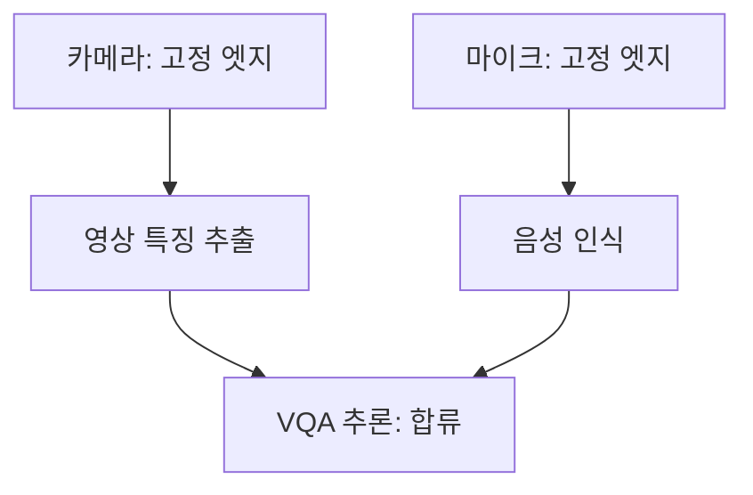

# DAG·토폴로지·노드 성능 프로파일: 실제 시스템 실험 인계

Status: PREPARED — 2026-10-19. **이 문서는 실행 준비 명세다. 새 클러스터 실험 결과가 아니다.**

## 이번 연구의 고정된 범위

센서 위치가 고정된 워크플로 DAG를 인프라 네트워크 토폴로지와 작업×노드 실행 성능 프로파일에 매핑한다. CPU/메모리/가속기 및 모델 호환성을 제약으로 두고 센서 입력부터 최종 결과 반환까지의 지연을 줄이는 배치를 선택한다. 공유 WAN 다중 워크플로, DRL, 동적 재배치 연구로 범위를 확대하지 않는다. 기존 동적 실험 기록은 보존하며 이번 정적 배치 검증과 구분한다.

- 입력: DAG 선후관계·분기·합류·간선 bytes, 센서 발생 노드, 링크/경로별 전달 비용, 작업·모델·노드별 실행시간, 품질 통과 후보 및 자원 가용량.
- 출력: Task→Node 배치. 모델/정밀도/입력은 정책 사이에 고정한다.
- 주 지표: source에서 monotonic clock으로 측정한 전체 완료시간. 분기 시간을 더하지 않는다.
- 전수 탐색은 작은 DAG의 구현 수단이다. DAG 전체 최적화 자체나 고려 변수 개수를 신규성으로 주장하지 않는다.

## 현재 갖춰진 것과 남은 연결

|항목|상태|
|---|---|
|3연산자 영상·음성 합류 DAG 시뮬레이션|완료, [보고서](../../experiments/topology-profile-20261019/REPORT.md)|
|실측 프로파일 기반 정적 계획기·자원 제약·성분 제거 비교|구현 및 로컬 회귀 확인|
|기본 kube-scheduler/제안 배치용 Pod 명세 생성|구현, 실제 API 서버 검증은 미실시|
|노드별 연산 프로파일 수집·스냅샷·평가 로그 집계 도구|구현, 실제 모델/클러스터 호출은 미실시|
|이번 분기·합류 DAG의 모델 이미지·RPC 실행기|연결 필요 — 기존 E0는 3Task chain이며 그대로 fork/join이라고 부를 수 없음|
|실제 링크별 payload 전달 보정·배포·성능 비교|실행 필요|

**도구는 준비됐지만 실제 모델 adapter, stage 이미지, 두 센서의 직접 전송/합류 실행기는 실험실 환경에서 연결해야 한다.** `pods.json`은 배치 명세만 만든다. 자동으로 센서/Service/DAG 데이터 경로를 구현하지 않는다. 이 단계를 끝내기 전에 클러스터 벤치마크가 준비 완료됐다고 표시하지 않는다.

기존 자산: [KubeEdge 실제 환경](e0-kubeedge.md), [RPC 경로 보정](e0-rpc-profile.md), [공통 실행기](common-policy-runner.md), [기존 chain 실측](edge-network-placement.md). 기존 코드/원자료를 수정하거나 덮어쓰지 않는다. `experiments/e0/policy_runner.py`는 기존 chain 전용 계약이며 이번 DAG 준비 도구와 자동 연동되지 않는다.

## 대상 DAG와 고정 조건



1. 실제 사용할 모델·버전·가중치 hash·runtime·정밀도를 먼저 확정한다. JellyBean 수치표는 실험실 노드의 프로파일이 아니다.
2. 두 branch 입력은 동일 request_id로 짝지어진다. VQA는 둘 다 수신한 뒤 한 번만 실행한다. 출력 품질 비교 기준과 허용오차를 사전에 고정한다.
3. 실제 영상/음성 fixture를 엣지 source Pod에서 재생한다. 제어 PC에서 데이터를 보내놓고 센서 위치를 엣지라고 기록하지 않는다. 실제 센서 스트림과 파일 재생을 구분한다.
4. stage 간 실제 tensor/text bytes가 해당 Pod 사이로 흐르도록 한다. 중앙 클라이언트가 모든 중간 결과를 받아 재전송하는 구현은 다른 토폴로지다. 같은 노드 IPC/HTTP도 실제 사용할 경로로 보정한다.
5. branch 처리, 합류, 반환의 request_id·노드명·Pod UID·입출력 bytes/hash·모델 hash·device·시간을 receipt에 기록한다. 노드 간 시계 차이를 빼서 E2E를 만들지 않는다.
6. 각 task는 동일 이미지/requests/limits/replica 수를 사용한다. 가속기 요구가 있으면 모든 방식에 동일 extended resource와 호환성 제약을 추가한다. 현재 생성기는 CPU/메모리만 지원하므로 GPU/NPU 실험에는 명세를 확장하고 검증해야 한다.

## 비교군

|정책|실제 배치|목적|
|---|---|---|
|resource|실제 default-scheduler가 후보 중 선택; nodeName 강제 없음|기본 Kubernetes 기준선|
|topology_only|동일 DAG 계획기, 작업별 평균 시간을 모든 후보에 동일하게 사용|노드별 성능 정보 제거|
|profile_only|동일 DAG 계획기, 전달 비용만0으로 가정|네트워크 정보 제거|
|topology_profile|측정한 전달 비용과 작업별 노드 성능 모두 사용|제안 방식|

선택 결과는 required node affinity로 좁히되 정상 kube-scheduler가 자원 admission을 수행한다. 별도 scheduler 플러그인/바인더 구현이 아니라 **정적 배치 제어 프로토타입**이다. 기본 비교군에는 동일한 호환 후보만 지정하고 점수 우선순위를 강제하지 않는다. 스케줄러 버전/config, admission webhook, taint, topology spread, image locality 영향을 기록한다. 실제 Pod 배치를 캡처하며 자원 점수 Python 근사를 실측 기준선으로 사용하지 않는다.

계획기는 measured payload 경로별 비용표의 DAG critical path를 최소화한다. 큐/동시 링크 경합/다중코어 간섭을 예측하지 않는 첫 모델이다. 시뮬레이터의 단일 lane 모델과 비용 모델이 완전히 같지 않으므로 실제 시스템 결과는 새 실험으로 보고한다. 최종 지표는 예측값이 아닌 실제 E2E다.

## 1. 인벤토리와 격리

실험 전 노드/주소/자원/아키텍처/runtime/가속기/model readiness를 기록한다. `fixture.json`의 노드명은 예시이며 실제 장비 이름이 아니다. 기존 운영 namespace·노드 NIC·EdgeCore/CloudCore를 변경하지 않는다. 실험 전용 namespace와 run-id를 사용한다. GPU/NPU가 등록됐다는 것과 모델이 성공적으로 실행된 것은 별도로 확인한다.

```bash
python experiments/real-topology-profile/capture.py \
  --namespace topology-profile-lab --run-id b01-resource --out /tmp/tp-b01-before
```

이 명령은 읽기 전용이며 실패/timeout 부분 출력도 보존한다. namespace가 없으면 먼저 전용 namespace를 준비한다. node의 Allocatable에서 현재 Pod requests를 뺀 CPU/메모리를 `cpu_free_m`/`memory_free_mib`에 기록한다. `kubectl top`의 순간 사용량을 requests 잔여량으로 대신하지 않는다.

## 2. 사전 프로파일 수집

노드별 동일 입력·동일 모델에 warmup5/측정100회로 시작한다. 이는 선택한 초기 프로토콜이며 특정 논문의 정확한 재현을 뜻하지 않는다. 전원모드·스레드 수·batch·동시성·온도·runtime hash를 남긴다. CPU reference와 품질 검사를 먼저 하고 실패 후보/입력을 결과 확인 뒤 임의 삭제하지 않는다.

`profile.py`는 실제 노드에서 `module:function` adapter를 호출한다. adapter는 bytes를 받아 실제 연산 후 직렬화한 bytes를 반환한다. 모델은 import 시 한 번 준비하고 CUDA/비동기 가속기는 반환 전에 동기화한다. tensor 직렬화 포함 여부를 고정하며 동일 동작으로 보정/평가한다. 다중 입력 task는 고정된 binary envelope로 두 입력을 전달한다. 이 adapter는 프로젝트 모델 코드에 맞춰 구현해야 한다.

```bash
python experiments/real-topology-profile/profile.py \
  --adapter my_workload.vision:run --input /data/calibration/image.bin \
  --node ACTUAL_NODE --task vision --model-sha256 ACTUAL_MODEL_SHA \
  --warmup 5 --repeat 100 --out /results/b01-vision-node.jsonl
```

이 예시는 실험실에서 채워 실행할 명령이며 현재 세션에서 실행하지 않았다. 수집기는 raw 샘플·입출력 hash/bytes·실패를 보존한다. 자동으로 품질 동등성을 판정하지 않는다. `NODE_NAME`을 downward API로 넣어 선언 노드와 대조한다. 초기 모델 준비시간은 별도로 기록한다.

전달 프로파일은 **실제 stage 데이터 경로에서 동일 payload 크기**로 노드쌍별/입력별 최소100회 보정한다. bytes/hash 무결성을 확인한다. HTTP round trip에서 임의로2를 나누거나 NIC 협상속도를 실효 bandwidth로 사용하지 않는다. request/response/직렬화 비용 경계를 명시해 연산시간과 중복 합산하지 않는다. 링크 혼잡조건은 별도로 표시한다. [기존 RPC 측정 계약](e0-rpc-profile.md)을 참고하되 chain의 중첩 잔여 공식을 분기 DAG에 그대로 복사하지 않는다.

## 3. 프로파일 동결과 계획 생성

`fixture.json`은 스키마/로컬 테스트용 합성 예시다. 실제 calibration 결과로 `measured.json`을 작성한다:

- `provenance: measured`, `evidence_id`: 원자료/manifest 식별자.
- task `candidates`: 품질/실행 호환성 통과 노드만; `compute_ms`: 같은 분위수의 warm 실행시간.
- task inputs: predecessor task 또는 고정 source_node, 실제 bytes, origin|destination 별 전달시간.
- outputs: 최종 반환 목적지와 전달시간.
- namespace·image는 실험 전용 값과 검증한 immutable digest로 교체한다.
- 파일 hash/원시 보정 로그/모델·데이터·이미지 hash, topology/route/worker Pod UID를 함께 동결한다. 평가 값으로 다시 선택하지 않는다.

```bash
python experiments/real-topology-profile/prepare.py --config measured.json \
  --policy topology_profile --run-id b01-full --out /tmp/tp-b01-full
python experiments/real-topology-profile/prepare.py --config measured.json \
  --policy resource --run-id b01-resource --out /tmp/tp-b01-resource
```

`topology_only`, `profile_only`도 같은 파일에서 생성한다. 출력은 frozen profile, 선택 계획, Pod 명세이며 기존 경로를 덮어쓰지 않는다. 기본 비교군의 plan placement는 null이고 실제 scheduler 결정을 나중에 기록한다. 소규모 정확 열거는100,000조합 상한이 있다.

## 4. 배포와 평가

아래 명령은 이미지/실행기/프로파일 준비 후 실험실에서 실행할 절차다. **이 세션에서 클러스터에 적용한 적은 없다.**

```bash
kubectl apply --dry-run=server -f /tmp/tp-b01-full/pods.json
kubectl apply -f /tmp/tp-b01-full/pods.json
kubectl get pods -n topology-profile-lab -l run-id=b01-full -o wide
```

실제 task server가 준비됐는지 health/model warm/quality 확인 후 각 Pod IP와 실제 노드명을 고정 실행기에 제공한다. 배치마다 같은 DAG 데이터 경로를 유지한다. Service를 쓴다면 한 stage의 실제 replica1개를 가리키는지 검증한다. 생성된 manifest 자체에는 Service/실행기/readiness가 없다. default-scheduler 기준선도 동일 health/quality gate를 통과해야 한다. 후보 상태가 바뀌면 그 시도는 stale-profile로 기록하고 새 block을 보정한다.

첫 본 실험: 동일 노드 집합,3연결조건(native/제한/복귀 검증),2센서 배치,2부하,4정책. 가능하면 서로 다른 날짜의 최소5block, 조건별 warmup20·측정200요청을 시작점으로 한다. 표본 수는 파일럿 변동성과 실질적 효과 크기로 재검토하며 검정력 보장을 주장하지 않는다. block 내 정책 순서를 seed로 무작위화하고 동일 입력·도착 trace를 재생한다. 느린 요청을 누락하거나 closed-loop를 고정 RPS라고 부르지 않는다.

- warm 정상구간 E2E와 이미지 pull/Pod ready/모델 준비/프로파일링/선택 시간을 각각 기록한다.
- source 고정, 실제 Task 배치, 각 간선 payload bytes와 interface counters, 완료/실패/timeout/quality를 기록한다.
- 같은 계획/상태를 선택한 방식은 관측을 공유하고 다른 독립 표본처럼 세지 않는다.
- topology 변경은 실험 소유 Pod network namespace 또는 실험 전용 라우터에 한정하고 목적지·counter·복귀를 검증한다. `pod_link_control.py`의 기존 대상/경로를 새 실험에 무검토 재사용하지 않는다. 이번 준비 도구는 tc 설정을 자동 적용하지 않는다.
- 원격 stage 실행기까지의 왕복 시간을 모두 더하지 않는다. source에서 최종 응답을 받은 단일 E2E를 사용한다.

## 5. 결과 계약·분석·정리

실제 DAG 실행기는 JSONL에 다음 필드를 요청마다 기록한다. 실패/timeout도 반드시 한 행을 남긴다.

```json
{"run_id":"b01-full","request_id":"r0001","condition":"split-cap10-load1","block":"day1-b01","policy":"topology_profile","warmup":false,"status":"ok","quality_ok":true,"e2e_ms":123.4,"source_nodes":["edge-a","edge-b"],"placement":{"vision":"edge-b","speech":"cloud-c","fusion":"cloud-c"},"receipts":[],"profile_sha256":"..."}
```

123.4와 빈 receipts는 형식 예시일 뿐 유효 측정이 아니다. 실제 receipts에 Task/Pod UID/device/bytes/hash/완료 상태를 채워 무결성 검사한다. 현재 집계기는 필수 집계 필드와 중복 identity를 검사하지만 receipts 진실성 검증기는 아니므로 실행기 측 검증이 추가로 필요하다.

```bash
python experiments/real-topology-profile/analyze.py attempts.jsonl --out summary.json
python experiments/real-topology-profile/capture.py \
  --namespace topology-profile-lab --run-id b01-full --out /tmp/tp-b01-after
kubectl delete pods -n topology-profile-lab -l run-id=b01-full
```

삭제는 해당 run의 Pod만 대상으로 한다. namespace 전체나 기존 workload를 삭제하지 않는다. 네트워크 제약 복귀는 별도 검증하고 cleanup event를 보존한다. 집계기는 condition×block×policy 성공 지연과 전체 실패/품질실패 분모를 내며 p값/CI를 만들지 않는다. 같은 날짜의 수백 요청을 독립 환경 수백 개로 세지 않는다. 보고 시 paired block별 차이와 실패율을 함께 제시한다.

## 이번 변경에서 실제 확인한 것

- 표준 Python 로컬 회귀7개: 실측 입력 gate, DAG 합류 max, cycle 거부, 자원 부족, baseline/제안의 배치 제약 차이, 성분 제거 비교의 동일 제약, 실패/중복 행 처리.
- 실제 kube-scheduler/API server·AI 모델·센서·네트워크 실험은 실행하지 않았다.
- Semantica 도구를 사용할 수 없어 별도 그래프 기록은 수행하지 못했다.
