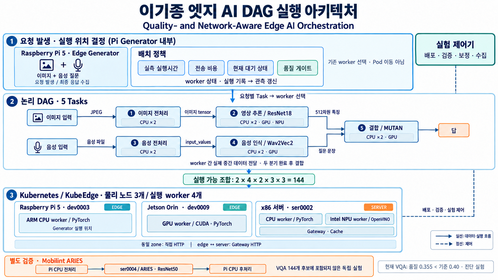

# 면접 발표용 아키텍처 상세 설명

작성 기준: 2026-10-27 저장소의 실제 실행 코드와 동결 실험 보고서. 발표는 1–2장에 배치하되, 이 문서는 설명·질의응답을 위한 상세 원자료다.



[아키텍처 PNG 원본](system-architecture.png) · [실험 수치·조건](data-only.md) · [이미지 생성 기록](architecture-image-prompt.md)

그림 읽는 순서: ① Pi generator 내부의 요청 발생·배치 결정 → ② 논리적인 5 Task 분기·결합 → ③ 실제 실행 worker. DAG와 물리 worker 사이의 연결은 요청별로 달라지며, 그림은 하나의 고정 배치를 나타내지 않는다. 실험 제어기는 배포·검증·실험 제어를 담당한다. 주황색 Mobilint 영역은 주 VQA 배치 후보와 분리된 실험이다.

## 1. 프로젝트를 한 문장으로 설명하면

**Kubernetes/KubeEdge 위에 CPU·GPU·NPU 실행 worker를 배포하고, 엣지에서 발생한 AI 요청의 DAG를 작업 단위로 나누어 실행 위치를 선택하고, 실제 중간 데이터를 전달하며 종단 성능을 측정하는 시스템이다.**

연구 목표는 서비스 품질 조건을 만족하는 실행 구성 중에서 연산·대기·전송 비용을 고려하여 기한 내 처리량을 높이는 것이다. 현재 구현은 이를 검증하기 위한 공통 실행기와 기준선 비교 시스템이다. 품질 적격 goodput 개선이라는 최종 연구 성과는 아직 입증하지 않았다.

핵심 배치 단위는 `Task → worker`다. worker는 미리 실행해 둔 Pod의 프로세스이며, 정책은 요청이 들어올 때 각 Task를 어느 worker에 보낼지 정한다. Pod 생성·자원 할당과 요청별 Task 배치를 구분한다.

## 2. 발표 자료에 포함된 세 실험의 관계

| 구분 | A. 멀티모달 실행 시스템 | B. Mobilint 실추론 검증 | C. 전송 조건별 배치 실험 |
|---|---|---|---|
| 목적 | 공통 DAG 실행기에서 배치 정책 비교 | 국산 NPU의 실제 실행·품질·지연 검증 | 데이터 이동이 배치 성능에 미치는 영향 확인 |
| 모델 | ResNet18 + Wav2Vec2 + MUTAN | ResNet50 | SqueezeNet |
| DAG | 5 Task, 두 분기 후 결합 | 전처리 → 추론 → 후처리 | 전처리 → 추론 → 후처리 |
| 환경 | ARM CPU·x86 CPU·Jetson GPU·Intel NPU | Pi CPU + Mobilint ARIES 또는 서버 CPU | ARM CPU + Intel NPU 서버 |
| 배치 결정 | 엣지 generator 내부 정책 | 사전에 정한 두 경로 비교 | 제어기에서 조건별 계획 결정·동결 |
| 대표 자료 | Task별 실행시간, 정책별 지연·기한 내 처리량 | 종단 중앙값 19.94 / 128.80 ms | 큰 입력·20 Mbps에서 239.12 / 63.05 ms |

세 실험은 같은 연구의 서로 다른 검증이다. Mobilint가 A의 VQA 모델을 실행한 것으로 표시하거나, C의 수치를 A의 알고리즘 성과로 붙이지 않는다.

## 3. A의 물리 노드와 worker 구성

| 물리 노드 | 실행 구성 | 역할 |
|---|---|---|
| Raspberry Pi 5, dev0003 | generator Pod, `cpu-e0` worker | 엣지 입력 발생·정책 결정·응답 집계 / ARM CPU Task 실행 |
| x86 서버, ser0002 | `cpu-c`, `npu-c` worker 및 cache·gateway helper | 서버 CPU 실행 / Intel NPU 실행 / 준비 파일 제공 / edge–server 전달 중계 |
| Jetson Orin, dev0009 | `jgpu-dev0009-cu130` worker | CUDA GPU에서 영상·음성·결합 실행 |

주 비교는 **물리 노드 3개, 추론 worker 4개**다. generator·gateway·cache까지 포함하면 7개 Pod와 코드 전달용 ConfigMap으로 구성된다. CPU worker와 NPU worker가 같은 서버에 있어도 서로 다른 실행 프로세스와 backend로 식별한다.

worker는 모델별 별도 Pod가 아니다. CPU worker 하나가 여러 Task의 모델을 미리 로딩하고 요청의 stage 이름으로 실행 대상을 고른다. 같은 worker의 실행은 하나의 lock으로 직렬화한다.

Kubernetes/KubeEdge는 Pod 배포·노드 연결·자원 할당의 기반이다. 애플리케이션 정책이 kube-scheduler를 대체하지 않으며, 요청별 계획 변경은 기존 worker 사이의 요청 경로 변경이다.

근거: [실측 환경](../../experiments/quality-network-baseline-results.md), [배포 제어기](../../../experiments/quality-network-baselines/live.py), [worker](../../../experiments/quality-network-heterogeneous/worker.py).

## 4. 제어 경로와 데이터 경로

### 제어 경로

1. 실험 제어기가 입력·모델 manifest와 배포 recipe를 준비한다.
2. cache Pod에 모델·의존성·입력 파일을 전달하고, ConfigMap으로 실행 코드를 배포한다.
3. worker와 generator·gateway Pod를 생성한다.
4. `/health`에서 모델 로딩, backend, 실제 장치, 노드, Pod UID, 모델·파생 산출물 hash를 검증한다.
5. worker 주소·실행 후보표·통신 경로·프로파일을 generator에 전달한다.
6. 제어기가 실험 시작과 상태 조회·ledger 수집을 수행한다.

### 데이터 경로

1. generator가 사전에 받아 둔 corpus를 Pi의 메모리에서 재생한다.
2. generator 내부 정책이 요청의 5개 Task 실행 위치를 결정한다.
3. 이미지·음성 분기를 동시에 시작한다.
4. 각 worker가 실행한 실제 출력 데이터를 다음 worker로 보낸다.
5. 결합 worker가 두 분기의 출력을 모아 답을 생성한다.
6. 최종 답과 실행 증거가 generator로 돌아온다.

따라서 외부 실험 제어기가 매번 이미지·음성을 대신 발생시키는 구조는 아니다. 현재 데이터 source는 엣지 Pod의 고정 corpus 재생이며, 실제 카메라·마이크 연속 수집은 이 실험의 검증 범위에 포함되지 않는다. 사전 모델 다운로드·로딩 시간은 warm 요청의 종단 지연과 분리된다.

근거: [live.py](../../../experiments/quality-network-baselines/live.py), [generator.py](../../../experiments/quality-network-baselines/generator.py).

## 5. 실제 서비스와 5개 Task의 입출력

서비스는 **이미지와 그 이미지에 관한 음성 질문을 입력받아 답을 선택하는 VQA**다. 영상 분류 결과와 음성 분류 결과를 단순 연결하는 구조가 아니다. 영상에서는 이미지 특징을, 음성에서는 질문 문장을 얻고 결합 모델이 둘을 사용한다.

```text
                    이미지 전처리 → 영상 특징 추론 ─┐
엣지 입력 발생기 ──┤                              ├→ 결합 모델 → 답 → 엣지
                    음성 전처리   → 음성 인식      ─┘
```

| Task | 입력 | 처리 | 출력 | 실행 후보 |
|---|---|---|---|---|
| image_preprocess | 원본 JPEG | RGB 변환, Resize·CenterCrop 448, tensor 변환·정규화 | float32 `[1,3,448,448]` `.npy` | x86 CPU, ARM CPU |
| vision | 정규화된 이미지 tensor | ResNet18 특징 추출·공간 pooling | float32 512차원 특징 | x86 CPU, ARM CPU, Jetson GPU, Intel NPU |
| audio_preprocess | 음성 파일 | 16 kHz PCM 처리, Wav2Vec2 입력 정규화 | float32 input_values `.npy`, 길이는 음성별 상이 | x86 CPU, ARM CPU |
| speech | input_values | Wav2Vec2-base-960h, CTC decode | 질문 문장 UTF-8 | x86 CPU, ARM CPU, Jetson GPU |
| fusion | 512차원 영상 특징 + 질문 문장 | 질문 tokenization, MUTAN no-attention 결합 추론 | 상위 답 5개·답 ID·점수 JSON | x86 CPU, ARM CPU, Jetson GPU |

영상 전처리 출력은 raw tensor 2,408,448 B이며, `.npy` header를 포함한 직렬화 payload는 **2,408,576 B**다. 512차원 특징의 값 자체는 2,048 B이며, 실제 전달에는 직렬화 overhead가 붙는다. 음성은 길이가 달라 전달 크기도 달라진다.

이 크기 차이가 배치에 중요하다. 영상 추론까지 엣지에서 끝내면 서버로 큰 이미지 tensor 대신 작은 특징을 보낼 수 있다. 반대로 Intel NPU의 연산이 빠르더라도 큰 입력을 제한된 경로로 옮기는 시간이 이득을 상쇄할 수 있다.

각 작업의 모델 계산은 가속기에 올라가더라도 직렬화·전송·일부 후처리는 host에서 수행한다. CUDA 경로도 host→GPU, GPU→host 복사를 포함하며 GPU 간 직접 전송 구조가 아니다.

근거: [stages.py](../../../experiments/quality-network-heterogeneous/stages.py), [DAG 정의](../../../experiments/quality-network-baselines/policies.py).

## 6. 이기종 장치를 공통 실행 후보로 만드는 방법

공통 HTTP worker 인터페이스 뒤에 backend별 실행 코드를 둔다.

| backend | 실행 방식 | 확인하는 증거 |
|---|---|---|
| cpu-torch | x86/ARM의 PyTorch CPU 실행 | backend·장치·모델 hash·입출력 hash |
| cuda-torch | Jetson의 PyTorch CUDA 실행 | CUDA 가용성, tensor/output의 CUDA 장치, 모델 hash |
| openvino-npu | 고정 ONNX를 OpenVINO로 NPU에 compile·실행 | `execution_devices=['NPU']`, 파생 artifact·모델 hash |

장치가 Kubernetes 자원으로 등록되어 있다는 사실만으로 후보로 사용하지 않는다. 해당 Task의 모델이 로딩·실행되고 기대한 장치와 산출물이 확인되어야 한다. GPU/NPU 실행 실패를 CPU fallback 성공으로 대체하지 않는다.

CPU 두 worker는 5개 Task, GPU는 영상·음성·결합, Intel NPU는 영상만 후보다. 따라서 당시 검증된 조합은 **2 × 4 × 2 × 3 × 3 = 144개**다. 전체 DAG의 실행 위치 조합 수이며 물리 장치 수가 아니다.

Intel NPU 음성 경로는 해당 recipe에서 검증을 마치지 못해 주 비교 후보에 넣지 않았다. 장치 자체의 보편적 음성 모델 미지원으로 해석하지 않는다. 주 비교에는 Mobilint가 포함되지 않는다.

근거: [design.py](../../../experiments/quality-network-baselines/design.py), [stages.py](../../../experiments/quality-network-heterogeneous/stages.py), [검증 절차](../../../experiments/quality-network-baselines/live.py).

## 7. 프로파일: 배치 정책이 성능을 아는 근거

### 연산 프로파일

Task·worker 조합별로 실제 입력을 실행하여 worker 실행시간, 출력 bytes, 입출력·모델 hash를 수집한다. 후보별 첫 1회는 warmup으로 구분하고, 8개 보정 입력의 실행시간 중앙값을 사용한다. 원격 호출 전체 시간과 worker 실행시간을 따로 남겨 연산·전송을 중복 계산하지 않는다.

| Task | x86 CPU | ARM CPU | Jetson GPU | Intel NPU |
|---|---:|---:|---:|---:|
| vision | 118.5 ms | 289.8 ms | 35.9 ms | 11.4 ms |
| speech | 277.4 ms | 590.0 ms | 52.5 ms | 후보 없음 |
| fusion | 26.4 ms | 288.0 ms | 27.0 ms | 후보 없음 |

위 값은 compare run의 사전 보정값이다. NPU가 vision에는 유리하지만 전체 서비스가 항상 NPU를 쓰는 계획에서 가장 빠른 것은 아니다.

### 전송 프로파일

가능한 경로에 4 KiB·1 MiB payload를 각 3회 전송하고 RTT 중앙값으로 다음 근사식을 맞춘다.

`전달 비용 = 경로의 고정 비용 + bytes당 비용 × 실제 payload 크기`

HTTP 처리와 응답 overhead를 포함한 응용 경로 비용이다. 물리 회선의 순수 latency나 NIC 협상 속도와 다르다. 실험은 네트워크 조건을 설정한 뒤 그 조건에서 보정하여 정책에 제공한다.

### 현재 상태 관측

worker의 waiting·active 등을 목표 주기 1초로 조회한다. 요청 완료 receipt를 이용해 실행시간과 전달비용 추정치를 EWMA α=0.3으로 갱신한다. 대기비용은 `(waiting + active) × 평균 service time`으로 근사한다.

worker 순차 조회와 timeout 때문에 모든 상태가 동시 관측되는 것은 아니다. 관측 나이와 오류도 기록한다. 미래 부하 예측용 학습 모델은 사용하지 않는다.

근거: [프로파일·관측 구현](../../../experiments/quality-network-baselines/generator.py), [비용 모델](../../../experiments/quality-network-baselines/policies.py).

## 8. DAG 전체 비용을 계산하는 방법

각 배치 후보에 대해 다음 순서로 예상 완료시간을 계산한다.

1. 선행 Task가 끝났을 때 다음 Task로 입력을 보내는 비용을 더한다.
2. 입력 도착 예상시각과 실행 worker가 비는 예상시각 중 늦은 시각을 시작시각으로 정한다.
3. 해당 Task·worker의 실측 실행시간을 더한다.
4. 같은 worker에 놓인 Task의 실행은 직렬화한다.
5. fusion은 영상·음성 양쪽 입력이 도착해야 실행할 수 있다.
6. fusion 종료 후 최종 답을 origin으로 돌려보내는 비용을 더한다.

개념식은 `start(T) = max(선행 출력의 도착시각들, worker 사용 가능시각)`이며, `finish(T) = start(T) + compute(T, worker)`다.

따라서 두 분기의 시간을 무조건 합하는 방식이 아니다. 서로 다른 worker에서는 병렬 진행하고, 같은 worker를 공유하면 순서를 기다린다. 모델은 worker 단위 자원 경쟁을 근사하며, 물리 서버의 모든 메모리·CPU 간섭이나 공유 relay 포화를 정밀하게 예측하는 모델은 아니다.

선택 목표는 후보 중 **예측 종단 지연 최소화**다. 실험의 평가 목표인 기한 내 처리량과 연결되지만, 이 selector가 goodput을 직접 최대화하거나 최적 goodput을 보장하는 것은 아니다.

근거: [policies.py의 predict 및 정책 구현](../../../experiments/quality-network-baselines/policies.py).

## 9. 같은 실행기에서 비교하는 정책

| 정책 | 선택 방법 | 설명 포인트 |
|---|---|---|
| fixed | 사전 지정한 이기종 배치 유지 | 고정 경로 대조군 |
| task_fastest | 각 Task의 연산시간이 가장 짧은 worker 선택 | 노드별 성능을 알지만 전송·대기는 고려하지 않음 |
| greedy_comm | 위상 순서로 현재 Task의 가장 이른 종료 위치 선택 | 연산·전송·대기를 봄. 이후 Task 전체를 동시에 결정하지 않음 |
| dag_static | 시작 시 전체 후보를 열거해 선택 후 trace 동안 유지 | 해당 네트워크 조건의 보정값을 사용 |
| dag_reopt | 요청마다 최신 관측으로 전체 후보 재평가 | 이후 요청의 경로를 변경 |
| dag_reopt_hysteresis | reopt 개선 폭과 최소 유지시간을 확인하고 변경 | 개선 > max(15%, 50 ms), 유지 ≥5초 |

열거는 작은 144개 조합에 대한 정확 탐색이다. 비용모델의 후보를 빠짐없이 평가한다는 뜻이며, 실제 시스템 성능의 최적성 증명은 아니다. JellyBean·OctopInf 논문 재현이나 새로운 DRL 정책으로 표시하지 않는다.

**실제 선택 예시** — 순서: 이미지 전처리 / vision / 음성 전처리 / speech / fusion.

| 조건·정책 | 실제 선택 |
|---|---|
| task_fastest | 서버 CPU / Intel NPU / 서버 CPU / Jetson GPU / 서버 CPU |
| good의 dag_static | Pi CPU / Jetson GPU / Pi CPU / Jetson GPU / 서버 CPU |
| limited의 dag_static | Pi CPU / Jetson GPU / Pi CPU / Jetson GPU / Jetson GPU |

limited에서 fusion까지 Jetson에 두는 계획은 제한된 edge–server 경로를 피한다. 여기서 ‘all-edge’는 Pi와 Jetson 등 엣지 측 장치에서 처리한다는 의미이며 모든 Task가 같은 CPU에서 실행된다는 뜻이 아니다.

근거: [정책 코드](../../../experiments/quality-network-baselines/policies.py), [관측된 계획](../../experiments/quality-network-baseline-results.md).

## 10. 품질 검증은 어디에 들어가는가

실행 가능한 후보와 서비스 품질을 만족하는 후보는 다른 조건이다.

strict mode에서는 전체 계획의 최종 서비스 품질이 문턱 이상이라는 measured 또는 identical_outputs 근거를 요구한다. 영상 정확도와 음성 정확도를 곱해서 최종 품질로 쓰지 않으며, 장치 종류에 고정 정확도를 붙이지 않는다. 동일 출력 근거도 이미 측정된 최종 서비스 품질과 연결해야 한다.

현재 VQA 평가는 **0.355 < Qmin 0.40**이므로 비교 실험은 diagnostic mode로 수행했다. 품질 필터의 구현과 품질 문턱을 만족한 성능 개선을 분리해서 설명해야 한다. 재사용 60쌍도 독립 holdout이 아니다.

따라서 현재 발표 문구는 ‘품질 검증과 실행 호환성을 포함하는 이기종 DAG 실험 시스템을 구현하고, 네트워크 조건별 배치 효과를 분석했다’가 적절하다.

근거: [QualityGate](../../../experiments/quality-network-baselines/policies.py), [품질 실측](../../experiments/quality-network-baseline-results.md).

## 11. 한 요청의 실제 실행 과정

1. generator가 예정된 도착시각에 요청 ID를 만들고 정책을 호출한다.
2. 선택한 계획을 이미지·음성 두 forward chain으로 구성한다.
3. 각 chain의 첫 worker로 입력을 보낸다.
4. worker는 입력 hash·Task를 확인하고 장치 lock을 기다린 뒤 실제 모델을 실행한다.
5. lock을 해제한 후 실제 출력 bytes를 다음 worker에 전달한다. 중간 결과를 매번 generator에 되돌려 다음 Task로 재전송하지 않는다.
6. fusion worker의 join table은 `(run_id, request_id)`로 두 분기를 연결한다.
7. 먼저 도착한 분기는 device lock을 잡지 않고 상대 결과를 기다린다.
8. 두 번째 결과가 도착하면 fusion을 한 번 실행하고 두 chain에 동일한 최종 결과를 반환한다.
9. generator는 두 chain의 답과 receipt 연결을 확인하고 요청의 종료 상태를 ledger에 남긴다.

누락된 분기를 임의 결과로 채우지 않는다. 중복 part, join 만료, table 용량 초과는 오류로 기록한다. worker 실행 도중의 native kernel을 즉시 선점하는 구조는 아니며, 요청 timeout과 실제 kernel 중단은 다르다.

근거: [dag_worker.py](../../../experiments/quality-network-baselines/dag_worker.py), [worker.py](../../../experiments/quality-network-heterogeneous/worker.py), [generator.py](../../../experiments/quality-network-baselines/generator.py).

## 12. gateway와 네트워크 제약의 위치

같은 zone에서는 Pod 간 직접 HTTP를 사용한다. edge–server 경계를 넘는 통신은 지정 gateway를 통과한다. gateway는 모델이나 배치 정책을 실행하지 않고 요청·응답을 전달한다.

제약은 소유 gateway Pod의 network namespace에 적용한다. 조건은 relay-unshaped, good 100 Mbps/0 ms, limited 10 Mbps/20 ms다. edge–edge의 Pi–Jetson 경로까지 동일하게 제한한 것은 아니다.

이 구분 때문에 동일한 모델 조합도 실행 위치에 따라 데이터 이동 비용이 달라진다. 다만 gateway의 동시 처리 slot 96개가 소진되면 429가 발생하므로, 과부하 결과에는 응용 relay 병목도 포함된다.

근거: [gateway.py](../../../experiments/quality-network-baselines/gateway.py), [live.py](../../../experiments/quality-network-baselines/live.py), [결과 해석](../../experiments/quality-network-baseline-results.md).

## 13. 측정·검증·실험 종료 구조

| 구성 | 수집·처리 내용 | 필요한 이유 |
|---|---|---|
| 요청 ledger | 예정 도착·완료시각, 선택 계획, 성공·지연·실패·drop·timeout | 빠른 성공 요청만 남기는 편향 방지 |
| 실행 receipt | node, Pod UID, backend/device, 모델·파생 hash, 입출력 hash·bytes, 실행·대기시간 | 실제 장치와 실제 데이터 연결 검증 |
| queue poll | waiting·active, join 상태, 관측 나이·오류 | 현재 상태 추정과 관측 품질 확인 |
| offline analyzer | 중복·누락·외부 요청 검사, SLO 재계산, 품질·coverage | 기록된 결과의 일관성 검증 |
| drain | worker queue·join·inflight·gateway active가 비었는지 확인 | 이전 trace의 작업이 다음 조건에 섞이지 않게 처리 |

부하는 완료를 기다리고 다음 요청을 넣는 방식이 아니라 사전에 동결한 Poisson 도착열을 재생하는 open loop다. generator의 최대 inflight는 32이며 초과 시 admission_drop으로 남긴다.

SLO는 2초, 요청 취소 budget은 10초다. 지연은 **예정 도착시각부터 최종 완료까지**로 측정하므로 정책 결정·dispatch 지연도 포함된다. 기한 초과 완료와 미완료를 구분하고, 반환된 응답만의 품질과 누락·지연을 포함한 cohort 지표를 함께 본다.

다단계 RPC에는 하위 실행·전송 시간이 중첩되어 있다. 모든 RPC 시간을 더해서 종단 지연을 계산하지 않는다. 종단 지연은 origin의 하나의 시간축에서 직접 잰다.

현 구현의 관측은 근사다. 예를 들어 poll 실패 시 queue가 보수적으로 무한 비용이 되는 설계가 아니며, 완전한 장애 회피·운영 가용성을 보장하지 않는다. 실제 compare 중 CPU worker OOM 이후 영향 cell을 구분하고 후속 두 cell을 skip한 기록을 보존했다.

근거: [generator.py](../../../experiments/quality-network-baselines/generator.py), [analyze.py](../../../experiments/quality-network-baselines/analyze.py), [실측 보고서](../../experiments/quality-network-baseline-results.md).

## 14. B. Mobilint는 어떻게 연결했는가

별도 실험의 데이터 경로는 **Pi CPU 전처리 → ser0004의 추론 worker → Pi CPU 후처리**다. 같은 입력을 Mobilint worker와 서버 CPU reference worker에 보내 비교한다. edge·cache·NPU·CPU reference의 4개 Pod와 코드 ConfigMap을 사용한다.

| 단계 | 실제 처리 |
|---|---|
| 입력 | Pi에 미리 적재한 JPEG |
| Pi 전처리 | RGB, short side 256 resize, center crop 224, uint8 HWC |
| 추론 요청 | 두 경로 모두 동일한 150,528 B 입력 전송 |
| Mobilint backend | vendor 입력 정규화 → qbruntime 1.4.0 → ARIES Cluster0/Core0 Single → 공식 ResNet50 MXQ |
| CPU backend | CPU 입력 정규화 → ONNX Runtime CPUExecutionProvider, intra/inter 각 1스레드 → FP32 ONNX |
| 응답 | 1,000개 float32 logits, 값 자체 4,000 B, 실제 응답에는 인코딩·metadata 추가 |
| Pi 후처리 | finite·hash 검증, softmax·Top-5, 정답과 비교 |

추론 worker 내부의 backend는 별도 child process로 격리했다. 로딩·호출 timeout 시 해당 child를 종료하고 실패 상태로 남긴다. `/dev/aries0`, qbruntime, 모델 hash, Pod UID와 receipt를 확인해 국산 NPU의 실제 추론 경로를 검증했다.

고정된 두 경로의 단일 run·동시성 1·closed loop 비교다. Mobilint를 144개 VQA 배치 후보에 추가한 실험이나 여러 요청을 동시에 스케줄링한 성과가 아니다.

ImageNetV2 동일 200장 기준 종단 중앙값은 Mobilint **19.94 ms**, CPU FP32·1스레드 **128.80 ms**다. Top-1은 각각 **120/200**, **119/200**이며, 이 작은 차이로 품질 우월성·동등성을 선언하지 않는다. 전체 530회 성공은 warmup·평가·별도 출력 비교를 합친 두 경로의 실행 수다.

근거: [Mobilint worker](../../../experiments/mobilint-dag-pilot/worker.py), [Mobilint 실측 보고서](../../experiments/mobilint-dag-pilot.md).

## 15. C. 239.12 → 63.05 ms 결과의 아키텍처

고정 source는 Pi다. T1 전처리 → T2 SqueezeNet → T3 후처리의 각 위치를 A(ARM) 또는 N(Intel NPU 서버)으로 정해 **8개 배치**를 비교한다. N 위치에서도 T1·T3는 CPU가 실행하며 T2만 NPU에서 실행한다.

조건별 보정값을 제어기가 받아 Task-fastest·data greedy·전체 DAG 열거 계획을 정하고, 계획을 동결한 후 평가한다. 현재 VQA의 요청별 generator 정책과는 다른 실험이다.

원본 JPEG는 입력에 따라 112,525 / 240,512 / 527,940 B, 전처리 출력은 602,112 B, 추론 출력은 4,000 B다. owned Pod netns에서 native·50·20 Mbps 제약을 적용한다.

큰 입력·20 Mbps에서 DAG가 선택한 AAA는 모든 Task를 ARM에 두어 원격 Task payload를 없앤다. 따라서 239.12 → 63.05 ms는 **전송을 줄이는 배치 효과**이며, NPU로 계산을 가속한 결과가 아니다. 같은 조건의 단순 greedy도 동일 계획을 골랐으므로 DAG 열거만의 독자적 우월성으로 제시하지 않는다.

근거: [전송 조건별 배치 보고서](../../experiments/edge-network-placement.md), [조건별 실험 제어기](../../../experiments/e0/run_edge_network_placement.py).

## 16. 구현 파일과 책임 대응표

| 파일 | 실제 책임 |
|---|---|
| `quality-network-baselines/design.py` | DAG 후보·환경·조건·입력 및 계획 동결 |
| `quality-network-baselines/live.py` | Pod 배포·검증·보정·실험 제어·drain·정리 |
| `quality-network-baselines/generator.py` | 엣지 입력 발생·정책 호출·분기 실행·관측·ledger |
| `quality-network-baselines/policies.py` | 품질 gate·비용 모델·배치 기준선 |
| `quality-network-baselines/dag_worker.py` | worker 간 실제 데이터 전달·fan-in join |
| `quality-network-heterogeneous/worker.py` | 모델 로딩·worker queue·장치 lock·receipt |
| `quality-network-heterogeneous/stages.py` | CPU/CUDA/OpenVINO별 모델·전처리·결합 실행 |
| `quality-network-baselines/gateway.py` | edge–server HTTP relay |
| `quality-network-baselines/analyze.py` | 결과 검증·지연·처리량·품질 분석 |
| `mobilint-dag-pilot/worker.py` | Mobilint/CPU reference 실제 추론·Pi 전후처리 |

경로는 `experiments/` 아래다. 프로파일·품질·정책·관측은 위 Python 모듈과 파일로 구현된 책임이며, 각각 독립 DB나 별도 운영 마이크로서비스가 존재한다는 뜻은 아니다.

## 17. 1–2장에 넣을 내용의 우선순위

**1장: 이기종 실행 시스템 설계·구현.** 물리 노드 3개와 worker 4개, 5 Task의 분기·결합, 엣지 generator의 정책 결정, 공통 worker 뒤의 CPU/CUDA/OpenVINO backend, 실측→선택→전달→receipt 수집 흐름을 설명한다. 표에는 Task별 장치 실행시간과 144개 조합의 산식을 넣는다.

**2장: 실장비 검증과 분석.** 별도 Mobilint 경로·모델·runtime·동일 200장·종단 지연·정답 품질을 넣는다. 공간이 허용되면 별도 SqueezeNet 실험의 데이터 이동 효과를 추가하되 모델·조건을 표시한다. 하나의 성과 그래프로 합치지 않는다.

본인 담당 범위는 사용자 확인에 따라 연구·실험 설계, 클러스터 구성·운영, worker·실행기 구현, 이기종 backend 검증, 결과 분석 전반이다. 발표의 역량 표현은 **‘서로 다른 장치를 실제 모델 실행 경로로 연결하고, 작업·데이터·자원 상태를 함께 측정하여 배치 효과와 한계를 검증한 경험’**으로 정리할 수 있다.

상세 수치와 CSV는 [data-only.md](data-only.md)에 있다.
