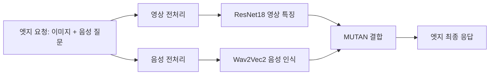

# CPU·GPU·NPU 기반 품질·네트워크 인지 파이프라인 설계

## Material Passport

- Origin Skill: academic-research-suite / experiment-agent
- Origin Mode: plan
- Origin Date: 2026-10-23
- Verification Status: UNVERIFIED (설계; 실험 결과 아님)
- Version Label: heterogeneous_design_v1
- 입력: 사용자 연구 방향·범위 정정, [문제 정의](problem-definition.md), [장비 감사](quality-network-heterogeneous-capability-audit.md).

## 목표와 유지할 범위

CPU·GPU·NPU의 실제 실행 후보를 대상으로 최종 서비스 품질을 지키면서 초당 기한 내 완료 요청 수를 높인다. 모델 선택·장치 배치·실제 데이터 이동·큐·준비 상태가 연결된 실행 시스템을 만든다. CPU 전용 구현은 기준선/변환 검증으로 사용하며 이기종 실험 완료로 세지 않는다.

12개 노드의 CPU와 NVIDIA 서버/Jetson GPU, Intel/Hailo/Mobilint/Rockchip NPU를 검증 목록에 유지한다. 현재 점유된 자원을 빼앗거나 응답 불가 장치를 성공한 것으로 대체하지 않는다. 미검증·의존성 미확보·노드 불가·장치 점유·변환 실패·실행 실패·품질 실패를 별도 상태로 남긴다. 모든 Task가 모든 장치를 지원할 필요는 없지만, 실제로 수행하지 않은 지원 검증을 생략한 채 전체 검증을 완료했다고 하지 않는다.

## 서비스 DAG와 실행 경계

현재 서비스 후보는 이미지와 해당 이미지의 음성 질문으로 최종 답을 내는 VQA다. 영상·음성 원본은 동일 요청 ID에 묶이며 입력 발생 위치는 엣지다.

영상/음성 전처리와 추론을 독립 배치하는 것이 최종 실행 계약이다. 현재 legacy adapter는 각 분기 안에 전처리를 포함하므로, 초기 가속기 qualification에서는 이 경계를 그대로 사용해 모델 의미를 먼저 보존한다. 그 결과는 전처리 독립 배치 실험으로 해석하지 않는다. 본 배치 실험 전에 분리 endpoint와 tensor 전송 경로를 연결하고 raw 입력 경로와 별도로 실측한다.

| 단계 | 입력 → 출력 | 우선 구현과 확인할 후보 |
|---|---|---|
| 영상 전처리 | RGB/JPEG → 정규화한 1×3×448×448 float tensor | CPU 위치 선택; decode·resize·normalize·직렬화 각각 계측 |
| 영상 추론 | tensor → 512-d pooled feature | CPU, NVIDIA CUDA, Intel direct NPU; Hailo/Mobilint/RKNN 변환·실행 검증 |
| 음성 전처리 | PCM/WAV → 모델 입력과 길이 정보 | CPU 위치 선택; 실제 음성 길이 보존 |
| 음성 인식 | 모델 입력 → transcript | CPU, CUDA; NPU 변환·연산자·shape 지원을 실제 probe로 확인 |
| 결합 | feature + transcript → 답/점수 | CPU, CUDA; 추가 NPU 경로는 실제 컴파일/실행 결과로 판정 |

고정 길이 버킷·padding·양자화가 필요하면 원본 의미를 보존하는지 별도 비교한다. 변환 성공만으로 실행 가능 후보에 등록하지 않는다. 전처리·토큰화 등 호스트 연산은 명시하며 모델을 CPU에서 실행한 결과를 GPU/NPU 실행으로 표시하지 않는다.

동일 모델·가중치를 사용해도 장치 내부 정밀도가 같다는 뜻은 아니다. Intel NPU의 내부 FP16 연산처럼 런타임/장치가 요구하는 차이는 실행 설정에 기록한다. CPU/CUDA FP32 대조와 이러한 장치별 설정 대조를 구분하고, 후자를 순수한 동일 정밀도 장치 비교로 부르지 않는다. 근거는 버전별 runtime 증거와 실제 품질 평가다.

## 시스템 구조

1. **Capability registry**: 원 모델/가중치·파생 산출물 hash, node/device/runtime/version, shape/dtype, 장치 실사용 증거, 메모리 한도, 품질 검증 범위를 저장한다. 등록 자원 수는 실행 증거가 아니다.
2. **Profiler**: 실제 입력·중간 표현별 준비/연산/대기/전송 비용과 동시성에 따른 간섭을 측정한다. 같은 GPU를 공유하는 복수 모델은 하나의 자원 예산과 큐로 관리한다. synthetic 비용과 실측은 별도 형식/출처로 구분한다.
3. **Quality registry**: 완전한 파이프라인 구성의 보정 데이터 최종 출력과 공식 서비스 점수를 연결한다. 단계 품질의 곱을 사용하지 않는다. 측정하지 않은 구성의 품질은 임의로 추정해 통과시키지 않는다.
4. **Planner**: 현재 가용량·큐·모델 준비·측정된 전송 경로를 받아 호환성/용량/품질을 만족하는 DAG 계획을 고른다. 첫 구현은 작은 후보 집합의 열거/greedy로 비용 경계를 검증한다. 정확 열거 자체를 신규 알고리즘으로 부르지 않는다.
5. **Executor**: 요청별 계획 버전을 고정하고 병렬 분기와 합류를 실행한다. 한 장치 unit을 할당받은 worker 안에서 여러 모델을 실행할 수 있으나 실제 동시성·간섭·상주 메모리를 기록한다. 첫 정책은 진행 중 Task의 임의 migration 없이 다음 요청/Task 경계에서 전환한다.
6. **Observer**: 큐·완료시간·오류·장치·전송량·관측 시각을 수집한다. 미래 정답이나 미래 부하를 사용하지 않는다. 사전 regime 표를 주는 이상 정보 대조와 현재 관측 기반 운영을 분리한다.

최소 비용의 단일 요청 배치가 최대 goodput을 보장한다고 전제하지 않는다. 선택 점수에는 현재 큐와 자원 경합을 포함하고, goodput 효과는 동일 open-loop trace를 실제 실행한 결과로 검증한다. 관측/선택 비용은 요청 종단 경계와 전체 운영 구간에 포함한다.

## 비교 설계

연구 질문은 품질 제약의 효과, 통신 인지의 효과, 근접 기존 시스템 대비 효과다. 독립 변수는 정책, 품질 필터, 네트워크 조건, offered load, 실행 설정이며 종속 변수는 goodput, 최종 VQA 점수/coverage, 지연, 오류/드롭/시간 초과다.

| 비교 | 고정하는 것 | 바꾸는 것 | 해석 |
|---|---|---|---|
| Task-fastest vs network greedy vs DAG | 동일 모델·자원·품질 후보·프로파일·trace | 배치 선택 규칙 | 장치 단위 탐욕과 공동 배치 차이 |
| 동일 선택기 network on/off | 품질/호환성/용량·실제 데이터 경로 | 선택 비용의 통신 항목 | 네트워크 인지 효과 |
| 동일 선택기 quality on/off | 기술적으로 가능한 설정·자원·trace | 최종 품질 필터 | 품질 인지 효과; 미달 처리량을 동일 품질 개선으로 세지 않음 |
| 근접 품질·네트워크 방법 vs 제안 | 동일 정보·예산·실행기·서비스 | 원문 계약을 명시한 정책/실행 제어 | 시스템 효과; 원 재현/아이디어 이식 구분 |
| 최신 DAG 재최적화 vs 단순 hysteresis vs 제안 | 동일 관측·관측 나이·변화 trace | 전환 결정 | 준비/전환 비용 포함 순이익 |

CPU-only, GPU 중심, NPU 활용 고정 배치는 자원 활용 진단 대조다. 사용 가능한 전체 이기종 자원 예산을 정책별로 달리 제공해 알고리즘 효과로 비교하지 않는다. 장치 제거 실험은 별도 capacity ablation으로 표시한다.

탐색용 네트워크는 기존 공유 gateway 100/2 Mbps, 추가 중간 구간 10 Mbps를 후보로 두며 물리 링크 변경이라고 부르지 않는다. 고대역폭/작은 입력과 연산 지배 조건도 포함한다. 부하는 초기 탐색 trace 뒤 공통 절대 도착률을 고정하고, 정책별로 자기 포화점에 맞춘 서로 다른 부하를 주 비교에 쓰지 않는다.

정책 순서는 run/block별로 바꾸며 같은 도착/입력 trace를 재사용한다. 배정·반복의 단위는 전체 run/block이고 요청 수를 독립 반복 수로 세지 않는다. run 중 경쟁 workload 변화와 shared GPU 간섭을 기록하며 장애 구간 제외 규칙은 사전 동결한다. 초기 반복은 분산 추정용이며, 본 반복 수와 MDE는 해당 자료로 statistical-power 절차를 거쳐 별도 사전 결정한다. 아직 임의의 n으로 통계적 우월성을 선언하지 않는다.

## 품질와 자료 계약

현재 60쌍은 이미지 기준 20 calibration / 40 evaluation으로 분리된 기존 fixture다. 이미 평가 결과를 보았으므로 독립 holdout이 아니다. 양자화/튜닝은 calibration만 사용한다. 공식 VQA 점수의 탐색 문턱은 0.40이며 과거 CPU reference의 evaluation 0.355는 미달이다.

이 사실 때문에 장치 실동작 검증을 중단하지는 않는다. 다만 같은 고정 모델의 가속기 성공도 **품질 미달인 진단 결과**로 보고한다. 품질을 만족하는 본 서비스 후보를 만들려면 별도 모델/설정 개선과 독립 평가 자료가 필요하다. 기존 결과를 통과시키기 위해 문턱을 낮추거나 어려운 입력을 제거하지 않는다.

품질 평가는 출력이 있는 요청의 점수와 coverage를 함께 보고하고, 누락을 0점으로 둔 전체 유입 기준 점수도 별도로 보고한다. 추론 실패·기한 초과·드롭·발생기 미전송을 보존한다. CPU-reference parity와 정답 기반 최종 품질 판정은 별도 필드다. 본 서비스의 후보 적격성은 실제 실행·완전한 검증 범위·최종 서비스 품질로 판단한다. CPU FP32와의 allclose 실패만으로 NPU의 서비스 적격성을 부정하지 않는다. 현재 qualification 구현의 `main_plan_candidates`에는 단계 parity 통과 조건도 있으므로, 이 목록을 본 서비스의 최종 품질 registry로 그대로 재사용하지 않는다. 기존 임계값과 결과는 보존하고 본 실행기 연결 시 두 판정을 분리한다. 2026-10-23 실행 `qnh-20261023t095013`에서 NPU 영상 특징은 기존 수치 임계값을 통과하지 못했지만 NPU+CPU 조합의 최종 답은 CPU와 60/60 동일했다. 이 결과도 evaluation 품질 0.355 < 0.40이므로 품질 제약 통과 사례는 아니다.

## 단계별 산출물과 완료 기준

| 단계 | 산출물 | 완료 기준 |
|---|---|---|
| 전체 장비 감사 | 12노드 표, raw API 시각·점유·기존 증거 | 모든 계열 유지, 등록/실행/품질 구분 — 2026-10-23 감사 작성됨 |
| 구현·오프라인 변환 | backend·HTTP worker·수집기·모델/산출물 manifest·단위 검증 | no-fallback, 오류/자원/품질 상태 보존, 독립 코드 리뷰 |
| 실제 장치 qualification | 실제 CPU/GPU/NPU receipts·단계 출력·최종 답·품질 점수 | `qnh-20261023t100710`: NPU 영상+CUDA 음성+CPU 결합 60/60건 실제 실행; 최종 평가 품질 0.355로 기준 미달. NPU 음성 단독은 27/60건 partial. 전체 장비 검증 완료 아님 |
| 전체 후보 검증 | 각 장비/단계 조합의 검증 또는 구체적 blocking 근거 | 점유/노드 장애/SDK 부재도 미완료 상태로 보존 |
| 분리 DAG·온라인 실행 | 전처리 독립 배치·현재 관측·계획 버전·큐/전환 계측 | 실제 복수 Task 이동과 전체 데이터 경로 확인 |
| 본 성능 비교 | 동결 조건·정책별 trace·품질/goodput·반복별 결과 | 품질 기준 충족, 같은 자원 비교, 근접 선행/성분 제거와 반례 포함 |

작업 경로는 `/home/jinuk/codex-work/scheduler`다. 구현 명령은 실제 구현·의존성 확인 뒤 `docs/experiments/quality-network-heterogeneous.md`에 기록한다. 아직 없는 명령을 실행했다고 적지 않는다. 모든 수집은 유한 timeout·phase 시작/끝·부분 stderr/stdout·소유 자원 cleanup 결과를 남긴다. 엣지 kubelet stream과 다른 작업의 장치 해제, 호스트 설정 변경은 사용하지 않는다.
