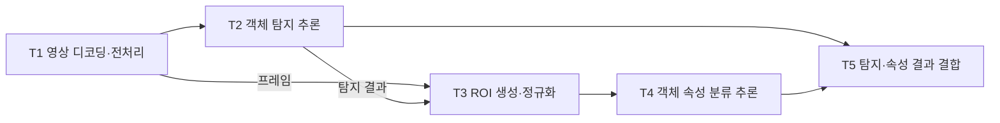

# 동적 워크플로 배치: 첫 비교 실험 계획

## Material Passport

- Origin Skill: academic-research-suite / experiment-agent
- Origin Mode: plan
- Origin Date: 2026-10-16
- Verification Status: UNVERIFIED
- Version Label: workflow_placement_plan_v1

계획 전체는 아직 검증하지 않았다. [CPU/KubeEdge fixture](../experiments/e0-kubeedge.md), [Service·EdgeCore 관측](../experiments/e0-transport.md), [서버 GPU·NPU 실행](../experiments/e0-accelerators.md), [576요청 전달 프로파일](../experiments/e0-rpc-profile.md)을 수행했다. [세 Task·64배치 준비 실험](../experiments/e1-dag.md)에서는 C1과 작은 DAG 열거가 같은 배치를 골랐다. 이어 [입력 위치·NPU 객체 준비 상태 파일럿](../experiments/e2-dynamic.md)의 1,380회 평가에서도 준비 비용 포함 재계산·greedy·hysteresis가 같은 배치 궤적을 골랐다. 링크 대역폭/지연 변경이나 아래 네 정책군 전체 비교의 완료를 뜻하지 않는다. 주 비교의 데이터셋·부하/SLO·정책 구현은 미확정이다. 연구 질문은 [문제 정의](problem-definition.md)를 따르며 5-Task 후보·주 지표·통제 방법은 후속 실험의 제안이다.

## 1. 목표와 첫 워크플로 후보

[E3 입력 재현성](../experiments/e3-input-replication.md)에서8입력·3새 배포/측정960회를 추가했다. 입력별 anchor 순위와 camera NPU Top-5 차이가 확인됐다. 단일 날짜/host의3Task chain이며 아래5Task DAG·최신 정보의 AnchorDL·네 정책군 본 비교를 검증한 것은 아니다.

Task별 실행시간 최적화, DAG 공동 배치, 환경 변화 대응을 분리하여 측정한다. 먼저 고정 모델·동일 출력 품질에서 배치 차이를 평가하고, 그다음 네트워크·실행환경 변화의 영향을 본다.

추천 후보는 영상 기반 객체·속성 분석의 5-Task DAG다. 이는 구현된 워크플로가 아닌 선택안이다.

T3는 프레임과 탐지 결과를 함께 필요로 한다. 탐지 결과만 보내고 원본/전처리 프레임의 이동 비용을 누락하지 않는다. 최소 실행 검증은 3-Task 전처리→추론→후처리로 시작할 수 있으나, 주 비교에서는 선정한 DAG를 모든 정책에 동일하게 사용한다.

Task별 모델/전처리 설정·입출력 schema·payload 크기 분포·검증 데이터·최종 품질 기준을 고정한다. 두 추론 모델이 대상 런타임에서 실제 실행되고 품질을 만족하는지 확인한다. 임의 tensor 크기 부풀리기 대신 해상도·객체 수 등 실제 입력 변화에 따른 데이터 크기를 측정한다. 합성 부하·링크 제한은 통제 수단으로 표시한다.

## 2. 환경·실행 경로

| 항목 | 준비할 내용 / 현재 상태 |
|---|---|
| 장비 | KubeEdge 10노드 중 ARM edge/x86 CPU·GB10/Intel NPU 4노드에서 3-Task 파일럿. edge eth0의 사후 협상값100Mbps 확인. 엣지 가속기·본 데이터셋/장비 범위는 미확정 |
| 소프트웨어 | KubeEdge 1.23.0·서버 kubelet 1.31.14·엣지 1.32.10 확인. E0의 ORT CPU·ONNX2Torch/CUDA·OpenVINO NPU 경로와 버전 기록. GPU 지원 경고·kernel trace 미확보 보존; 주 비교 runtime·Koordinator 구성은 미확정 |
| 공통 실행기 | 3-Task 직접 HTTP 전달·local call·양쪽 receipt, 요청 경계의 위치 변경·실제 NPU 객체 eviction/재준비 구현. 본 실험의 재시도·drain·운영 정책 연동은 다음 구현 |
| Task와 Pod | Task는 DAG의 처리 단계, Pod는 이를 실행하는 배포 단위. 요청별 처리와 장기 상주 worker를 구분하고, 한 Task=요청마다 새 Pod라고 가정하지 않음 |
| 배치 적용 | 공통 실행기로 동일한 Task–노드 계획을 적용. kube-scheduler/Koordinator에서는 같은 worker/Pod 모델을 사용하고, 직접 바인딩 정책과의 차이·적용 지연을 기록 |
| 데이터 경로 | worker 직접 HTTP1.1/NODELAY1·local call, 실제 edge/server 입력 위치 변경 확인. GPU 복사·trace·계층 RPC 잔여 경계 기록. 병렬 DAG·연속 부하 큐/경합은 미검증 |
| 실행 명령 | E0/E1 준비 실험의 실제 준비·수집·선택·평가·정리 명령은 각 실행 결과 문서에 기록. 네 정책군 연동 명령은 구현 후 추가 |

실행 호환성과 준비 상태를 분리한다. 모든 정책에 동일하게 확인된 실행 가능 후보와 자원 제약을 적용한다. kube-scheduler/Koordinator에 공통 node affinity·라벨 등을 제공한 경우 이를 '공통 호환성 필터 적용' 구성으로 명시한다. 무수정 기본 설정의 결과는 별도 운영 진단으로 보고, 정보가 추가된 구성과 혼합하지 않는다. fallback을 허용하면 실제 실행 장치·추가 복사·품질을 기록한다.

첫 전환 방식은 새 요청/Task 경계에서의 재배치다. 진행 중 요청은 drain 또는 동일하게 정의한 재시도 규칙으로 처리하며 계획 버전을 추적한다. runtime 가용성 변경은 새 배치 후보를 바꾸는 방식부터 시작하고, 프로세스 강제 종료는 별도 장애 실험으로 분리한다.

## 3. 비교 정책과 대조군

| ID | 정책 | 비교 목적과 구현 표기 |
|---|---|---|
| B0 | kube-scheduler | 공통 실행기에서 준비된 worker/Pod를 기본 프로파일로 배치. 사용 필터·점수·리소스 요청 고정. Task별 최단 실행시간 정책과 동일시하지 않음 |
| B1 | Koordinator | load-aware scheduling 구성 고정. 동적 실험에서는 descheduler 사용 여부·주기·eviction/복원 경로를 구분해 보고 |
| B2 | Task별 fastest-feasible | 실행 가능 노드 중 Task 자체의 예측 실행시간 최소 선택. 동일 프로파일·동률 처리·용량 초과 대기 규칙 사용 |
| B3 | 기존 DAG 최적화 | AnchorDL·JellyBean·Atlas 중 목적·DAG·실행 계약이 맞는 구현 선정. AnchorDL의 data/model joint cost+look-ahead를 직접 대조하되 본문/코드 미확보 상태에서 수식 추정 구현을 원 재현으로 부르지 않음. 목적함수 등을 바꾸면 '기반 재구현/변형'으로 표기 |
| B3-R | 기존 DAG 정책 재최적화 | B3에 동일한 최신 프로파일을 제공하고 주기/이벤트 기반 갱신. 원래 동적 기능이 있으면 먼저 보존하고 비교 |
| B4 | DRL 정책 | 기존 구현의 상태·행동·보상·학습 환경을 검토해 선정. DAG/데이터 정보가 없는 정책의 적용은 그 범위에 한정; PPO/DQN 사용을 미리 결정하지 않음 |
| C1 | 데이터·준비 인지 greedy | 선행 산출물 위치, 전송·대기·준비를 반영하는 단순 실행 위치 선택. DAG 미래 전체를 함께 푸는 효과와 분리 |
| C2 | 단순 안정화 | B3-R에 최소 체류시간/hysteresis 적용. 같은 튜닝 예산을 사용하고 전환 억제 효과 확인 |

네 필수 정책군은 B0·B1·B3·B4다. B2는 핵심 질문을 직접 비교하기 위한 기준선, B3-R/C1/C2는 원인 분해용 대조군이다. 모든 정책을 조합한 전수 실험 대신 정적 비교부터 필요한 조건을 좁힌다. 작은 배치 공간에서는 가능한 초기 배치를 열거해 검산할 수 있지만, 이것을 동적 온라인 최적해로 부르지 않는다.

원 코드의 재현, 알고리즘 기반 재구현, 새로운 조건으로 바꾼 변형을 구분한다. 기본 운영 스케줄러보다 좋아도 기존 DAG 방식·단순 보완보다 나아지지 않으면 새 알고리즘의 근거로 삼지 않는다.

AnchorDL은 공식 초록에서 데이터 전송·모델 로딩 joint cost와 look-ahead, chain/fan-in/fan-out 평가를 명시한다. [검토 상태](ieee-11662529-review.md)를 기준으로 비용식·look-ahead 깊이·cache·baseline 계약을 확보한 뒤 같은 관측값을 제공한다. [비교 준비 계약](anchordl-reproduction-contract.md)은 현재 service readiness와 model-weight residency, 요청 간 상각과 DAG look-ahead의 의미 차이와 보정/평가 정보 경계를 명시한다. E0~E3의 작은 DAG 열거와 입력 재현성 검증을 AnchorDL의 재현이나 실패 증거로 해석하지 않는다.

[공통 PolicyRunner](../experiments/common-policy-runner.md)는3Task chain의 관측→정책 callback→후보/상태 검사→실제 HTTP 실행과 오류 기록을 연결한다. 로컬 CPU/synthetic 비용표로 전체17개 회귀를 통과했으며, 특정 정책·네 필수 정책군의 구현이나 동일 상태 성능 비교를 완료한 것은 아니다. 실제 비용표와 원문 알고리즘 연결은 다음 단계다.

[E2 실측 비용표 연결 검증](../experiments/measured-policy-bridge.md)에서 기존 E2 정책 계산을 보존하고 같은 snapshot의 여섯 정책 결정60건·대표10+준비2회 ARM/NPU 실행을 확인했다. 전체22개 회귀를 통과했지만 이 단계는 과거 profile의 결정·실행 연결이며 B3 논문 정책·네 필수 정책군의 본 성능 비교는 아니다. 최신 profile 보정/평가 분리와 원문 계약은 남았다.

후속 [최신 profile·품질 후보 동결 비교](../experiments/fresh-placement.md)는8입력·3새 배포에서 보정1,536회/평가679회·측정485회를 완료했다. camera의 NPU 추론만 사전 제한했고 같은 계획의 관측은 공유했다. 균등 평균 total은 Task-fastest51.64ms, greedy43.56ms, 작은 DAG 열거38.59ms였다. greedy와 DAG는48조건 중35개에서 계획이 같고, 다른13개 중2개에서 DAG의 관측 평균이 더 높았다. 선택식의 workflow 비용과 관측·선택 위치별 state_validation을 포함한 total 지표의 경계, 보정 예측 안정성을 먼저 검증한다. 이 실험은 B3/AnchorDL 재현·동적 변화·네 필수 정책군 본 비교의 완료가 아니다.

관련 계약: kube-scheduler는 미배치 Pod의 후보를 필터링하고 점수를 매겨 바인딩한다. Koordinator는 실시간 부하를 사용하는 scheduling 및 별도 descheduling 기능을 문서화한다. 이 사실만으로 DAG 공동 최적화나 특정 runtime 지원의 유무를 단정하지 않는다. [Kubernetes 공식 문서](https://kubernetes.io/docs/concepts/scheduling-eviction/kube-scheduler/), [Koordinator v1.8 scheduling](https://koordinator.sh/docs/user-manuals/load-aware-scheduling), [descheduling](https://koordinator.sh/docs/user-manuals/load-aware-descheduling)

## 4. 변화 시나리오

| 단계 | 통제할 조건 | 구분해서 볼 효과 |
|---|---|---|
| E0 실행·측정 확인 | 모든 Task의 후보 노드 실행·출력 검증, 단일 경로 전송 실측 | 호환성·프로파일·로그가 실제 실행을 설명하는지 |
| E1 정적 비교 | 입력·모델·네트워크·준비 상태 고정. 실측 전송/계산 비율이 작은 조건과 큰 조건 | B2 대 B3의 차이와 C1으로 해소되는 정도; B0/B1/B4도 같은 조건 평가 |
| E2 네트워크 변화 | 동일 링크의 대역폭 또는 지연을 한 축씩 변경 후 회복. 단계별 일정·지속시간 재생 | 고정 계획 대 B3-R의 적응, 관측 지연·공유 링크 경합·전환 손실 |
| E3 실행환경 변화 | 새 배치에 대한 runtime 후보 가용성, 목적지 warm/cold 상태를 각각 변경 | 실행 불가 판단과 추가 준비 비용을 분리. 네트워크는 고정 |
| E4 필요한 결합만 | E2/E3에서 확인된 조건을 결합하고 변화 지속시간을 조절 | 비용 회수 전 환경 재변화, 반복 재배치, 단순 안정화의 충분성 |

링크·장치 수치는 장비 파일럿에서 정하며 실제 가능한 범위와 주입 방법을 기록한다. 동일 입력·외생 변화 일정은 정책마다 재생하되, 정책이 만들어낸 큐·간섭·네트워크 경합은 실제 측정값으로 취급한다. 정책별 네트워크 부하를 억지로 동일하게 만들지 않는다.

## 5. 관측·분석·공정성

- **주 지표 제안**: DAG 종단 지연 p95. **동반 지표**: SLO 내 유효 완료율, 실패·미완료·재시도율, 처리량. 입력 시점부터 결과까지 측정하고 완료율에는 모든 입력을 분모에 포함한다. 지연 분포의 대상과 실패·미완료 건수도 명시한다.
- **원인 지표**: Task별 queue/ready/start/end, 간선별 bytes·직렬화·복사·전송·수신 대기, compile/load/warmup, 배치 결정·적용·회복시간, 전환 횟수, controller 자원 사용.
- **전체 관측 구간**: 초기 준비·정상 구간·변화·회복을 포함한다. warm steady-state와 cold start는 별도 구간으로도 보고하며, 실패·관측 종료 시 미완료 요청은 누락하지 않는다.
- **동일 조건**: 모델·품질·입력·자원 제한·호환성 후보·데이터 경로·관측 주기를 고정한다. 캐시를 동일하게 초기화하되 정책의 정상 동작이 만든 캐시 차이는 결과로 기록한다.
- **정보 효과 분리**: 같은 관측값을 주는 정책 비교와 실제 시스템 전체 비교를 구분한다. 필요한 추가 프로파일의 획득 비용을 보고하고, 최신 정보 대 지연 정보 대조로 원인을 확인한다.
- **DRL**: 학습/검증/테스트 입력·변화 일정을 분리한다. 테스트 미래정보를 입력하지 않는다. 원래 online update가 있으면 보존하고 비용을 포함한다. seed·학습/튜닝 예산·추론시간을 기록한다.
- **반복·불확실성**: 독립 반복 실행을 분석 단위로 삼아 동일 외생 조건의 정책 간 차이를 계산한다. 한 실행의 상관된 프레임을 독립 표본으로 세지 않는다. 반복 수·실질적 개선 기준·SLO는 파일럿 후 본 실험 전에 고정하고, 지연 비율/차이와 실행 간 불확실성을 함께 보고한다.

분석은 RQ1의 정적 차이, RQ2의 변화 전후 손실·회복, RQ3의 단순 보완 후 잔여 손실 순서로 한다. 개선이 거의 없는 조건과 더 나빠지는 조건도 기록하며, 유리한 변화 일정만 선택하지 않는다.

RQ1은 동일 조건의 실행별로 `p95(Task별 정책) - p95(DAG 정책)`의 절대 차이와 이를 Task별 정책 p95로 나눈 상대 차이를 보고한다. SLO 내 완료율은 퍼센트포인트 차이도 함께 제시한다. 이를 통해 'DAG가 낫다'는 방향뿐 아니라 이득의 크기와 적용 조건을 답한다.

## 6. 재현 산출물과 모니터링

다음은 앞으로 만들 산출물의 계약이며 현재 파일 존재를 뜻하지 않는다. 경로는 구현 시 확정한다.

| 산출물 | 최소 내용 |
|---|---|
| 실행 manifest | DAG·모델/image hash·장비·버전·정책 설정·입력/변화 일정·seed·cache 초기화·관측 구간 |
| 호환성/프로파일 표 | Task–노드 조합·검증 시각·성공/실패·품질·실행/준비시간·생성 조건 |
| 요청/Task/전송 로그 | run/request/task/edge ID, 계획 버전·실제 위치·시각·bytes·실패 원인 |
| 요약 결과 | 정책/조건별 지표·반복 수·불확실성·비용 분해·차이가 없는 조건 |
| 재현 안내 | 검증된 설치·배포·실행·수집·정리 명령과 필요한 장비 |

타임스탬프는 단조 시계와 노드 간 동기화 상태를 구분한다. heartbeat·완료 수·오류율·준비 진행 상태를 감시하고, 최대 실행시간·중단 조건·종료 시 drain 시간을 실행 전에 정한다. 실패 실행을 자동으로 지워 성공 실행만 남기지 않는다.

## 7. 다음 단계와 판단 조건

1. **실행 기반 확인**: 장비·모델·실제 DAG를 선정하고, 지원 후보에서 올바른 결과·데이터 전달을 확인한다.
2. **정적 비교**: 필수 네 정책군과 B2/C1을 같은 조건으로 비교한다. 원 구현이 실행되지 않으면 재현 실패와 대체 구현의 변경점을 명시한다.
3. **동적 비교**: E2/E3를 분리하고 B3-R/C2를 포함한다. 정적 계획만 이긴 것을 동적 DAG 최적화 전체의 한계로 일반화하지 않는다.
4. **원인과 필요성 판단**: 동일 정보·기존 재최적화·단순 보완 후에도 준비/데이터/전환 상호작용으로 손실이 반복되면 그 최소 조건에 맞는 새 방법을 검토한다.

차이가 작으면 워크로드·통신/계산 비율의 적용 경계를 보고한다. 단순 보완으로 해결되면 그 기여로 한정한다. 호환성 정보 누락이나 backend 구현만이 원인이면 스케줄링 알고리즘 문제와 분리한다. 새로운 알고리즘 설계는 이 판단 뒤에 진행한다.

현재의 바로 다음 단계는 fresh v2에서 관측한 두 역전 조건을 분리 검증하는 것이다. hubble은 보정 예측 workflow 순위 자체가 평가에서 달라졌고, chelsea는 workflow가 빨라도 공통 관측/상태 검사 비용 때문에 total 순위가 바뀌었다. 외생 변화나 새 알고리즘을 추가하기 전에 보정표의 안정성과 목적·측정 비용 경계를 맞춘 단순 대조부터 수행한다. 해당 후속의 입력·반복·분석 계약은 실행 전에 별도로 고정한다.
